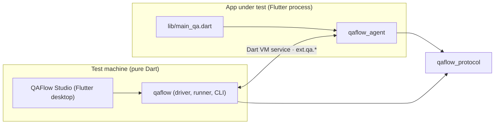

# 1. The wire protocol and the in-app agent

This chapter covers the two packages that live closest to the app under test:

- **`qaflow_protocol`**: the shared vocabulary. These are pure Dart types that describe every request and response passing between the test driver and the app.
- **`qaflow_agent`**: a Flutter package compiled into the app under test. It answers those requests from inside the app's own process: it searches the widget tree, synthesises pointer, text and key input, and takes screenshots.

Everything in this toolkit that touches a running app does so through these two packages. Chapter 2 describes the other end of the conversation, the driver in `qaflow`. For a file-by-file list, see [chapter 12](12-code-map.md).

## 1.1 Why the split exists



The driver and the agent must agree on the exact JSON shape of every message. Those shapes are defined once, in `qaflow_protocol`. The dependency rules are strict:

| Package | May depend on | Must never depend on | Why |
|---|---|---|---|
| `qaflow_protocol` | nothing (only `test` in dev) | Flutter | Both sides import it. A Flutter-free version runs in the CLI, in CI, and inside the pure-Dart driver. |
| `qaflow_agent` | `flutter`, `qaflow_protocol` | `qaflow` | It ships inside the app under test, so it should pull in as little as possible. |
| `qaflow` | `qaflow_protocol`, `vm_service`, `path`, `args`, `yaml`, `image` | Flutter | It runs from the command line and in CI, where there is no Flutter engine, and QAFlow Studio embeds it. |

`qaflow_protocol` exports everything from [`lib/qaflow_protocol.dart`](../../packages/qaflow_protocol/lib/qaflow_protocol.dart):

| Type | File | What it is |
|---|---|---|
| `QaMethod` | [method.dart](../../packages/qaflow_protocol/lib/src/method.dart) | The 19 methods; `extensionName` gives `ext.qa.<name>` |
| `Selector` | [selector.dart](../../packages/qaflow_protocol/lib/src/selector.dart) | Which widget a command targets; fields combine with AND |
| `QaNode`, `QaRect` | [node.dart](../../packages/qaflow_protocol/lib/src/node.dart) | One widget in a snapshot, with its rects in logical pixels |
| `QaResponse`, `QaErrorCode`, `QaException` | [response.dart](../../packages/qaflow_protocol/lib/src/response.dart) | The reply envelope and the eight error codes |
| `KeyChord` | [key_chord.dart](../../packages/qaflow_protocol/lib/src/key_chord.dart) | A parsed `mod+shift+a`, plus the list of named keys |
| `ScreenshotTransfer` | [screenshot_transfer.dart](../../packages/qaflow_protocol/lib/src/screenshot_transfer.dart) | `inline` or `file` |
| `protocolVersion` | [version.dart](../../packages/qaflow_protocol/lib/src/version.dart) | The wire version, currently `1` |

## 1.2 Transport: Dart VM service extensions

### How the technology works

A Flutter app started in **debug or profile** mode runs a *Dart VM service*: a JSON-RPC 2.0 endpoint served over a WebSocket on `127.0.0.1`. DevTools, IDE debuggers and `flutter run` itself use it to list isolates, read memory, hot reload and so on. The address looks like `ws://127.0.0.1:<port>/<auth code>=/ws`; the random auth code in the path is the only access control, and it can be turned off (chapter 2.1 does so for prebuilt apps).

Any Dart code in the app can add its own RPCs to that endpoint. `dart:developer`'s `registerExtension(name, handler)` registers a **service extension** whose name must start with `ext.`. From then on:

1. The isolate's `extensionRPCs` list includes the name, and the VM posts a `ServiceExtensionAdded` event on its `Isolate` stream.
2. A client calls it with `callServiceExtension(name, isolateId, args)`. The VM queues the call as a message on that isolate's event loop.
3. The handler runs **on the isolate that registered it**, the Flutter UI isolate here. It therefore sees the live widget, element and render trees, and runs between frames on the same thread that builds and paints them.
4. The handler returns a `ServiceExtensionResponse`, whose JSON goes back over the WebSocket as the RPC's result.

Extensions belong to an isolate. When the isolate dies (a hot restart creates a new one), its extensions go with it, and the new isolate has to register them again.

### How the agent uses it

The agent registers one extension per protocol method, named `ext.qa.<method>` (`QaMethod.extensionName`). The handler is `QaAgent.handle` in [agent.dart](../../packages/qaflow_agent/lib/src/agent.dart), which decodes the arguments, calls `Handlers.dispatch` in [handlers.dart](../../packages/qaflow_agent/lib/src/handlers.dart) and encodes a `QaResponse`.

This choice of transport drives several properties of the system:

- **No extra port, no server code in the app.** The VM service already exists in debug and profile builds. The agent only adds handlers to it.
- **Release builds cannot be driven, by construction.** The engine never opens a VM service in release mode. As a second layer, the agent refuses to install in release (1.4.1). Profile builds give release-like, AOT-compiled performance and still have the VM service, so they're the closest thing to a release build that can be tested.
- **Hot restart is cheap to survive.** A hot restart creates a new isolate. `main_qa.dart` runs again in it and registers the extensions again, so the driver only needs to switch to the new isolate (chapter 2.2).
- **Calls are serialised with the UI.** A handler cannot run in the middle of a frame, so the trees it reads are always consistent.

VM service extension parameters must be a flat map of strings. Every method therefore takes **one parameter, `args`**, holding a JSON-encoded object. The driver encodes it (`VmConnection._callExtension`) and the agent decodes it (`QaAgent.handle`). Argument readers in [args.dart](../../packages/qaflow_agent/lib/src/args.dart) check each field's type and raise `bad_request` with the field name.

### The response envelope

Every reply is a JSON object stamped with the protocol version:

```jsonc
// success
{ "ok": true,  "v": 1, "result": { ... } }
// failure
{ "ok": false, "v": 1, "code": "not_found", "message": "nothing matches Selector({\"text\":\"Save\"})",
  "details": { "selector": { "text": "Save" } } }
```

**The agent never throws across the VM service boundary.** `QaAgent.handle` turns every outcome into an envelope:

- `args` that are not a JSON object become `bad_request` (`invalid args: …`).
- A `QaException` thrown by a handler becomes a typed failure with its `details`.
- Anything else becomes `internal`, with the stack trace in `details.stack`.

So the driver has one error path, and every failure carries a machine-readable code.

### Error codes and what the driver does with them

| Code | Meaning | Driver retries? |
|---|---|---|
| `not_found` | No element matches the selector (or `index` is out of range, or the target holds no text field) | yes |
| `ambiguous` | More than one element matches and no `index` was given; `details.nodes` lists the first five | yes |
| `not_ready` | The tree has no root yet, the target has no laid-out box, the target is disabled or read-only, no text field has focus, or frames are paused | yes |
| `off_screen` | The target exists but none of it is inside the view and its scroll viewports | yes |
| `obscured` | The hit test at the target's action point does not reach the target | yes |
| `bad_request` | The call itself is wrong: a missing or mistyped argument, an unknown key, a bad chord | no |
| `unsupported` | The app or platform can't do this: no `QaAgent.wrap`, no reset hook, `hover` on a touch platform, `back` off Android, agent `setOrientation` off iOS | no |
| `internal` | A bug or an unexpected exception | no |

Retrying happens in the driver and runner, never in the agent: the agent answers each call at once with the current state of the app. That keeps the agent simple and puts every timing policy in one place (chapters 2.3 and 3). The driver also **never scrolls on its own** to fix `off_screen`. Scrolling is an explicit flow step, so a flow does exactly what it says.

### Versioning

`protocolVersion` is a single integer, currently `1`, bumped on every breaking wire change. There is no negotiation. After launching, the session pings the agent and requires `pong.v == protocolVersion` exactly, failing the launch with both numbers in the message (chapter 2.4). Since the agent is a dependency built into the app, a mismatch means the app was built against a different checkout. Failing loudly is the useful behaviour.

New methods (`back`, `hideKeyboard`, `setOrientation`) were added without a bump: an older driver never calls them, and a newer driver calling an older agent gets the VM's "method not found", which the connection reports as `not_ready`.

## 1.3 The methods

There are 19 methods. A unit test pins the count, so adding or removing one is a deliberate change ([response_test.dart](../../packages/qaflow_protocol/test/response_test.dart)).

| Method | Arguments | Result | Needs live frames |
|---|---|---|---|
| `ping` | `screenshotDirectory?` | `platform`, `mode` (`debug`/`profile`), `dartVersion`, `flutterVersion`, `views[]` (`viewId`, logical `width`/`height`, `devicePixelRatio`) | no |
| `elements` | `viewId?`, `all?` | `nodes[]`: the "interesting" elements, or every element with `all` | no |
| `find` | `selector` | `nodes[]` matching, innermost only, `index` applied | no |
| `elementAt` | `x`, `y`, `viewId?` | `node` under that point, plus suggested `selectors[]` | no |
| `tap` | `selector` *or* `x`+`y`; `count?` 1–3; `buttons?` | `node` | yes |
| `longPress` | target; `durationMs?` (600) | `node` | yes |
| `hover` | target | `node` | yes |
| `drag` | target; `dx`, `dy`; `steps?` (10); `durationMs?` (300) | `node` | yes |
| `scroll` | `dx`/`dy` *or* `direction`+`amount?` (300); optional target | `node` | yes |
| `enterText` | `selector?`, `text` | `node`, the field's resulting `value` | yes |
| `eraseText` | `selector?`, `count?` (1) | `node`, `value` | yes |
| `setText` | `selector?`, `text` | `node`, `value` | yes |
| `pressKey` | `key` (a chord such as `mod+s`) | `delivered`, `hadFocus`, `submitted` | yes |
| `waitForIdle` | `timeoutMs?` (5000), `tier?` (`idle`/`stable`, default `stable`) | `settled`: `idle`/`stable`/`timeout`, `elapsedMs`, `frames` | yes |
| `screenshot` | `transfer?` (`inline`/`file`), `path?` | `inline`: `format: png`, base64 PNG in `data`, `width`, `height`, `devicePixelRatio`. `file`: `path` and the same sizes | no |
| `resetState` | none | `{reset: true}`, or `unsupported` without a hook | no |
| `back` | none | `popped`: whether a route was popped. Android only | yes |
| `hideKeyboard` | none | `hadFocus`: whether a text field had focus | yes |
| `setOrientation` | `orientation` (`portrait`, `landscapeLeft`, `landscapeRight`) | `orientation`. iOS only | no |

Defaults worth knowing:

- **A target** is a selector or a coordinate pair. A selector can also be a plain string, which is shorthand for `{text: "…"}`. A selector with no fields is `bad_request`.
- **`scroll` with no target** scrolls at the centre of the first `Scrollable` on screen.
- **`ping` is the handshake.** It also tells the agent where to write `file`-mode screenshots (`QaAgent.screenshotDirectory`).
- **`viewId`** defaults to 0, the first view. Selector-based actions use the view the target was found in.

## 1.4 Inside the agent

### 1.4.1 Installing it

An app opts in with a second entrypoint, `lib/main_qa.dart`, next to its normal `main.dart`:

```dart
import 'package:qaflow_agent/qaflow_agent.dart';

void main() {
  QaAgent.install(onReset: clearAppStorage); // onReset is optional
  runApp(QaAgent.wrap(const MyApp()));
}
```

- **`QaAgent.install`** ([agent.dart](../../packages/qaflow_agent/lib/src/agent.dart)):
  - **Release guard:** it throws `StateError` in `kReleaseMode`.
  - **Reset hook:** it records the optional `onReset` hook.
  - **Registration:** it registers each `ext.qa.*` extension once per isolate. A static flag makes repeated calls harmless; a hot restart resets statics, so the new isolate registers again.
- **`QaAgent.wrap`** puts a `RepaintBoundary` with a known `GlobalKey` around the whole app. That gives screenshots a single render object to capture.
- **`onReset`** backs the flow command `clearState`. The runner calls `resetState`, the hook wipes whatever the app persists, and the runner restarts the app. Without a hook, `resetState` answers `unsupported`.

**The two-entrypoint design is the main release-safety guarantee.**

- **The driver only ever launches `main_qa.dart`** (or a prebuilt binary built from it). A normal `flutter build macos --release` compiles `main.dart`, which never imports the agent, so test hooks cannot leak into a shipped app.
- **The release guard is a second line of defence** in case someone builds `main_qa.dart` in release mode by mistake.

#### Which OS the agent is on

`AgentPlatform` ([agent_platform.dart](../../packages/qaflow_agent/lib/src/agent_platform.dart)) reports the real OS from `dart:io`'s `Platform`, not `defaultTargetPlatform`, which a debug build can override. `isTouch` (iOS or Android) chooses touch or mouse pointers, makes `hover` unsupported, and gates `back` (Android) and `setOrientation` (iOS). Tests replace its functions to act as a phone.

### 1.4.2 Finding widgets: the finder

`QaFinder.collect` ([finder.dart](../../packages/qaflow_agent/lib/src/finder.dart)) walks the element tree from `WidgetsBinding.instance.rootElement` using `debugVisitOnstageChildren`. Despite the name, that method works in profile builds, and it only visits what is actually on stage:

- hidden routes in an `Overlay` are skipped
- `Offstage` children are skipped
- children of a scroll viewport that are outside its visible region are skipped

A lazily built list row that has been scrolled far away doesn't exist as an element at all. So it is reported as `not_found` rather than `off_screen`, and flows use `scrollUntilVisible` to bring it in.

For each element the walk builds a **`Candidate`** with:

- **Geometry.** If the element has an attached, laid-out `RenderBox`, its global `rect` comes from `getTransformTo(null)`, unclipped. The `RenderView` above it gives its `viewId`. `visibleRect` is that rect intersected with the view bounds and every enclosing `RenderAbstractViewport` (a `ListView`, a `SingleChildScrollView`, …); nested scroll views narrow it further. Only viewports clip. Something painted on top, such as an app bar, is caught later by a hit test.
- **Text**, from `Text` (its string or span), `RichText`, `EditableText` (the field's live contents, except for obscured fields such as passwords, which report no text) and `Tooltip` (its message). A `Text` widget builds a `RichText` internally, through wrapper widgets. The inner `RichText` reports no text when the nearest text-source ancestor is a `Text`; otherwise a text selector would find two nodes for one label.
- **Identity:**
  - `key`, only for a `ValueKey<String>`, because other key types have no stable text form.
  - `semanticsId` and `label`, only from an explicit `Semantics` widget's `identifier` and `label`.
- **Interactivity and `enabled`**, by widget class: `ButtonStyleButton` (every Material button), `IconButton`, `InkResponse` (and so `InkWell`), `GestureDetector`, `EditableText`, `Checkbox`, `Switch`, `Slider`, `ListTile` and `Scrollable` count as interactive. Each has its own enabled rule (`onPressed != null`, `!readOnly`, and so on).

A node is **interesting** when it has text, a key, a semantics id or label, or is interactive. `Snapshot.elements` ([snapshot.dart](../../packages/qaflow_agent/lib/src/snapshot.dart)) returns interesting nodes, each re-parented to its nearest interesting ancestor, so the inspector shows a compact tree instead of thousands of layout widgets. Node ids are positions in the walk, so they change between snapshots.

### 1.4.3 Selectors and how they match

A selector is a set of fields, and **all of them must match** (`QaFinder.matches`):

| Field | Matches when |
|---|---|
| `text` | the node's text, trimmed, equals it exactly |
| `textRegex` | the whole text matches; it's anchored as `^(?:…)$`, so `G` does not match `Go` |
| `id` | the `ValueKey<String>` value **or** the `Semantics` identifier equals it |
| `key` / `semanticsId` | only that one source equals it |
| `type` | the widget's `runtimeType` name equals it |
| `enabled` | the node's enabled flag equals it |
| `within` | any ancestor (not just the parent) matches the nested selector (`childOf` in flows) |
| `index` | applied last, to pick one of several matches |

Two resolution rules make selectors behave the way people expect:

1. **Innermost wins.** If a match contains another match, the outer one is dropped (`QaFinder.find`). A `Semantics(identifier: 'save')` wrapping a button keyed `'save'` resolves to one node, not two.
2. **One target or a clear error** (`QaFinder.resolveOne`). An action needs exactly one node. Zero matches is `not_found`. Two or more is `ambiguous`, with the count and the first five nodes, and the message suggests adding `index` or narrowing the selector.

The `id` field deliberately accepts either a key or a semantics identifier. App code can then use whichever it already has, and both kinds of id survive copy changes and translations, which is why the inspector suggests them first.

### 1.4.4 Deciding where to act: hit testing and the action point

**How Flutter hit testing works.** `RendererBinding.hitTestInView(result, point, viewId)` starts at the view's `RenderView` and asks each render object whether the point is inside it. A `RenderBox` that contains the point asks its children first, in reverse paint order (topmost first), then adds itself. The resulting `HitTestResult.path` lists everything under the point from the most specific, topmost object outwards. Real pointer events are routed along the same path, so if a dialog or scrim is on top, its render objects come first and the widget underneath never gets the event.

Before any selector-based action, `QaFinder.actionPoint` checks that a real user could do it:

1. The node must have a laid-out box, or the result is `not_ready`.
2. Some of it must be visible, or the result is `off_screen` (with the rect and view size in `details`).
3. The point used is the **centre of the visible part**, not of the whole rect. A row half-hidden under an app bar or clipped by a list is tapped where it can actually be seen.
4. A hit test at that point must reach the target's render box or one of its descendants, or the result is `obscured`, naming the topmost render object that was hit. This catches dialogs, scrims and overlays covering the target.
5. An interactive node that is disabled is `not_ready`.

Coordinate-based input (`x`/`y`) skips these checks. It does what it says, wherever that lands.

### 1.4.5 Synthesising input

The agent synthesises input at the same entry points the engine uses for real input, so the app cannot tell the difference.

#### Pointer input

**How Flutter's pointer pipeline works.** The engine turns OS input into `PointerEvent`s and hands them to `GestureBinding.handlePointerEvent`. On a `PointerDownEvent` the binding hit-tests the position and remembers the path for that pointer id; later move and up events for the same pointer go to the same path. Gesture recognisers on that path (`TapGestureRecognizer`, `LongPressGestureRecognizer`, drag recognisers) join a *gesture arena* and the winner fires its callback. Mouse hover events also feed `MouseTracker`, which drives `MouseRegion` enter, exit and hover callbacks, cursors and tooltips. `PointerScrollEvent`s (mouse wheels) are *pointer signals*, which `Scrollable` resolves directly into a scroll.

`PointerSynth` ([pointer.dart](../../packages/qaflow_agent/lib/src/input/pointer.dart)) feeds events into that same entry point, so recognisers, the arena, hover and scroll physics all behave as they do for a person. It uses one synthetic device (id `0x5152`), with kind **touch** on iOS and Android and **mouse** elsewhere (`AgentPlatform.isTouch`). A mouse is added once per view with a `PointerAddedEvent`, and each press gets a fresh pointer id.

- **tap:** on desktop a hover to the point first (so enter/hover callbacks run), then down, a 50 ms timer, then up, then one frame. There is no frame wait between down and up: on a slow device one frame can outlast the long-press timeout, and a `Tooltip`'s long-press recognizer would then win the tap. Double and triple taps repeat this with a 100 ms gap (`multiTapGap`), inside Flutter's 40–300 ms double-tap window. `buttons` is a bitmask (primary by default).
- **longPress:** down, a frame, a hold of `durationMs` plus 100 ms, then up.
- **hover:** a hover event and a frame. `unsupported` on touch platforms.
- **drag:** down, then `steps` move events spread over `durationMs`, each followed by a frame, then up. On desktop a mouse drag does not scroll a `Scrollable` (Flutter's default scroll behaviour drags only with touch and similar devices), so use `scroll` for lists.
- **scroll:** mouse-wheel `PointerScrollEvent`s from a separate wheel device (`0x5153`) on every platform, split into five chunks with a frame after each. A wheel scroll has no fling, so it lands at a predictable offset. Positive `dy` moves toward the end of the content.

#### Text

`TextSynth` ([text.dart](../../packages/qaflow_agent/lib/src/input/text.dart)):

- **Which field:** with a selector, the target is resolved and checked like a tap (`actionPoint`), the first `EditableTextState` inside it is found (a `TextField` wraps one), and its focus node is asked for focus if needed. Without a selector, the field that owns the primary focus is used. A read-only field is `not_ready`.
- **How edits are applied:** every edit goes through `EditableTextState.userUpdateTextEditingValue` with `SelectionChangedCause.keyboard`. That is the path a keyboard uses, so input formatters and `onChanged` run exactly as they would for a real user. `enterText` replaces the selection (or inserts at the cursor), `eraseText` removes up to `count` characters before the cursor, `setText` replaces everything. The result reports the field's text after the edit.
- **Resolve once, then edit:** the field is found before editing and never re-found afterwards. A text selector that matched the field's old contents would stop matching after the edit, and the driver's retry-on-`not_found` would then apply the edit a second time.

#### Keys

**The chord.** `KeyChord.parse` in `qaflow_protocol` splits `mod+shift+z` on `+`, lower-cases each part, and checks that every part before the last is a known modifier: `mod`, `shift`, `alt`, `ctrl`, `meta`, `cmd`, `command`, `control`, `option`. An empty part or an unknown modifier is a `FormatException`, which the agent returns as `bad_request`. `KeyChord.namedKeys` lists the special key names the agent understands (`enter`, `tab`, `escape`, `space`, `backspace`, `delete`, the four arrows, `home`, `end`, `pageup`, `pagedown`, `f1`–`f12`); letters `a`–`z` and digits `0`–`9` are accepted too. QAFlow Studio's flow editor offers that list as completions for `pressKey`.

**How Flutter's key pipeline works.** The engine delivers each key as `ui.KeyData` to `ServicesBinding.instance.keyEventManager`. `KeyEventManager` converts it into a `KeyEvent`, updates `HardwareKeyboard`'s pressed-key state, and passes a `KeyMessage` to its `keyMessageHandler`. `FocusManager` installs itself as that handler: it offers the event to the primary focus node and then its ancestors (`Focus.onKeyEvent`, `Shortcuts`, `Actions`) until one reports it handled. Registering with `HardwareKeyboard` alone does not reach the focus tree.

**`KeyboardSynth`** ([keyboard.dart](../../packages/qaflow_agent/lib/src/input/keyboard.dart)):

- **Names resolve first.** Modifier aliases collapse (`cmd`/`command` → `meta`, `control` → `ctrl`, `option` → `alt`), and **`mod`** becomes `meta` on macOS and `ctrl` elsewhere, so one flow works on every platform. Every name is looked up in a table of logical and physical keys before anything is sent. A typo is `bad_request` with nothing dispatched, so it can't leave a modifier stuck down in `HardwareKeyboard`.
- **Dispatch.** Modifiers go down, the key goes down and up, then modifiers go up in reverse order. Each event goes through `keyEventManager.handleKeyData(..., synthesized: true)`, which dispatches at once. The key-down event carries a character for letters, digits and space; with `shift`, letters are upper-cased and digits map to the US-layout symbols (`!@#$%^&*()`). No other layout is modelled. One frame follows.
- **`handled`.** `handleKeyData` returns `false` for synthesized events and drops the focus system's answer. So for the length of each synchronous dispatch, `_send` wraps `keyMessageHandler` to capture the answer, then restores it (unless a handler replaced it meanwhile). `press` returns whether the key-down was handled, and whether anything had focus.
- **Bare `enter`.** Desktop text fields receive Enter through the text-input plugin, not as a key event, so a synthesized Enter alone would not submit a field. For a bare `enter`, *only when the focus system left the key-down unhandled* and a text field has focus, the agent also does what the plugin would: `performAction(textInputAction ?? done)` for a single-line field, a newline at the selection for a multi-line one. A widget that used Enter itself (an autocomplete accepting its highlighted option, say) gets no second newline or submit. The result reports `submitted`.

The handler's result is `{delivered: true, hadFocus, submitted}`. `hadFocus` is true when any node had focus, not only a text field.

#### Device-level methods for mobile

- **`back`** (Android only) calls `WidgetsBinding.instance.handlePopRoute()`, the path the engine takes for the system back button, and reports whether a route was popped.
- **`hideKeyboard`** unfocuses the primary focus, sends `TextInput.hide` on the text-input channel, waits a frame, and reports whether a text field had focus. It works on every platform.
- **`setOrientation`** (iOS only) calls `SystemChrome.setPreferredOrientations([...])` with one orientation and waits two frames. `simctl` cannot rotate a simulator, so on iOS the app's preferred orientation is how a flow rotates; on Android the driver's device controller rotates the emulator instead (chapter 2.1).

### 1.4.6 Knowing when the app has settled

Flows need to wait for the app to be ready without fixed sleeps. `Settle.waitForIdle` ([settle.dart](../../packages/qaflow_agent/lib/src/settle.dart)) has two tiers:

- **`idle`:** no frame is scheduled (`hasScheduledFrame` is false) and no transient callbacks (animation tickers) are registered. This is the strongest signal.
- **`stable`** (the default): either the app is idle, or the element snapshot's hash has stayed the same for at least three frames **and** at least 500 ms have passed. The hash covers each node's type, text, rect and visibility. This handles apps with endless animations, such as a spinner, which are never truly idle. The 500 ms minimum exists because an opacity-only fade changes no rects, so three identical frames can happen before the fade has visibly finished.

Elapsed time is measured in frame timestamps. If neither condition holds before the timeout, the result is `timeout`. That is a warning, not a failure: the driver logs it and carries on, and any assertion that follows still retries on its own.

### 1.4.7 Hidden windows and frame waits

Flutter stops producing frames when the app's lifecycle is `hidden`, `paused` or `detached`: on desktop a window that is minimised, fully covered or on another macOS Space; on mobile an app in the background. Any wait for "the next frame" (`SchedulerBinding.endOfFrame`) would then hang until the app came back.

Every frame wait in the agent goes through `Frames.next` ([frames.dart](../../packages/qaflow_agent/lib/src/frames.dart)), which gives up after 2 seconds by default. Input methods and `waitForIdle` first call `Frames.requireRunning()`. While frames are paused, that answers `not_ready` with the lifecycle state and a message telling the user to keep the window visible. Read-only methods such as `ping`, `find`, `elements`, `elementAt` and `screenshot` keep working while the app is hidden, so the studio can still inspect a backgrounded app.

### 1.4.8 Screenshots

**The technology.** A `RepaintBoundary` gets its own compositing layer. `RenderRepaintBoundary.toImage(pixelRatio:)` asks the engine to rasterise that layer into a `ui.Image`, which `toByteData(format: png)` encodes. This works in debug and profile alike, unlike `debugLayer`, which is null in profile.

`Screenshot.render` ([screenshot.dart](../../packages/qaflow_agent/lib/src/screenshot.dart)) waits for a frame (skipped when frames are paused, so a hidden app returns what it last drew), finds the boundary from `QaAgent.wrap` by its key, and renders it at the view's device pixel ratio. Without `QaAgent.wrap` the answer is `unsupported`. The pixel size and ratio come back with the image; QAFlow Studio's inspector needs them to map a click on the screenshot back to logical coordinates, and screenshot comparison uses the ratio.

There are two ways to get the bytes to the driver (`ScreenshotTransfer`):

| Transfer | What happens | When it works |
|---|---|---|
| `inline` (default) | The whole PNG goes back base64-encoded in the response; the driver writes the file | Always, including a sandboxed app and an app on another machine |
| `file` | The agent writes the PNG to `path`, or to `QaAgent.screenshotDirectory` with a generated name, and returns the path | Only when the app and the driver share a filesystem and the app may write there |

Inline is the default because the macOS App Sandbox, on by default for Flutter's debug and profile macOS builds, only lets the app write inside its own container. File mode first surfaced as a `PathAccessException` when the agent wrote to a folder the driver chose. A driver for an app on a remote host never asks for `file` (chapter 11).

### 1.4.9 What is under a point: `elementAt` and selector suggestions

`Snapshot.elementAt` serves QAFlow Studio's inspector and picker: "what did the user click on, and how should a flow name it?"

1. It hit-tests the point and collects every render object on the path.
2. Of all candidates whose box is on that path and that are interesting, it keeps the **last in tree order**, which is the innermost (deepest) one.
3. **Bare controls step out.** A control's internals are often interactive too: a `TextField`'s `EditableText` builds a `Scrollable` of exactly the same visible rect, and a `GestureDetector` may fill another control. While the chosen node is a *bare control* (interactive, with no text, key, semantics id or label) and the nearest enclosing interactive hit covers exactly the same visible rect, the reported node climbs to that enclosing control. A nested control with its own key, or a smaller rect, is kept. This matches QAFlow Studio's own hover ranking (smallest visible area, outer node on a tie), so the node reported is the one the mirror outlines.
4. **Suggestions come from the innermost hit**, before any climbing. Walking up from it, the agent lists every key and semantics identifier as `{id: …}` (the hit's own first, then its ancestors'), then the hit's own text as `{text: …}`, then `{type: <type>, index: n}` where `n` is the hit's position among `find(type)`'s *collapsed* (innermost-only) matches, so the index means the same thing `find` will later apply.

Nothing here is retried: `not_found` means there is nothing interesting at that point.

The ranking for display lives in `qaflow`: `suggestSelectors` in [selectors.dart](../../packages/qaflow/lib/src/flow/selectors.dart) takes the agent's list and orders it as ids, then the text, then the text with `childOf` the nearest ancestor id (the first id that is not the hit's own), then type and index. It removes duplicates and counts each candidate's matches with `find`. `bestSuggestion` picks the first that matches exactly one widget, and `selectorLabel` prints it in flow syntax (`text: Sign in, childOf: {id: form}`). QAFlow Studio's inspect controller calls it for every pick (chapter 4).

## 1.5 Invariants to keep in mind when changing this code

- **Every handler returns an envelope.** Never let an exception escape `QaAgent.handle`.
- **Retry policy belongs to the driver.** The agent reports the app's current state and never waits for a condition to become true, apart from `waitForIdle`.
- **Every frame wait must be bounded** (`Frames.next`), or a hidden window hangs the run.
- **Resolve text targets once per edit.**
- **Validate every key name before dispatching any key event.**
- **Input follows the real OS** (`AgentPlatform`), not `defaultTargetPlatform`.
- **Changing a JSON shape is a protocol change.** Bump `protocolVersion` and update both sides in the same commit. Adding a method also changes the pinned method count.

## 1.6 Tests

- **`qaflow_protocol`** has plain Dart unit tests for round-tripping every type, chord parsing (including that every entry of `namedKeys` parses), screenshot transfer names, error-code wire names and the method count.
- **`qaflow_agent`** has widget tests that pump real Flutter UIs headless and call the handlers directly:
  - [`agent_test`](../../packages/qaflow_agent/test/agent_test.dart): `ping`, malformed arguments as `bad_request`, and the reset hook.
  - [`finder_test`](../../packages/qaflow_agent/test/finder_test.dart): matching, the innermost rule, text deduplication and clipping.
  - [`snapshot_test`](../../packages/qaflow_agent/test/snapshot_test.dart): `elements`, `elementAt` (innermost node, the type-index suggestion, a `TextField` reporting its `EditableText` rather than its `Scrollable`, nested controls with their own key) and action-point errors.
  - [`pointer_test`](../../packages/qaflow_agent/test/pointer_test.dart): taps, double taps, hover tooltips, drags and scrolls.
  - [`text_test`](../../packages/qaflow_agent/test/text_test.dart): formatters, `onChanged`, read-only fields and the resolve-once rule.
  - [`keyboard_test`](../../packages/qaflow_agent/test/keyboard_test.dart): `Shortcuts` and `Actions`, shifted characters, Enter submission (skipped when the app handled Enter) and no stuck modifiers.
  - [`mobile_test`](../../packages/qaflow_agent/test/mobile_test.dart): `back`, `hideKeyboard` and `setOrientation`, on and off their platforms.
  - [`settle_test`](../../packages/qaflow_agent/test/settle_test.dart): idle, stable and timeout.
  - [`frames_test`](../../packages/qaflow_agent/test/frames_test.dart): the hidden-window behaviour.
  - [`screenshot_test`](../../packages/qaflow_agent/test/screenshot_test.dart): PNG output, pixel ratio and transfer modes.

  Helpers in [`test/helpers.dart`](../../packages/qaflow_agent/test/helpers.dart) pump frames while agent code awaits real frames and delays, and simulate lifecycle changes the way the engine sends them.

## 1.7 Where the code differs from the original spec

The Stage 1 spec (`docs/superpowers/specs/2026-09-29-flutter-qa-stage-1-design.md`) was a draft. Where it and the code disagree, the code is the current truth:

| Spec said | Code does |
|---|---|
| The finder walks each `RenderView`'s root | It walks from `rootElement` and assigns each node the view of its render ancestor |
| `elements` takes `maxDepth`; `screenshot` takes `viewId` | Neither is implemented |
| `tap` takes `button` | `tap` takes `buttons` (a bitmask) and `count` |
| The version check compares a "major version" | It requires exact integer equality |
| `install()` takes no arguments; `wrap` takes a `key` | `install` takes `onReset`; `wrap` has no `key` |
| Pointer input is a mouse | Touch on iOS and Android, a mouse elsewhere; wheel scrolling is always a mouse |
| `elementAt` returns the deepest node | It returns the innermost interesting node, stepping out of bare controls that fill an enclosing control |
| Not in the spec | Added later: `Selector.enabled`, `QaNode.enabled`/`visibleRect`, `resetState`, `back`, `hideKeyboard`, `setOrientation`, the `frames` count in `waitForIdle`, `dartVersion` in `ping`, `KeyChord.namedKeys`, the `handled` check before Enter submits |
