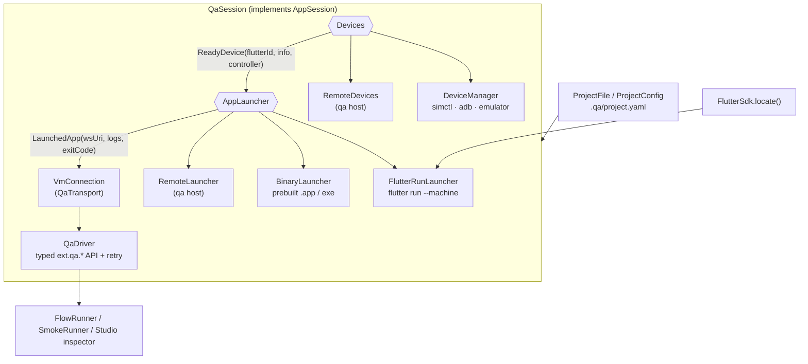
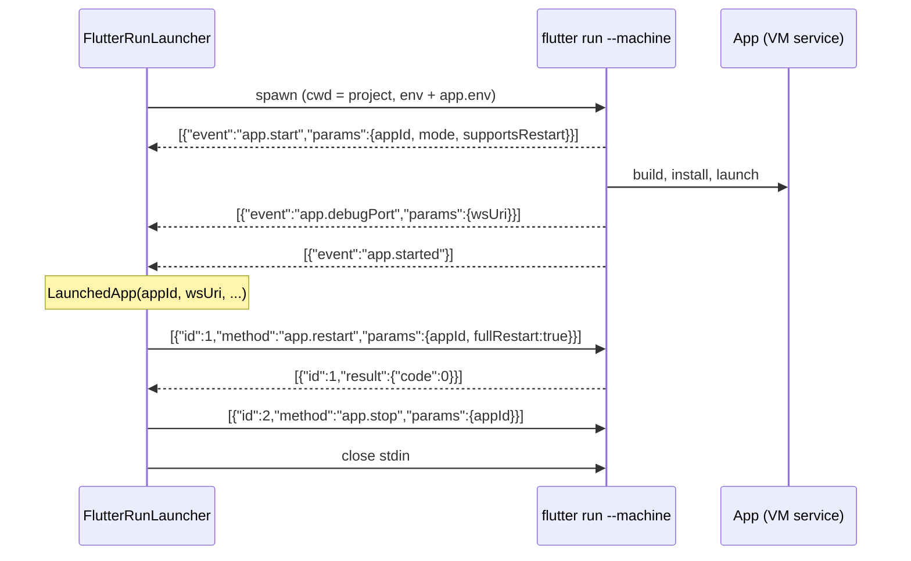
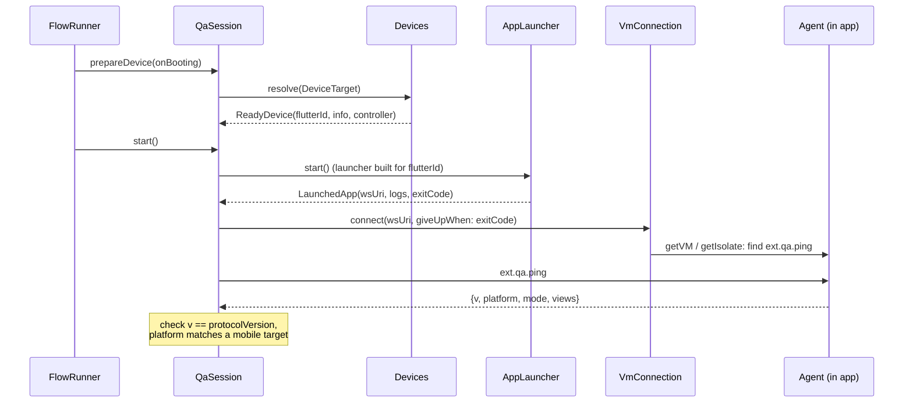
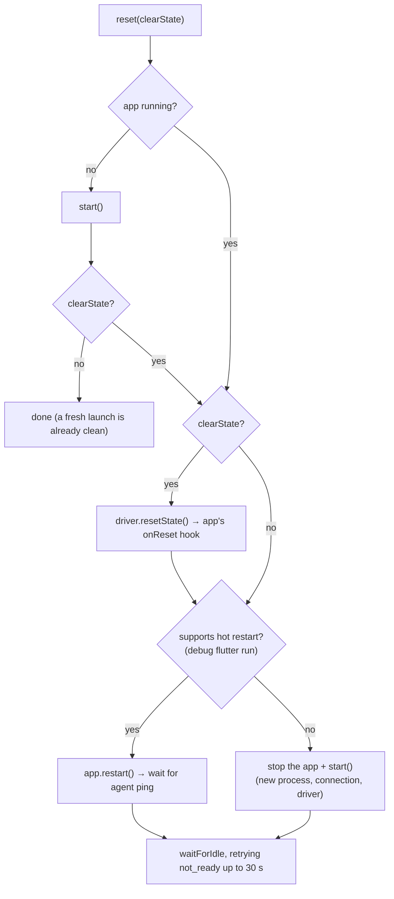

# 2. Launching, connecting, driving: `qaflow`'s runtime and the CLI

`qaflow` is the pure-Dart engine that both the `qa` command line tool and QAFlow Studio use. This chapter covers the layers that get from "a project on disk" to "a typed API for poking a running app":



Chapter 3 covers the flow runner that sits on top of `QaSession`. Chapter 11 covers running the app on another machine through `qa host`. Paths below are relative to `packages/qaflow/lib/src/` unless noted; [chapter 12](12-code-map.md) lists every file.

## 2.1 Launching the app under test

The launch layer has one job: produce a **`LaunchedApp`**, a uniform handle on a running app however it was started ([launched_app.dart](../../packages/qaflow/lib/src/launch/launched_app.dart)). It holds:

- **`wsUri`**: the VM service WebSocket address.
- **`appId`**: the daemon's app id, or the host's for a remote app. It is null for binaries.
- **`mode`**: `debug` or `profile`.
- **`supportsRestart`**: whether a hot restart is possible.
- **`logs`**: a stream of output lines.
- **`exitCode`**: a future that completes when the process ends.
- **`stop()`** and **`restart()`**. `restart()` throws `LaunchException` when `supportsRestart` is false.

`AppLauncher` is the one-method interface (`Future<LaunchedApp> start()`) behind which the launch strategies hide. Launch failures are `LaunchException`. Processes are started through an injectable `ProcessStarter` ([process.dart](../../packages/qaflow/lib/src/launch/process.dart)), which lets tests use a `FakeProcess` instead of spawning anything. The same file has `ProcessRunner` (run a short command to completion), `DetachedStarter` (start something that outlives `qa`, the Android emulator) and `runUntil` (run to completion, but SIGTERM the process if a `stop` future completes first, so an abandoned wait leaves nothing running).

### Source launch: `flutter run --machine`

`FlutterRunLauncher` ([flutter_run_launcher.dart](../../packages/qaflow/lib/src/launch/flutter_run_launcher.dart)) builds and runs the app from a project folder:

```
flutter run --machine -d <device> --<debug|profile> -t <entrypoint>
            [--flavor <f>] [--dart-define=K=V ...]
```

It runs in the project folder, with the project's `app.env` added to the environment, and through the shell on Windows (where `flutter` is a `.bat`). `<device>` is the resolved device id from the device layer below (`deviceId`), not the raw `device:` value: a simulator UDID, an emulator serial, or the desktop name.

**How the daemon protocol works.** `--machine` makes `flutter run` speak the *daemon protocol*, a line-oriented JSON-RPC dialect that IDEs use. Each message on stdout is one line holding a one-element JSON array: either an event `[{"event": "app.start", "params": {…}}]` or a response `[{"id": 3, "result": …}]` / `[{"id": 3, "error": …}]`. Requests go to stdin the same way: `[{"id": 3, "method": "app.restart", "params": {…}}]`. Anything else on stdout (build output, `print`s before the app starts) is plain text. [daemon_protocol.dart](../../packages/qaflow/lib/src/launch/daemon_protocol.dart) parses a line only if it starts with `[{` and ends with `}]`, and returns null otherwise.



The launcher:

- **Waits for three events in order:** `app.start` (app id, mode, `supportsRestart`), `app.debugPort` (the VM service `wsUri`, auth code included) and `app.started`. Each wait has its own timeout, 5 minutes by default (`startTimeout`), because a first build can be slow. An `app.stop` event before the start, or the process exiting, fails the launch at once.
- **Turns everything else into log lines:** `app.log`, `daemon.logMessage` (prefixed `[daemon]`), non-JSON stdout, and all of stderr. Unknown events (`app.progress`, `app.devTools`, `app.dtd`, …) are ignored on purpose, because the daemon protocol keeps growing.
- **Keeps the last 20 lines.** If `flutter run` exits before the app starts, the failure quotes that tail. "Build failed" then comes with the actual compiler error instead of a bare exit code.
- **Hot restart** sends `app.restart {appId, fullRestart: true}`. The daemon answers with an operation result `{code, message}`; a non-zero `code` (a compile error introduced while you were editing, say) fails the restart rather than silently continuing with stale code.
- **Closes its log stream only after both stdout and stderr have finished.** A line still being decoded when the process exits could otherwise arrive after `close` and crash the controller.

Only debug supports hot restart. Profile builds use Flutter's "cold" runner, so `supportsRestart` is false and the session relaunches instead (2.4).

**Stopping.** `flutter run` starts the app as its own child, and on macOS the app outlives a kill of `flutter run` alone. So `stop()` runs `_shutDown`:

1. Record the process tree below `flutter run` with each process's start time (`ProcessTree.descendants`, below), before anything is signalled.
2. Send `app.stop {appId}`, bounded by `stopTimeout` (10 s); errors are ignored.
3. Close stdin, which is the daemon's own shutdown signal (bounded).
4. Wait up to `stopTimeout` for `flutter run` to exit. If it doesn't, kill its whole tree (`ProcessTree.kill`: SIGTERM, then SIGKILL). During an Android build the tree includes the Gradle daemon, which this stops too; that is intended, since the launch is being cancelled.
5. Kill any recorded descendant that is still running as the same process (`killSurvivors`). This catches an app that `flutter run` left behind when it exited.

A launch that fails part-way (a timeout, an early exit, an `app.stop` event) runs the same steps 1 and 3–5, so no `flutter run` or app is orphaned.

### Prebuilt launch: a binary or `.app`

`BinaryLauncher` ([binary_launcher.dart](../../packages/qaflow/lib/src/launch/binary_launcher.dart)) runs an already-built debug or profile binary. That's useful when the build happens elsewhere (CI artifacts, a release-engineering pipeline) or for testing exactly the binary you will ship, built in profile mode.

**How it gets a VM service without `flutter run`.** A Flutter desktop embedder reads engine command-line switches from the environment: `FLUTTER_ENGINE_SWITCHES=<n>` and `FLUTTER_ENGINE_SWITCH_1` … `_n`. This is how `flutter_tools` itself passes switches to desktop apps. The launcher sets:

```
FLUTTER_ENGINE_SWITCHES=3
FLUTTER_ENGINE_SWITCH_1=enable-dart-profiling=true
FLUTTER_ENGINE_SWITCH_2=vm-service-port=<a free port>
FLUTTER_ENGINE_SWITCH_3=disable-service-auth-codes=true
```

`vm-service-port` fixes the VM service's port and `disable-service-auth-codes` removes the random path segment, so the URI is known in advance: `ws://127.0.0.1:<port>/ws`. The app's own `app.env` and the parent environment are passed too. Points worth knowing:

- **`.app` bundles are not opened with `open`**, because `open` drops environment variables. The launcher reads `CFBundleExecutable` from the bundle's `Info.plist` with `plutil -extract … raw` (which handles XML and binary plists) and runs `Contents/MacOS/<name>` directly.
- **Release binaries ignore these switches** and never open a VM service. So `start()` first runs `inspectPrebuiltApp` ([prebuilt_inspector.dart](../../packages/qaflow/lib/src/launch/prebuilt_inspector.dart)) and refuses a release `.app` at once, with the rebuild command, instead of waiting out the 30 s connect timeout.
  - **Build mode:** read from the `BuildMode` key in `FlutterMacOS.framework/Resources/Info.plist`.
  - **Agent present:** checked by scanning the compiled Dart (`App.framework/App`, or `kernel_blob.bin` in debug) in 1 MiB chunks for the `package:qaflow_agent/` library path, which compiled code keeps for stack traces. It also accepts `package:qa_agent/`, the agent's name before the QAFlow rename, so an app built with the old agent is still recognised; the `ext.qa.*` extensions it registers are unchanged.
  - **A missing agent is not refused** by the launcher, because an obfuscated build can hide that path. QAFlow Studio runs the same check when you choose a build: it refuses a release build and asks before using one without the agent.
  - Only macOS `.app` bundles can be inspected; anything else is "unknown" and is launched.
- **The free port is found by binding port 0 on loopback and closing the socket.** There's a tiny window where another process could grab it before the app does.
- **No hot restart.** `supportsRestart` is false, so every reset relaunches the process.
- **Stop kills the process tree:** SIGTERM to the binary and everything below it, then SIGKILL after 3 s to whatever is left (see Process lifecycle below).
- **`mode` comes from the config, not from inspecting the binary.** It is a label, so keep it accurate.

### Finding Flutter

Source launches need a `flutter` executable. `FlutterSdk.locate` ([flutter_sdk.dart](../../packages/qaflow/lib/src/launch/flutter_sdk.dart)) tries, in order:

1. an **explicit path** (`--flutter`, or the path chosen in QAFlow Studio settings);
2. **`$FLUTTER_ROOT/bin/flutter`**;
3. **fvm's default**, `~/fvm/default/bin/flutter` (`%USERPROFILE%` on Windows);
4. every directory on **`PATH`**;
5. on macOS and Linux, a **login shell**: `$SHELL -l -c 'command -v flutter'`, with a 5 s limit, accepting only an absolute path.

The last step exists because **a macOS app launched from the Dock or Finder does not inherit your terminal's PATH**. A login shell reads the same profile files the terminal does, so it finds what `which flutter` finds. `version()` runs `flutter --version --machine` and parses the outermost JSON object only, because Flutter sometimes prints banners before it.

### Process lifecycle: no orphans

A test tool that leaves apps running is worse than one that fails. Three pieces make sure every launched process ends.

#### `ProcessTree`: stopping a process and everything it started

[process_tree.dart](../../packages/qaflow/lib/src/launch/process_tree.dart). On POSIX a signal reaches one pid. A *process group* kill would reach a whole tree, but Dart starts children in the parent's own process group, and macOS has no `setsid` command to start them in a new one, so a group kill would hit `qa` itself. Instead `ProcessTree` reads the tree from `ps`:

- **`descendants(pid)`** runs `ps -A -o pid= -o ppid= -o lstart=`, builds a parent-to-children map and walks it breadth-first from `pid`. It returns each descendant with its **start time** (`lstart`, to the second). It must run before anything is signalled: once a parent dies, its children are re-parented (to `launchd` or `init`) and can no longer be found from it.
- **`kill(root)`** sends SIGTERM to the root and every descendant, polls every 100 ms for up to `grace` (3 s) until the root has exited and no descendant is alive, then sends SIGKILL to what is left. With `force`, it sends SIGKILL at once and doesn't wait.
- **`killSurvivors(recorded)`** ends whichever previously recorded descendants are still running, the same way.
- **PIDs are verified by start time.** A pid counts as "still alive" only if `ps` shows it with the same start time as when it was recorded. Process ids are reused; without this check a later kill could hit an unrelated process that happened to get the same pid.
- **Windows** has no `ps` tree walk here: `kill` runs `taskkill /PID <pid> /T /F`, which kills the tree itself, and falls back to killing the root alone if that fails.
- **`ProcessTree.direct()`** only kills the process itself. The launchers use it when a test injects a fake process, whose pid is not real.

#### `liveProcesses`: what is still running

`LiveProcesses` keeps every process a launcher started, with its tree, until the process exits. Both launchers call `liveProcesses.track(process, tree)` right after spawning. `killAll({force})` kills every tracked tree. This is the safety net for a launch still in flight or a stop that ran out of time.

#### `exitOnTermination`: Ctrl-C and `kill`

[termination.dart](../../packages/qaflow/lib/src/launch/termination.dart). `terminationSignals()` merges SIGINT and SIGTERM into one stream (only SIGINT on Windows, which has no SIGTERM to watch). `exitOnTermination(shutdown)` listens to it:

- **The first signal** runs `shutdown` (bounded by 15 s), then `liveProcesses.killAll()` (also bounded), then exits with **128 + the signal number**: 130 for SIGINT, 143 for SIGTERM, the shell convention for "terminated by a signal".
- **A second signal** doesn't wait for any of that: it runs `liveProcesses.killAll(force: true)` (SIGKILL, bounded by 2 s) and exits at once.

The `qa` CLI installs it in `main` with a shutdown that stops whatever the current command started (the session, the test run, or the host server). QAFlow Studio installs it too (studio_app.dart), with a shutdown that stops its run and inspect sessions the way quitting does.

### Devices: desktops, simulators and emulators

#### Naming a device: `DeviceTarget`

A `device:` value is parsed by `DeviceTarget.parse` ([device.dart](../../packages/qaflow/lib/src/device/device.dart)) into a `DevicePlatform` and, for mobile, a query:

| Value | Platform | Query |
|---|---|---|
| `macos`, `windows`, `linux`, `flutter-tester` | that desktop | none |
| `ios:<simulator name or UDID>` | iOS | the name or UDID |
| `android:<AVD name or emulator serial>` | Android | the name, or a serial shaped `emulator-<port>` |

An empty query after `ios:` or `android:` is a `FormatException` with an example. A bare unknown value is a `FormatException` whose message lists the accepted forms and suggests the prefixed one (`(e.g. "ios:iPhone 17 Pro")`). Parsing never lists devices, so config parsing never runs `simctl` or `adb`.

`ProjectConfig.deviceProblems` adds the rules that depend on the rest of the config: a flavor only on macOS, iOS and Android; no prebuilt `binary` on a mobile device; no `mode: profile` on iOS, because Flutter cannot run profile builds on a simulator (`profile mode is not supported on iOS simulators; use debug`).

#### Describing a device: `DeviceInfo` and baseline keys

`DeviceInfo` holds a platform, a display `name`, an `id` (UDID, AVD name, emulator serial, or the desktop name), an optional `osVersion` (`iOS 26.5`, `Android 15 (API 35)`) and `booted`. A desktop's info carries the host OS version as `major.minor`, parsed from `Platform.operatingSystemVersion` by `DeviceInfo.hostVersion` (`macos` → `27.0`, Windows → `10.0`); `flutter-tester` has none.

`baselineKey({suffix})` names the folder that holds a device's screenshot baselines (`.qa/baselines/<device key>/…`, chapter 3):

- Each part is cleaned on its own: runs of characters outside `[A-Za-z0-9.]` become one `_`, and leading and trailing `_` are dropped. The parts are joined with `-`.
- A desktop key is the desktop name plus the OS version: `macos-27.0`, `windows-10.0`. An OS upgrade can change how an app renders, so it gets new baselines.
- A mobile key is the platform, the device name (or the id when the name cleans to nothing) and the OS version when known: `ios-iPhone_17_Pro-iOS_26.5`, `android-qa_pixel_baklava-Android_15_API_35`.
- `suffix` keeps separate sets, for example for CI, whose fonts render differently from a local Mac. The runner takes it from `TestRunRequest.baselineKeySuffix`, else the `QA_BASELINE_KEY_SUFFIX` environment variable. It is cleaned the same way, with leading and trailing `.` also dropped, so it can never name a folder outside `.qa/baselines`.

#### Listing and resolving: `Devices` and `DeviceManager`

`Devices` ([device_manager.dart](../../packages/qaflow/lib/src/device/device_manager.dart)) is the interface the session and QAFlow Studio use:

```dart
abstract interface class Devices {
  Future<DeviceList> list();
  Future<ReadyDevice> resolve(DeviceTarget target, {void Function(DeviceInfo)? onBooting, CancelSignal? cancel});
}
```

It has two implementations: `DeviceManager` for this machine, and `RemoteDevices` for a `qa host` (chapter 11). `DeviceManager` sits over the native tools, never over `flutter devices`, which is slow and has no readiness signal. It delegates each mobile platform to a `MobileDevices` (`IosDevices`, `AndroidDevices`).

- **`list()`** returns this computer's desktop and `flutter-tester`, every available iOS simulator (newest runtime first), and every AVD and running emulator. A missing toolchain is not an exception: it comes back as a `DeviceGroupProblem` (`Xcode command line tools not found (xcrun)`, `Android SDK not found (set ANDROID_HOME)`, `iOS simulators need macOS`) for QAFlow Studio to show in that group.
- **`resolve(target, onBooting:, cancel:)`** returns a **`ReadyDevice`**: `flutterId` (what `flutter run -d` takes), `info`, `controller` and `bootedByUs`. It boots the device first if it is shut down, calling `onBooting` so the caller can say "Booting …". A desktop target returns at once with an `UnsupportedDeviceController`.

Devices are never shut down by `qa`, including ones it booted; `bootedByUs` is reported only. Every external command goes through an injectable `ProcessRunner`, `ProcessStarter` or `DetachedStarter`, so the tests never run `xcrun`, `adb` or `emulator`.

Boot waits use `guardDeviceWait(work, timeout:, what:, cancel:)`: the work races a timer (`booting <device> did not finish within <n> s`) and a `CancelSignal` (`stopped while waiting for …`). `QaSession.stop()` cancels the signal, so Stop works while a device is still booting; the device itself keeps booting.

#### iOS simulators through `xcrun simctl`

`simctl` is Xcode's command line for the iOS Simulator. [ios_devices.dart](../../packages/qaflow/lib/src/device/ios_devices.dart):

- **List:** `xcrun simctl list devices available -j` returns JSON keyed by runtime (`com.apple.CoreSimulator.SimRuntime.iOS-26-5`). The runtime gives the OS label; `state == Booted` gives `booted`.
- **Resolve:** match the query as a UDID (case-insensitive) first, then as a name, newest runtime winning. No match is a `LaunchException` naming up to five available simulators.
- **Boot:** `simctl boot <udid>` (an "already Booted" error is fine), then `simctl bootstatus <udid> -b`, which blocks until the simulator has finished booting. That wait runs under `runUntil`, so a timeout or cancel kills the `bootstatus` process. The limit is 120 s, or `QA_IOS_BOOT_TIMEOUT` seconds.
- **Show:** `open -a Simulator`, so anyone watching sees the device. Frames do not need the window.

#### Android emulators through `adb` and `emulator`

`emulator` is the SDK's emulator launcher; `adb` (Android Debug Bridge) talks to running devices by serial. A running emulator's serial is `emulator-<console port>`. `AndroidSdk.locate` ([android_sdk.dart](../../packages/qaflow/lib/src/device/android_sdk.dart)) finds both tools through `ANDROID_HOME`, `ANDROID_SDK_ROOT`, the SDK manager's default folder for the OS (`~/Library/Android/sdk`, `~/Android/Sdk`, `%LOCALAPPDATA%\Android\Sdk`), then `PATH`. [android_devices.dart](../../packages/qaflow/lib/src/device/android_devices.dart):

- **List:** `emulator -list-avds` names the AVDs; `adb devices` lists running serials; `adb -s <serial> emu avd name` maps each serial to its AVD, so the two lists merge by AVD name. A running emulator's OS comes from `getprop ro.build.version.release` and `ro.build.version.sdk`.
- **Resolve a serial** (`android:emulator-5554`): it must already be running; it is never booted.
- **Resolve an AVD name:** reuse a running emulator that reports that AVD. Otherwise:
  1. start `emulator -avd <name> -no-snapshot-save -no-boot-anim` detached, so it outlives `qa`;
  2. poll `adb devices` until a new serial reports the AVD;
  3. `adb -s <serial> wait-for-device` (under `runUntil`), then poll `getprop sys.boot_completed` until it reads `1`;
  4. wait up to 30 s for `am get-config` to report a SIM (`config: mcc…`). The SIM arrives seconds after boot, and its configuration change restarts the foreground activity, which would replace the Flutter engine under a freshly launched app;
  5. `input keyevent 82` wakes the screen and dismisses the lock screen.

  Steps 2–5 share one limit: 180 s, or `QA_ANDROID_BOOT_TIMEOUT` seconds.

#### Acting on the device: `DeviceController`

The `controller` in `ReadyDevice` serves the flow commands that act on the device rather than inside the app (chapter 3):

| Controller | `setOrientation` | `resetOrientation` (app not running) | `openLink` |
|---|---|---|---|
| `AndroidDeviceController` | `settings put system accelerometer_rotation 0`, then `user_rotation` 0/1/3; then polls the agent's `ping` every 100 ms for up to 10 s until the first view's aspect matches (an app locked to one orientation just costs the wait) | `user_rotation 0`, leaving auto-rotate off | `am start -W -a android.intent.action.VIEW -d '<link>'`, quoted for the device shell; any `Error` line fails it |
| `IosDeviceController` | the agent's `ext.qa.setOrientation` (`simctl` cannot rotate) | nothing: the preferred orientation died with the app | `xcrun simctl openurl <udid> <link>` |
| `UnsupportedDeviceController` (desktop) | `unsupported` | nothing | `unsupported` |
| `RemoteDeviceController` (chapter 11) | iOS through the agent; otherwise `device.setOrientation` on the host | `device.resetOrientation` (not on iOS) | `device.openLink` |

Controller failures are `QaException`s (`internal` for a failed tool, `unsupported` for the desktop), so they fail a step like any agent error.

## 2.2 Connecting to the VM service

`VmConnection` ([vm_connection.dart](../../packages/qaflow/lib/src/driver/vm_connection.dart)) implements the transport interface `QaTransport` ([transport.dart](../../packages/qaflow/lib/src/driver/transport.dart)). Its single method `call(method, args)` returns a `QaResponse` and only ever throws `QaException`, so callers have one error type to catch. It uses the `vm_service` package's client (`vmServiceConnectUri`), which speaks the VM service's JSON-RPC over the WebSocket.

**Connecting** retries every 250 ms for up to 30 s. Each failed attempt disposes its socket, so retries don't leak. The wait races against the app's `exitCode` (`giveUpWhen`), so if the app crashes, the connection fails within milliseconds rather than after 30 s. The timeout message says release builds have no VM service, because that is the most common cause. The URI is logged and quoted through `redactUri`/`redactToken`, which matters for a remote host's `?token=` (chapter 11).

**Finding the agent.** On connect it subscribes to the `Isolate`, `Stdout` and `Stderr` streams. An app can have several isolates; the connection picks the one whose `extensionRPCs` include `ext.qa.ping`. The search is lazy: the socket can connect before `main_qa.dart` has registered anything, and a call simply waits (polling every 250 ms, up to 30 s) for the extension to appear, then answers `not_ready` if it never does.

**Surviving hot restart.** The connection listens to the isolate event stream:

- **`ServiceExtensionAdded` for `ext.qa.ping`** switches the cached isolate to the new one.
- **`IsolateExit` of the cached isolate** clears it.

During a restart the old isolate may disappear mid-call. A `SentinelException`, or an RPC error "method not found" (the extension isn't registered yet) or "isolate must be runnable" (it hasn't resumed yet), is mapped to `not_ready` and drops the cached isolate, so the next call finds it again. A hot restart looks to the layers above like a brief "not ready" blip.

**Call time limit and infrastructure errors.** Each call is bounded by 60 s (`callTimeout`), plus any `timeoutMs`/`durationMs` the call itself asked for. A call that doesn't come back in time almost always means the UI isolate is frozen or paused in a debugger. That becomes an `internal` error whose `details` contain an **`rpcCode`** key. Every VM-service-level failure carries `rpcCode` too, including connection loss (`kConnectionDisposed`, `kServiceDisappeared`). That key is a deliberate marker: the flow runner treats any error carrying it, or a step failure whose last error carries it, as an **infrastructure failure**, which ends the whole run instead of failing one step and carrying on against a dead app (chapter 3).

The connection also forwards the VM's own stdout and stderr to a log stream (prefixed `[vm]` by the session). There's no socket-level reconnect: if the socket dies, the session relaunches and builds a new `VmConnection`.

## 2.3 The driver: a typed API with one retry policy

`QaDriver` ([qa_driver.dart](../../packages/qaflow/lib/src/driver/qa_driver.dart)) turns `ext.qa.*` calls into Dart methods (`tap`, `enterText`, `assertVisible`, `screenshot`, …). Its most important job is **when to retry**:

- **Retried:** `not_found`, `ambiguous`, `not_ready`, `off_screen` and `obscured`. They retry every 100 ms until the step timeout (10 s by default), and every attempt is preceded by `waitForIdle` (5 s) so the app gets a chance to settle.
- **Not retried:** any other code fails immediately.
- **On timeout:** the driver takes a best-effort `elements()` snapshot and throws a **`QaStepFailure`** carrying the last error and the snapshot. That is what the runner saves as `elements-<id>.json` for debugging.

Not every method retries, by design:

| Method group | Retry? | Why |
|---|---|---|
| Selector actions: `tap`, `doubleTap`, `longPress`, `hover`, `drag`, `scroll`, `scrollDirection`, `enterText`, `eraseText`, `setText` | yes | The target may not have appeared yet |
| `assertVisible` / `assertNotVisible` | yes (poll until true) | That is what an assertion over time means |
| Coordinate actions: `tapAt`, `longPressAt`, `dragAt`, `scrollAt` | no, and no settle | A raw coordinate action should happen exactly when asked |
| `pressKey`, `back` | settles once, no retry | A key press either reaches the focus tree or it doesn't; retrying could type twice |
| `hideKeyboard`, `setOrientation` | no; settle afterwards | They report a state change and then let it animate |
| `resetState` | no | An app's reset hook must not run twice |
| `ping`, `elements`, `find`, `elementAt`, `screenshot` | no | These are reads; the caller decides |

`untilReady(label, attempt)` is a narrower retry, on `not_ready` only, for callers that need the app rendering before a one-off read. `waitForIdle` returning `timeout` is logged, not thrown: an app with an endless animation shouldn't fail every step.

**Screenshots.** `screenshotCapture()` asks for an inline PNG and returns the bytes with the device pixel ratio (used by screenshot comparison); `screenshotBytes()` returns just the bytes; `screenshot(path:, transfer:)` writes a file and returns its path. Inline is the default (chapter 1.4.8). With `transfer: file` the agent writes the file itself, unless the driver was built with `inlineScreenshotsOnly`, which the session sets for an app on a `qa host`, whose filesystem is not this machine's.

`elementAt(x, y)` returns an `ElementHit` (the node and the agent's selector list); `suggestSelectors` in [flow/selectors.dart](../../packages/qaflow/lib/src/flow/selectors.dart) ranks it (chapter 1.4.9).

## 2.4 The session: one app, its whole lifetime

`QaSession` ([qa_session.dart](../../packages/qaflow/lib/src/session/qa_session.dart)) owns one app under test across a whole run. It implements the `AppSession` interface the flow runner talks to ([app_session.dart](../../packages/qaflow/lib/src/flow/app_session.dart)). It is used by the CLI, by `TestRun`, and by QAFlow Studio's inspector.

**`create`** validates the config, so an invalid config fails before anything launches. Then:

- **Locally**, it finds Flutter (unless the app is a binary or a launcher was injected) and prepares a launcher factory: `BinaryLauncher` when `app.binary` is set, otherwise `FlutterRunLauncher`. Devices come from a `DeviceManager` (or an injected `Devices`).
- **With `config.host`**, it reads the host token, connects to the host, and uses `RemoteDevices` and `RemoteLauncher` instead; no Flutter SDK is needed. Chapter 11.6 has the details, including how an unset device becomes the host's desktop.

`launch` is `create` followed by `start`, stopping the session (and closing any host connection) if `start` fails.

**`prepareDevice({onBooting})`** resolves the device once per session and builds the launcher with `ReadyDevice.flutterId`. It is idempotent; a failure lets a later call retry. `start()` calls it itself if nobody has; the flow runner calls it first so it can report booting and compute the baseline key. `device` and `deviceController` expose the result.



**`start()`**:

1. Prepares the device if needed and launches the app.
2. Before connecting, subscribes to its logs (keeping a 20-line tail, and forwarding them to the session's `logs`) and its exit code.
3. Connects the `VmConnection`, giving up early if the app exits. When the app dies before the VM service connects, the error names the exit code and quotes the tail. On macOS this is typically a `dyld` message about a missing framework.
4. Builds the `QaDriver` and pings. **The ping's protocol version must equal the driver's**; otherwise the launch fails with both numbers in the message. On a mobile target the ping's `platform` must also match the target's (`expected an iOS app but the agent reports android`), which catches a wrong `-d` id at launch rather than at the first step.
5. On any failure after launching, it disposes the connection and always stops the app, so nothing is left running.

**`reset({clearState})`** is how the runner gets a clean app between flows:



Hot restart takes about a second; a relaunch takes a few. That's the main reason debug runs of many flows are faster than profile runs. The final `waitForIdle` retries through `not_ready`, because a window that is minimised or on another Space can't produce frames (chapter 1.4.7).

**`stop()`** is idempotent: it cancels a boot wait in progress, clears its references first, then disposes the connection and stops the app (in a `finally`). With a host it also closes the host connection; a later `start()` opens a new one. The session's `logs` stream lives for the whole session and survives relaunches, so a subscriber, such as QAFlow Studio's log panel, keeps receiving output across them.

## 2.5 Project configuration: `.qa/project.yaml`

Settings live **in the app's repository**, at `<app root>/.qa/project.yaml`. The CLI, CI and QAFlow Studio all read the same file, so "it passes in the studio" and "it passes in CI" mean the same thing. `qaflow` only reads the file; QAFlow Studio is the only writer (chapter 4).

```yaml
name: demo_app                 # default: the app root folder's name
app:
  source: .                    # or binary: build/.../my_app.app — exactly one
  entrypoint: lib/main_qa.dart # default; passed to flutter run -t
  mode: debug                  # debug | profile
  device: macos                # default: this machine; ios:<name|UDID>, android:<AVD|serial>
  flavor: staging              # macOS, iOS and Android
  dartDefines: {API: staging}
  env: {LOG_LEVEL: debug}      # environment of the app process
flows:
  folders: [.qa/flows]         # default; must not be empty
  env: {USERNAME: alice}       # flow variables
  secrets: [PASSWORD]          # names only; values come from elsewhere
  retries: 1                   # extra attempts for a failing flow
  screenshots: failures        # failures | all | none
  baselines: record            # record | strict | update (screenshot baselines)
  includeTags: [smoke]
  excludeTags: [slow]
host:                          # optional: run the app on a `qa host` (chapter 11)
  url: ws://127.0.0.1:7777     # default
  project: C:\src\myapp        # the project folder on the host; required
```

- **Two classes, two concerns.** `ProjectConfig` ([project_config.dart](../../packages/qaflow/lib/src/config/project_config.dart)) is *how to launch*: source or binary, entrypoint, mode, device, flavor, defines, env, the Flutter path and the optional `RemoteHostConfig host`. `ProjectFile` ([project_file.dart](../../packages/qaflow/lib/src/config/project_file.dart)) wraps a `ProjectConfig` together with *how to run flows*: folders, variables, secrets, retries, screenshots, baselines and tags.
- **An unset device is remembered as unset** (`deviceIsDefault`). Locally it means this machine's desktop; on a host it means the host's desktop.
- **Paths resolve against the app root**, the folder containing `.qa/`. `--config` must therefore point at a file inside a `.qa` folder. With `host:`, `app.source` and `app.binary` are paths on the host and are kept as written; `configWithHost(host)` returns host paths for a host and locally resolved ones for `null`.
- **The Flutter location is never stored in the project.** Where Flutter lives belongs to the machine, not the repository, so it comes from `--flutter` or Studio settings.
- **The host token is never stored in the project.** A `token:` key under `host:` is an error that says to set `QA_HOST_TOKEN`.
- **Every error has a line and column.** The parser whitelists keys per section ("unknown key "x" in app; expected …") and reports positions from the YAML spans, printed as `file:line:col: message`, the same format as flow errors. A device rule is reported at the node it concerns (`flavor`, `mode` or `device`).
- **Secrets are names only.** Listing a name under `secrets` *and* giving it a value under `flows.env` is an error, because the whole point is that values never land in the repository. Values come from `--env` or from the process environment (or, in QAFlow Studio, from the machine's settings).

## 2.6 The `qa` command line tool

`qa` is defined in [`bin/qa.dart`](../../packages/qaflow/bin/qa.dart) and run as `dart run qaflow:qa <command>` from the workspace root.

| Command | What it does | Exit code |
|---|---|---|
| `qa ping` | Launch, ping the agent, settle, take one screenshot (`ping.png`), stop | 0 |
| `qa smoke` | Run the fixed demo-app smoke scenario, writing a step table and `smoke.log` | 0 all pass, 1 otherwise |
| `qa validate [paths] [--config]` | Parse the project file and flows (default: the project's flow folders) and print `file:line:col: message` per problem | 0 valid, 1 problems |
| `qa test [paths]` | Run flows and write the reports | 0 all passed (flaky counts as passed), 1 otherwise |
| `qa host [--port] [--token-file]` | Serve this machine's devices and launchers to one remote client (chapter 11) | runs until Ctrl-C; 1 if it can't listen |

**Shared options** (`ping`, `smoke`, `test`): `--config`, `--project` or `--binary` (not both), `--mode`, `--device`, `--entrypoint`, `--flutter`, `--host <url|none>`, `--host-project <path>` and `--out`. Without `--config`, `./.qa/project.yaml` is used when it exists. The precedence is **flag > project file > default**. Giving `--project` or `--binary` replaces both launch fields from the file. Flavor, dart-defines and app env come only from the file. Device rules (2.1) are checked here too, as usage errors. Output goes to `--out`, else `<app root>/qa-out`, else `./qa-out`.

**`qa test` adds** `--include-tags`, `--exclude-tags`, `--env K=V` (repeatable), `--retries`, `--screenshots`, `--baselines` and `--verbose`. Before launching anything it:

1. **Merges variables:** the project's `flows.env`, overlaid by `--env`.
2. **Checks secrets:** every declared secret must get a value from that merge or from an environment variable of the same name. Otherwise it's a usage error (exit 64) that names the missing secrets.
3. **Parses every flow file.** Any parse error prints its position and exits 1 without launching anything.
4. **Filters by tags.** A CLI tag option *replaces* the file's tags rather than merging with them. Nothing selected is an error.

Only then does it start a `TestRun` (chapter 3) and stream its events into the console reporter. Baselines live under the app root, which is the project file's, else `--project`'s; a run on a host with no project file has no local app root and so no baselines.

**Signals.** `main` installs `exitOnTermination` (2.1). Ctrl-C during `qa test` stops the run (the reports are still written) and the session; during `ping` and `smoke` it stops the session; during `qa host` it closes the server, which stops every app it launched. A second Ctrl-C force-kills what is left.

**Errors map to stable exit codes:**

| Error | Printed as | Exit |
|---|---|---|
| Usage errors | the usage message | 64 |
| Project-file errors | `file:line:col: message` | 1 |
| Launch failures | `qa: launch failed: …` | 1 |
| Remote host errors | `qa: <message>` (for example `Can't reach the QA host at …`) | 1 |
| Step failures in `ping`/`smoke` | `qa: step failed: …` | 1 |
| Agent errors | `qa: agent error: …` | 1 |
| Invalid configuration | `qa: invalid argument: …` | 1 |
| Terminated by a signal | | 130 (SIGINT) or 143 (SIGTERM) |

**`qa smoke`** predates the flow language. It's a fixed Dart scenario against the demo app ([smoke_runner.dart](../../packages/qaflow/lib/src/smoke/smoke_runner.dart)), covering login, list scrolling, a dialog, hover and text editing. It still serves as an end-to-end check of the agent and driver independently of the flow parser.

## 2.7 Timeouts at a glance

| What | Limit | Where |
|---|---|---|
| Each `flutter run` startup phase | 5 min | `FlutterRunLauncher.startTimeout` |
| Each `flutter run` shutdown step | 10 s | `FlutterRunLauncher.stopTimeout` |
| SIGTERM before SIGKILL for a process tree | 3 s | `ProcessTree.grace` |
| Shutdown on the first SIGINT/SIGTERM | 15 s, then 15 s for leftovers | `exitOnTermination` |
| Forced kill on a second signal | 2 s | `exitOnTermination` |
| VM service connect | 30 s, every 250 ms | `VmConnection.connect` |
| Waiting for the agent's isolate | 30 s per call | `VmConnection._requireIsolate` |
| Any single call | 60 s plus the call's own `timeoutMs`/`durationMs` | `VmConnection.callTimeout` |
| Driver step (retries) | 10 s, every 100 ms | `QaDriver.stepTimeout` |
| Settle before a step | 5 s | `QaDriver.settleTimeout` |
| Agent after a restart, and `not_ready` after a reset | 30 s | `QaSession.agentTimeout` |
| Login-shell Flutter lookup | 5 s | `FlutterSdk` |
| iOS simulator boot | 120 s, or `QA_IOS_BOOT_TIMEOUT` | `IosDevices.bootTimeout` |
| Android emulator boot | 180 s, or `QA_ANDROID_BOOT_TIMEOUT` | `AndroidDevices.bootTimeout` |
| SIM after an emulator boot | 30 s | `AndroidDevices.simSettleTimeout` |
| Android rotation taking effect | 10 s | `AndroidDeviceController.rotationTimeout` |
| Remote host connect and `hello` | 10 s each | `RemoteHost.connect` (chapter 11) |

## 2.8 Invariants

- **Callers only ever catch `QaException`** (plus `LaunchException` at launch, and `RemoteHostException` for a host).
- **An `rpcCode` in `details` means infrastructure.** Don't add it to ordinary agent errors, or a missing button would end a whole run.
- **No orphaned processes.** Every process a launcher spawns is tracked in `liveProcesses`, and every failure path after spawning stops it with its tree.
- **Record a tree before signalling it.** Children of a dead parent can't be found from it any more.
- **Never signal a pid without checking its start time.**
- **Log controllers close only after both stdout and stderr have finished.**
- **Changing a project-file key** means updating the whitelist, the error positions in the tests, the README table, and QAFlow Studio's project settings screen together.

## 2.9 Tests

Everything here is tested without launching a real app, using fakes:

- [`fake_process.dart`](../../packages/qaflow/test/fake_process.dart): scriptable stdout, stderr and exit, and it records stdin.
- [`fake_vm_service.dart`](../../packages/qaflow/test/fake_vm_service.dart): scriptable isolates, events and extension responses. It can hang a reply to model a frozen app.
- [`host_fakes.dart`](../../packages/qaflow/test/host_fakes.dart): fake devices, controllers and launchers for an in-process `HostServer`.

| Test file | What it checks |
|---|---|
| [`flutter_run_launcher_test`](../../packages/qaflow/test/flutter_run_launcher_test.dart), [`daemon_protocol_test`](../../packages/qaflow/test/daemon_protocol_test.dart) | Replays a realistic daemon transcript; startup, stop, kill and restart paths; frame parsing |
| [`binary_launcher_test`](../../packages/qaflow/test/binary_launcher_test.dart), [`prebuilt_inspector_test`](../../packages/qaflow/test/prebuilt_inspector_test.dart) | That the engine environment matches flutter_tools'; build-mode and agent detection |
| [`process_tree_test`](../../packages/qaflow/test/process_tree_test.dart) | Tree walks, SIGTERM then SIGKILL, `taskkill` on Windows, reused pids left alone, `LiveProcesses`, the launcher stop paths, and real child and grandchild processes |
| [`termination_test`](../../packages/qaflow/test/termination_test.dart), [`run_until_test`](../../packages/qaflow/test/run_until_test.dart) | Exit codes 130 and 143, a hanging shutdown, the second signal; killing an abandoned command |
| [`flutter_sdk_test`](../../packages/qaflow/test/flutter_sdk_test.dart) | The lookup order, including a hung login shell |
| [`vm_connection_test`](../../packages/qaflow/test/vm_connection_test.dart) | Isolate selection, hot-restart following, error mapping, call time limits |
| [`qa_driver_test`](../../packages/qaflow/test/qa_driver_test.dart), [`qa_driver_screenshot_test`](../../packages/qaflow/test/qa_driver_screenshot_test.dart) | The retry policy; inline and file screenshot transfer, and inline-only for an app on a host |
| [`selectors_test`](../../packages/qaflow/test/selectors_test.dart) | Selector suggestion ranking and labels |
| [`qa_session_test`](../../packages/qaflow/test/qa_session_test.dart) | Lifecycle, fail-fast on crash, reset paths |
| [`project_file_test`](../../packages/qaflow/test/project_file_test.dart), [`project_config_test`](../../packages/qaflow/test/project_config_test.dart) | Exact error positions; validation rules |
| [`cli_test`](../../packages/qaflow/test/cli_test.dart) | Runs `bin/qa.dart` as a subprocess for exit codes and usage errors, including `--host` |
| [`device_target_test`](../../packages/qaflow/test/device_target_test.dart) | Every device string form and error message |
| [`ios_devices_test`](../../packages/qaflow/test/ios_devices_test.dart), [`android_devices_test`](../../packages/qaflow/test/android_devices_test.dart), [`android_sdk_test`](../../packages/qaflow/test/android_sdk_test.dart), [`device_manager_test`](../../packages/qaflow/test/device_manager_test.dart) | Listing, resolving, booting and the controllers' command lines, fed captured `simctl`/`adb`/`emulator` output |
| `host_*_test`, `remote_client_test`, `qa_session_remote_test`, `remote_integration_test` | The remote host (chapter 11.10) |
## 2.10 Remote hosts in brief

A `qa host` daemon lets `qa` or QAFlow Studio on one machine drive an app on another, reached through an SSH tunnel. Flows stay on the client; the host only boots devices, launches apps and relays the VM service. In this chapter's terms:

- `RemoteDevices` implements `Devices`, and `RemoteDeviceController` implements `DeviceController`, over JSON-RPC calls to the host.
- `RemoteLauncher` implements `AppLauncher`; its `LaunchedApp.wsUri` is the host's `/vm/<appId>?token=` proxy, which `VmConnection` connects to unchanged.
- `QaSession` picks them when `config.host` is set, and its driver uses inline screenshots only.

[Chapter 11](11-remote-hosts.md) describes the protocol, the host, the client classes, configuration and setup.
