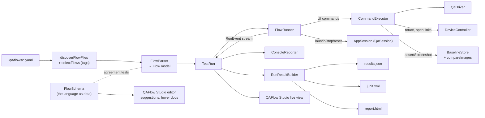
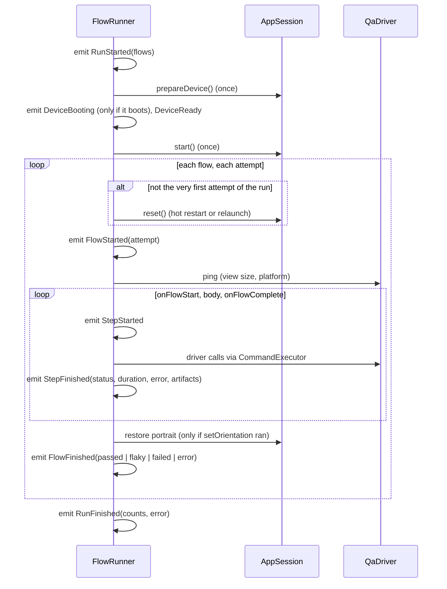

# 3. Flows, the runner and reports

This chapter covers the parts of `qaflow` that turn YAML test files into a run, and a run into reports:



Everything downstream of the runner consumes one **event stream**. The CLI prints it, the results builder folds it into reports, and QAFlow Studio animates it live. Paths in this chapter are relative to `packages/qaflow/lib/src/` unless they say otherwise. For a file-by-file index, see [chapter 12](12-code-map.md); for every command's options, see the [command reference](../commands.md).

| Concern | Code |
|---|---|
| The flow model (`Flow`, `FlowHeader`, one `Command` subclass per command, `FlowSelector`, `Condition`, `PointSpec`) | [`flow/model.dart`](../../packages/qaflow/lib/src/flow/model.dart) |
| YAML → model, with positioned errors | [`flow/parser.dart`](../../packages/qaflow/lib/src/flow/parser.dart) |
| The language as data, for editors | [`flow/flow_schema.dart`](../../packages/qaflow/lib/src/flow/flow_schema.dart) |
| `${NAME}` substitution and scopes | [`flow/variables.dart`](../../packages/qaflow/lib/src/flow/variables.dart) |
| Finding flow files, picking by tag | [`flow/discovery.dart`](../../packages/qaflow/lib/src/flow/discovery.dart) |
| `qa validate` | [`flow/validate.dart`](../../packages/qaflow/lib/src/flow/validate.dart) |
| Lifecycle, composition, hooks, retries, artifacts | [`flow/runner.dart`](../../packages/qaflow/lib/src/flow/runner.dart) |
| UI commands → driver calls | [`flow/executor.dart`](../../packages/qaflow/lib/src/flow/executor.dart) |
| What the runner needs from a session | [`flow/app_session.dart`](../../packages/qaflow/lib/src/flow/app_session.dart) |
| Events | [`flow/events.dart`](../../packages/qaflow/lib/src/flow/events.dart) |
| One run, one folder | [`run/test_run.dart`](../../packages/qaflow/lib/src/run/test_run.dart) |
| Baselines, comparison, comparison record | [`screenshot/`](../../packages/qaflow/lib/src/screenshot/) |
| Reports | [`report/`](../../packages/qaflow/lib/src/report/) |
| Writing steps back to YAML; ranking selectors | [`flow/step_writer.dart`](../../packages/qaflow/lib/src/flow/step_writer.dart), [`flow/selectors.dart`](../../packages/qaflow/lib/src/flow/selectors.dart) |

## 3.1 The flow language

Flows are YAML, deliberately close to [Maestro](https://maestro.mobile.dev)'s format, so people who know Maestro can read and write them, and simple Maestro flows often work unchanged. Maestro commands the toolkit does not implement are rejected by the parser with "X is not supported by QAFlow" instead of being ignored, so a flow never silently does less than it says.

### Shape of a file

```yaml
name: Wrong password shows an error      # optional; default: the file name without extension
tags: [login]                            # for --include-tags / --exclude-tags; a single string also works
env:                                     # flow variables
  PASSWORD: wrong
onFlowStart:                             # optional hook, runs before the body
  - launchApp
onFlowComplete:                          # optional hook, always runs after
  - takeScreenshot: end
---
- launchApp
- runFlow:
    file: ../subflows/login.yaml
    env: {PASSWORD: wrong}
- assertVisible: Wrong password
- assertVisible: {id: login, enabled: true}
```

- **Header and body.** A file is a header and a command list separated by `---`. A file can also be a bare command list, with no header. A third YAML document is an error ("a flow file has a header, ---, and one command list"), as is a body that is a map ("expected a command list; put the header before a --- line"), an empty file and an empty body.
- **Header keys** are exactly `name`, `tags`, `env`, `onFlowStart`, `onFlowComplete` and `appId`. `appId` is Maestro's and is accepted and ignored. Any other key is "unknown header field X".
- **`env` names** must be identifiers (`[A-Za-z_][A-Za-z0-9_]*`), and a value cannot be empty.
- **Command forms.** Each command is a bare word (`- scroll`), a word with a scalar (`- tapOn: Login`), or a word with a map (`- tapOn: {id: login}`). A list item with more than one key is an error ("a command is a single key").
- **Common options.** Every map form takes `label:`, which replaces the step's title in reports, and `optional: true`, which turns a failure into a warning.

### Commands

The parser accepts exactly the 27 names in `FlowParser.commandNames`. The [command reference](../commands.md#flow-commands) gives every option and default.

| Command | Purpose |
|---|---|
| `launchApp` (`clearState`, `stopApp`, `appId`) | Make sure the app is running and fresh (see 3.3) |
| `stopApp` / `killApp` | Stop the app |
| `clearState` | Run the app's reset hook and restart |
| `tapOn`, `doubleTapOn`, `longPressOn` | A selector, or `point: "x, y"` / `"50%, 90%"` |
| `hover` | Move the mouse over an element (mouse only: `unsupported` on iOS and Android) |
| `inputText`, `eraseText` (default 50 characters), `setText` | Type into the focused field, delete before the cursor, or replace a selected field's text |
| `pressKey` | A key chord such as `enter`, `mod+s` or `shift+tab`, checked at parse time. `pressKey: back` parses as `back` |
| `back` | Android system back (`ext.qa.back`); `unsupported` elsewhere |
| `hideKeyboard` | Drop focus and hide the soft keyboard (`ext.qa.hideKeyboard`); every platform |
| `setOrientation` | `PORTRAIT`, `LANDSCAPE_LEFT`, `LANDSCAPE_RIGHT` (`LANDSCAPE` = left), through the device controller; `unsupported` on desktop |
| `openLink` | Open a URL on the device; `unsupported` on desktop |
| `assertVisible`, `assertNotVisible` | Poll until true or the step timeout |
| `extendedWaitUntil` | Like an assertion, with its own timeout |
| `waitForAnimationToEnd` | Settle, with a timeout |
| `scroll` | Scroll the main list 70% of its height |
| `scrollUntilVisible` | Scroll a direction until an element is visible enough |
| `swipe` | Drag by direction or between points (for draggable widgets; desktop lists ignore mouse drags, but on iOS and Android the drag is a touch and scrolls lists) |
| `takeScreenshot` | Save a named PNG into the run folder |
| `assertScreenshot` | Compare the screen with a baseline PNG under `.qa/baselines/` (`name`, `threshold`, `ignore`) |
| `runFlow` | Run a subflow file, or inline `commands`, with optional `env` and a `when` condition |
| `repeat` | Repeat `commands` a number of `times`, or `while` a condition holds (capped at 100) |

Conditions (`runFlow`'s `when`, `repeat`'s `while`) can test `visible`, `notVisible`, `platform` (`iOS`/`Android`/`macOS`/`Windows`/`Linux`) and `true` (a string that must substitute to `true` or `false`). Several keys must all hold.

**Rejected Maestro commands** (`FlowParser.unsupportedCommands`): `addMedia`, `assertDarkMode`, `assertLightMode`, `assertNoDefectsWithAI`, `assertTrue`, `assertWithAI`, `clearKeychain`, `copyTextFrom`, `evalScript`, `extractTextWithAI`, `inputRandomEmail`, `inputRandomNumber`, `inputRandomPersonName`, `inputRandomText`, `pasteText`, `retry`, `runScript`, `setAirplaneMode`, `setClipboard`, `setDarkMode`, `setLocation`, `setPermissions`, `startRecording`, `stopRecording`, `toggleAirplaneMode`, `toggleDarkMode`, `travel`. Each fails with `<name> is not supported by QAFlow`. The tap options `repeat`, `delay`, `retryTapIfNoChange` and `waitToSettleTimeoutMs` fail with "tapOn option X is not supported".

### Selectors

A plain string means "this text". A map accepts `text`, `id`, `type`, `index`, `enabled` and `childOf`, and needs at least one of `text`/`id`/`type`/`childOf`. `CommandExecutor.toSelector` translates them into protocol `Selector`s:

- **`text` is "literal or full regular expression".** The executor builds `(?:value)|(?:escaped value)` and sends it as `textRegex`, so `Item 1` finds "Item 1" exactly and `Item \d+` finds "Item 42". Text that isn't a valid Dart regular expression is sent as a literal `text`.
- **`childOf` becomes the protocol's `within`.** It matches any ancestor, not only the direct parent, which is more forgiving than Maestro.
- **`id` matches a `ValueKey<String>` or a `Semantics` identifier** (chapter 1).
- **`text`, `id` and the nested `childOf` fields are variable-substituted; `type` and `index` are not.**

Selector fields with no equivalent here (`above`, `below`, `leftOf`, `rightOf`, `checked`, `focused`, `selected`, `containsChild`, `containsDescendants`, `traits`, `width`, `height`, `tolerance`) fail with "selector field X is not supported"; any other unknown field is "unknown selector field X".

### Variables and secrets

`${NAME}` is substituted when a step runs ([`variables.dart`](../../packages/qaflow/lib/src/flow/variables.dart)). An undefined name fails that step with `bad_request` ("undefined variable NAME"). Anything other than a plain name inside `${…}` is rejected at parse time ("JavaScript expressions are not supported: ${…}"). `VariableScope` is a chain of maps; lookup walks from the innermost scope out, so the innermost definition wins:

```
lowest  ── the calling flow's scope
          ── the subflow's header env
          ── run-level env (project flows.env, overlaid by --env or Studio's flow variables and secrets)
highest ── the runFlow step's own env (values substituted in the caller's scope)
```

For a top-level flow the scope is `VariableScope(header.env).child(runEnv)`, so the run-level env overrides the header env. Secrets are declared by name in the project file's `flows.secrets`. Their values come from `--env`, the process environment, or QAFlow Studio's per-machine store, and they are merged into the run-level env; `qa test` refuses to start (exit 64) when one has no value. **Step titles are never substituted**: a report shows `inputText "${PASSWORD}"`, not the password. Failure artifacts such as screenshots and element dumps can still show what was typed, so treat run folders as sensitive when secrets are involved.

Where substitution happens: `inputText`, `setText`'s text, `pressKey`, `openLink`, `takeScreenshot` and `assertScreenshot` names, `runFlow` file paths and `env` values, selector `text` and `id`, and the `true` condition. A value with a `${…}` reference skips the parse-time checks that need its final value (key chords, URLs, screenshot names, subflow paths); those are checked when the step runs.

## 3.2 Parsing

`FlowParser` ([parser.dart](../../packages/qaflow/lib/src/flow/parser.dart)) builds an immutable model ([model.dart](../../packages/qaflow/lib/src/flow/model.dart)): `Flow`, `FlowHeader` and one `Command` subclass per command. Each command has a `name` (the YAML word), a `describe()` (the default step title, such as `tapOn {id: login}`), a `title` (`label ?? describe()`), a `SourceRef` (file, line, column) and `optional`. `Flow.name` is the header's `name`, else the file's basename without extension.

How it works: `loadYamlDocuments` reads the text with source spans. `_FileParser` walks the nodes with small typed helpers (`string`, `integer` with `min`/`max`, `boolean`, `direction`, `point`, `selector`, `condition`, `env`). Each command has its own parse function; map forms go through `withOptions` (which removes `label` and `optional`) and then `allowOnly(rest, {keys}, command)`, which fails on any other key with "`<command>` does not accept "`<key>`"".

Its design priorities:

- **Precise, actionable errors.**
  - **Location:** every `FlowParseException` carries `file:line:column`, taken from the YAML node that is actually wrong. That's the key for a bad key, the value for a bad value.
  - **Suggestions:** unknown commands get a "did you mean …?" suggestion (case-insensitive Levenshtein distance under 4).
  - **Consumers:** the CLI, the Studio Flows list and the Studio YAML editor's gutter all show the same messages.
- **Subflows parsed eagerly when possible.**
  - **Static paths:** a `runFlow` file path without variables is resolved relative to the calling file, checked to exist ("runFlow file not found"), checked for cycles ("runFlow cycle: a.yaml -> b.yaml -> a.yaml") and parsed up front. A broken subflow then fails validation, not halfway through a run.
  - **Paths with variables** are parsed at run time, by the runner's parser.
- **One parser per run.** `parseFile` caches each file it parsed successfully, so a subflow used by twenty flows is parsed once. `parseText(text, path)` parses unsaved editor text as if it were the file at `path`. That result is never cached (the subflows it reaches are), and the Studio editor uses it for live validation, 300 ms after the last keystroke.

**Discovery** ([discovery.dart](../../packages/qaflow/lib/src/flow/discovery.dart)) expands the paths it is given: a folder contributes the `.yaml`/`.yml` files directly inside it, sorted by name, skipping `project.yaml` and `config.yaml`, and **does not descend into subfolders**. That's what lets `.qa/subflows/` hold shared pieces that never run on their own. A path given twice is kept once, in the order given. A missing path or a non-YAML file is an `ArgumentError` (`qa: invalid argument: …`). **Tag selection** (`selectFlows`) keeps flows with any include tag (or all, if none are given), then drops flows with any exclude tag.

**Validation** ([validate.dart](../../packages/qaflow/lib/src/flow/validate.dart)) is what `qa validate` runs: discover, parse every file with one parser, print each distinct problem as `path:line:column: message` (paths relative to the current folder), or `N flow file(s) OK`.

### `FlowSchema`: the language as data

[`flow_schema.dart`](../../packages/qaflow/lib/src/flow/flow_schema.dart) describes the flow language for tools. The parser stays the only validator; `FlowSchema` is what QAFlow Studio's editor reads for suggestions, templates, hover docs and the element picker's value kinds.

| Part | What it holds |
|---|---|
| `FlowSchema.commands` | One `CommandSpec` per command, in `FlowParser.commandNames` order |
| `CommandSpec` | `name`, `description`, `bare` (may be written alone), `scalar` (the `ValueKind` of the scalar form, if any), `scalarExample`, `keys` (its map keys as `KeySpec`s), `selectorForm` (the map form is a selector) |
| `KeySpec` | `name`, `kind`, `required` (part of the minimal map and the template), `example`, `description` |
| `ValueKind` | `selector`, `selectorList`, `direction`, `orientation`, `boolean`, `integer`, `number`, `keyChord`, `flowFile`, `screenshotName`, `text`, `url`, `commands`, `condition`, `env`, `point` |
| `headerKeySpecs`, `selectorKeySpecs`, `conditionKeySpecs` | The header, selector and condition keys with kinds, examples and descriptions; `headerKeys`, `selectorKeys`, `conditionKeys` as plain lists |
| Enums | `directions`, `orientations` (without the `LANDSCAPE` alias), `platforms`, `optionKeys` (`label`, `optional`) |

Where the parser needs one of several keys (`visible` or `notVisible`, `times` or `while`, `direction` or `start`/`end`, `file` or `commands`), the first is marked `required` and its description names the alternative. Keys the parser accepts and ignores (`appId`, `speed`, `autoVerify`, `browser`) are listed so the editor does not flag them. `launchApp`, `stopApp`, `killApp` and `clearState` have no scalar form in the schema, although the parser ignores a scalar (a Maestro app id).

[`flow_schema_test`](../../packages/qaflow/test/flow_schema_test.dart) keeps the schema and the parser in agreement both ways:

- the command list equals `FlowParser.commandNames`, in order, and the header, selector and option key lists equal the parser's;
- every command and key has a description and every key an example;
- every command's minimal example (bare, scalar, or a map of its required keys) parses, and so does each optional key added to it with its example;
- a command that is not `bare` fails without a value; `label` and `optional` parse on every map form; a key the schema lacks is an `unknown key` error naming it;
- directions, orientations, platforms and condition keys parse;
- **the keys of each `allowOnly(...)` call in `parser.dart`, read from the source with a regular expression, equal the schema's keys for that command.** An `allowOnly` call in a shape the test cannot read fails it, rather than passing silently.

So a new parser key without a schema entry, or the reverse, fails the build. QAFlow Studio's editor builds its suggestions and hover docs on the schema.

## 3.3 The runner

`FlowRunner` ([runner.dart](../../packages/qaflow/lib/src/flow/runner.dart)) runs a list of flows against one `AppSession` and emits events. It owns:

- the app lifecycle commands (`launchApp`, `stopApp`, `clearState`);
- composition (`runFlow`, `repeat`) and conditions;
- hooks, retries, artifacts, orientation restore and the infrastructure/stop rules.

Every other command goes to `CommandExecutor` ([executor.dart](../../packages/qaflow/lib/src/flow/executor.dart)), which maps it onto `QaDriver` calls and, for rotation and links, the session's `DeviceController`.

`AppSession` ([app_session.dart](../../packages/qaflow/lib/src/flow/app_session.dart)) is the small interface the runner needs: `prepareDevice`, `start`, `reset({clearState})`, `stop`, `isRunning`, `driver`, `deviceController` and a `logs` stream. `QaSession` implements it (chapter 2), whether the app runs on this machine or on a QA host ([chapter 11](11-remote-hosts.md)); the runner cannot tell the difference. Tests use `FakeAppSession`.

### A run



- **The device first.** Right after `RunStarted` the runner calls `session.prepareDevice`, emitting `DeviceBooting` if it has to boot a simulator or emulator and `DeviceReady` once it is ready, then `start()`. The device key for screenshot baselines is computed here, from `DeviceInfo.baselineKey`.
- **Isolation between flows.** Before every flow except the first, and before every retry, the runner calls `session.reset()`. Every flow therefore starts from a freshly started app, and one flow's leftovers can't break the next. In debug this is a hot restart of about a second; in profile or for a binary it's a relaunch. Persisted data survives either, which is what `clearState` and the app's `onReset` hook are for.
- **View info.** After each reset (and each `launchApp` or `clearState` that restarted), the runner pings the agent for the first view's size and the platform name. Point taps and swipes resolve against that size; `platform:` conditions compare against that name.
- **Retries and flakiness.** A flow gets `retries + 1` attempts. Passing on attempt 1 is `passed`. Passing later is **`flaky`**, which counts as a pass for the exit code but is reported distinctly. Attempt `n > 1` writes its screenshots to `screenshots/attempt-<n>/`.
- **Hooks.** If `onFlowStart` fails, the body is skipped. `onFlowComplete` always runs, and its failure fails the flow.
- **First failure stops the list.** The remaining steps are recorded as `skipped` (zero duration) so reports show the whole flow.
- **Optional steps** that fail are recorded as `warned` and the flow continues.
- **App not running.** After `stopApp`, any command other than `launchApp`, `stopApp`, `clearState`, `runFlow` or `repeat` fails with `not_ready`: "the app is not running; add launchApp after stopApp".
- **Portrait is restored** after every flow attempt that ran `setOrientation`, after `onFlowComplete`, whether the attempt passed or not, and even when the `setOrientation` step itself failed (the runner marks the attempt as rotated before running the step). With the app running it is `setOrientation(portrait, driver)`; when the attempt ended with the app stopped (`stopApp`, a crash, a forced stop) it is `DeviceController.resetOrientation()`, which on Android sets `user_rotation` back to 0 (leaving auto-rotate off) and on iOS does nothing, since the rotation went away with the app. A failed restore does not change the flow's status; it is emitted as an `AppLog` line, `[qa] could not restore portrait orientation: <message>`.

### Waits, retries and timeouts

The runner itself never sleeps. Waiting happens in the driver ([`driver/qa_driver.dart`](../../packages/qaflow/lib/src/driver/qa_driver.dart)) and the agent:

| Mechanism | Value | Where |
|---|---|---|
| Step timeout for element-finding commands | 10 s (`QaDriver.stepTimeout`) | `tapOn`, `assertVisible`, `hover`, `setText`, … |
| Poll interval between tries | 100 ms | Same |
| Retried error codes | `not_found`, `ambiguous`, `not_ready`, `off_screen`, `obscured` | `QaDriver.retryable` |
| Settle before each try | `ext.qa.waitForIdle`, up to 5 s | Idle (no frames scheduled), or "stable": the element tree unchanged for three frames and at least 500 ms. A settle timeout is logged, not thrown |
| `untilReady` | Retries only `not_ready` until the step timeout | `assertScreenshot`'s capture |
| `extendedWaitUntil` | Its own `timeout` (ms) instead of 10 s | |
| `scrollUntilVisible` | Its own `timeout` (20 s default) | Settles once, then scrolls without settling |
| `waitForAnimationToEnd` | Settle with its `timeout` (5 s default); running out is not a failure | |

When the time runs out, the driver throws `QaStepFailure(label, lastError, snapshot)`; its last error's code becomes the step error's code. Coordinate actions (`tapOn: {point: …}`, swipes) settle first but are not retried. Chapter 2 has the full timeout table.

### Step ids

Every step has a dotted id so reports, the live view and screenshots can name it:

| Where | Id form | Example |
|---|---|---|
| Body | `N` | `3` |
| Hooks | `start.N`, `complete.N` | `start.1` |
| Inline `runFlow` | `<id>.N` | `2.1` |
| Subflow file | `<id>.start.N`, `<id>.N`, `<id>.complete.N` | `2.3` |
| `repeat` | `<id>.<iteration>.N` | `4.2.1` |

A parent step (`runFlow`, `repeat`) emits `StepFinished` **after** its children. That is why the results builder re-sorts steps (3.7).

### `launchApp` is usually a no-op

The runner tracks whether the app is **fresh**: just started or reset, with no UI command run since. Because the runner already resets between flows, a `launchApp` at the top of a flow finds the app fresh and does nothing, noting "app already fresh". That keeps Maestro-style flows, which all begin with `launchApp`, from restarting the app twice. The full decision, in order:

1. App not running: start it, then run the reset hook if `clearState: true`.
2. `clearState: true`: `session.reset(clearState: true)`.
3. Fresh: nothing ("app already fresh").
4. `stopApp: false`: nothing ("app already running").
5. Otherwise: `session.reset()`.

### Composition and conditions

- **`runFlow`** first evaluates `when`; a condition that does not hold makes the step pass with the note "condition not met". Its `env` values are substituted in the caller's scope. Inline `commands` run in a child scope; a file subflow (`RunFlow.subflow`, or parsed now when the path had variables) runs its own `onFlowStart`, body and `onFlowComplete`, in a scope built as in 3.1. A failure inside fails the parent with "a step inside "…" failed".
- **`repeat`** checks `while` before each iteration and stops at `times`, whichever comes first. A `while` with no `times` stops after 100 iterations (`FlowRunner.maxWhileIterations`) and fails with `repeat_limit`. The note is `<n> iteration(s)`.
- **Conditions** (`_holds`): `platform` compares with the view info's platform, case-insensitively; `true` must substitute to `true` or `false` (anything else is `bad_request`); `visible`/`notVisible` settle once and then look **once**, with no retry, so a condition never waits for an element.

### Failures and artifacts

When a non-optional step fails, the runner captures, on a best-effort basis:

- **`screenshots/failure-<id>.png`**, unless the screenshot policy is `none`;
- **`elements-<id>.json`**, the full element dump (`ext.qa.elements`, as JSON), written **even with screenshots off** because it is the most useful thing for debugging a selector. QAFlow Studio also reads these files: the editor's element suggestions come from the newest run's `elements-*.json` when no inspect session is open (chapter 4);
- **the last 50 lines of app output**, attached to the step as `logTail`.

A failed `assertScreenshot` skips the failure screenshot, since its `<name>.actual.png` is that screenshot; the element dump and log tail are still kept.

A `runFlow` or `repeat` parent whose child failed doesn't capture again: the child already did. The step error is a `{code, message}` pair (`StepError`):

| Source | Code |
|---|---|
| An agent error, directly or as the last error of a `QaStepFailure` | its wire code (`not_found`, `ambiguous`, `obscured`, `not_ready`, `unsupported`, `bad_request`, …) |
| Undefined variable; a subflow that fails to parse at run time | `bad_request` |
| `assertScreenshot` mismatch | `screenshot_mismatch` (results only; not a protocol error code) |
| `repeat` with `while` that reached 100 iterations | `repeat_limit` |
| A child of `runFlow`/`repeat` failed | `failed` |
| Anything else | `internal` |

### Infrastructure errors end the run

Some errors mean the run can't meaningfully continue: the app can't launch (`LaunchException`), the VM service connection is gone, or the UI isolate stopped answering. Connection errors carry `rpcCode` in their details (chapter 2). When one happens:

1. The step is marked `failed`, without trying to capture artifacts from a dead connection.
2. The flow ends as `error`.
3. Every remaining flow is reported `notRun`.
4. The run error names the innermost step, for example `step 1.1 (inputText "a"): Service connection disposed`.

Reports are still written. `optional: true` doesn't soften an infrastructure error.

### Stopping

`stop()` sets a flag that is checked **between** steps, so the step in flight finishes and the rest are skipped. `TestRun.stop()` called a second time also stops the session, killing the step in flight. While the device is still booting, the first `stop()` already stops the session, which cancels the boot wait (the device itself keeps booting); a stop that lands as the device becomes ready still keeps the app from launching. That is the "Force stop" button in QAFlow Studio, and Ctrl+C under `qa test` (which stops twice at once, see the [command reference](../commands.md#the-qa-command-line-tool)). A stopped run reports "stopped by the user", even if killing the app caused a connection error.

### What the executor does, command by command

`CommandExecutor.execute(command, ExecutionContext)` gets the driver, the variable scope, the step's screenshot folder, the view size, the `DeviceController` (an `UnsupportedDeviceController` on desktop) and a `BaselineContext`. It returns a `CommandOutcome {artifacts, note, warn, comparison}`; only `assertScreenshot` sets more than artifacts.

| Command | What it does |
|---|---|
| `tapOn`/`doubleTapOn`/`longPressOn` with a selector | `driver.tap`/`doubleTap`/`longPress`: retried; the agent checks the element is visible, unobscured and enabled, then taps the centre of its visible part |
| … with `point` | Settle, resolve the point against the view size, `tapAt` (count 2 for a double tap) or `longPressAt`; no checks, no retry |
| `hover` | `driver.hover` (agent: mouse only) |
| `inputText` | `driver.enterText` into the focused field |
| `eraseText` | `driver.eraseText(count)` |
| `setText` | `driver.setText(text, selector)` |
| `pressKey` | `driver.pressKey(chord)`. A bare `enter` that the app left unhandled also submits the focused field (single-line: its action; multi-line: a newline) |
| `assertVisible`/`assertNotVisible` | Retried find until visible / gone |
| `extendedWaitUntil` | The same with the step's `timeout` |
| `waitForAnimationToEnd` | `waitForIdle(timeout)` |
| `scroll` | Settle, find the visible `Scrollable` with the largest visible area, wheel-scroll 70% of its visible height at its centre |
| `scrollUntilVisible` | Below |
| `swipe` | Settle; a box (the view, or the `from` element's visible rect); direction presets in percent of that box or explicit points; one `dragAt` of `duration` ms |
| `takeScreenshot` | Write `<name>.png` into the screenshots folder |
| `back`, `hideKeyboard` | `driver.back()` / `driver.hideKeyboard()` |
| `setOrientation` | Settle, `device.setOrientation(orientation, driver)`, settle |
| `openLink` | `device.openLink(uri)`, then settle, tolerating `not_ready` |
| `assertScreenshot` | 3.4 |

- **`scrollUntilVisible`**: it settles once and resolves the scroll area once (the named `scrollable`, or the largest visible `Scrollable`), then loops: find the element; if a match is visible enough (`visibilityPercentage` of its area, default 100%) stop, else scroll half the visible extent in `direction`, until the timeout (20 s), which fails with "… not visible after scrolling down for 20000 ms". It does not settle between scrolls: waiting for "stable" each time would add 500 ms per scroll on screens with endless animations. `centerElement: true` finishes with one scroll that centres the element.
- **Swipe presets**, in percent of the box: `LEFT` 90%,50% → 10%,50%; `RIGHT` 10%,50% → 90%,50%; `DOWN` 50%,20% → 50%,90%; `UP` 50%,50% → 50%,10%.
- **The device commands.** On Android, `setOrientation` rotates the emulator through `adb` and waits up to 10 s for the app's view to change aspect; on iOS the agent sets the app's preferred orientation. `openLink` uses `am start -W -a android.intent.action.VIEW -d <url>` on Android and `simctl openurl` on iOS. A link another app handles leaves this one in the background, and the next step that needs a frame reports that. On a QA host the same calls go over the host connection (`RemoteDeviceController`).
- **`takeScreenshot`**: a trailing `.png` is dropped, characters outside `A-Z a-z 0-9 . _ / -` become `_`, subfolders are allowed, and a name that would leave the screenshots folder (`..`) is a `bad_request`.
- **Live preview:** while preview is on (QAFlow Studio), each finished UI step emits a `StepPreview` with an in-memory PNG. Previews are never written to disk, and a failed preview never fails a step.
- **`--screenshots all`** adds `step-<id>.png` after every UI step except `assertScreenshot`.

## 3.4 Screenshot assertions

`assertScreenshot` compares the app's window with a baseline PNG kept in the project. The pieces:

| Piece | Code |
|---|---|
| Baseline paths, name rules, atomic write | `BaselineStore` in [`screenshot/baseline_store.dart`](../../packages/qaflow/lib/src/screenshot/baseline_store.dart) |
| Pixel comparison and diff image (pure, no I/O) | `compareImages` in [`screenshot/image_compare.dart`](../../packages/qaflow/lib/src/screenshot/image_compare.dart) |
| The comparison record, `BaselineMode`, `ComparisonOutcome` | [`screenshot/screenshot_comparison.dart`](../../packages/qaflow/lib/src/screenshot/screenshot_comparison.dart) |
| Device keys | `DeviceInfo.baselineKey` in [`device/device.dart`](../../packages/qaflow/lib/src/device/device.dart) |
| The step itself | `CommandExecutor._assertScreenshot` |
| Message text shared by console, JUnit and HTML | [`report/comparison_text.dart`](../../packages/qaflow/lib/src/report/comparison_text.dart) |

### Where baselines live

```
<app root>/.qa/baselines/<device key>/<flow slug>/<name>.png
```

- **App root** is the folder that contains `.qa/`: `ProjectFile.appRoot`, or the `--project` folder. With neither (only `--binary`), or on a QA host with no local project file, the step fails with `bad_request: assertScreenshot needs a project (pass --config or --project) to know where baselines live`.
- **Device key** (`DeviceInfo.baselineKey(suffix:)`): on desktop the platform name and the host OS version as `major.minor` (`macos-27.0`; bare `macos` when the version cannot be read; `flutter-tester` has none); on a simulator or emulator `<platform>-<device name>-<OS version>` (`ios-iPhone_17_Pro-iOS_26.5`, `android-qa_pixel_baklava-Android_15_API_35`). Each part is cleaned on its own: runs of characters outside `A-Z a-z 0-9 .` become one `_`, leading and trailing `_` are dropped. A suffix from `FlowRunOptions.baselineKeySuffix`, else the `QA_BASELINE_KEY_SUFFIX` environment variable (read by `TestRun`), is cleaned the same way and appended as `-<suffix>`; CI uses `ci` so hosted runners keep their own set. An OS upgrade starts a new set.
- **Flow slug** (`FlowRunner.baselineSlug`): the **top-level** flow file's path under `<app root>/.qa/`, extension dropped, slugified (`.qa/flows/screenshot.yaml` is `flows-screenshot`, `.qa/flows/mobile/back.yaml` is `flows-mobile-back`), or its basename outside `.qa/`. Subflow steps use the top-level flow's slug, so a name only has to be unique within one flow file. It ignores `name:` (unlike the run folder's slug), so renaming or moving a flow file moves its baselines.
- **Name**: letters, digits, `.`, `-` and `_`; `.` and `..` are refused. A literal bad name is a parse error; one that becomes bad after substitution fails the step with `bad_request`.

### Modes

`BaselineMode` comes from `--baselines`, else the project file's `flows.baselines`, else `record` (`ProjectFile.baselinesFor`). QAFlow Studio's Project settings writes the same key.

| Mode | Baseline missing | Baseline present |
|---|---|---|
| `record` | Write it; step **warned**, note `baseline recorded` | Compare |
| `strict` | Fail: `no baseline for "<name>" on <device key> (run with --baselines record or update)` | Compare |
| `update` | Write it; step **passed**, note `baseline updated` | Overwrite it; passed, `baseline updated` |

### The step, in order

1. Substitute the name and check it (`BaselineStore.nameProblem`).
2. Capture through `QaDriver.untilReady`, which settles and retries `not_ready` up to the step timeout, so a window that has just launched and is not rendering yet does not fail the step.
3. Find each `ignore` selector (once, no retry) and keep every match's visible rect. A selector that matches nothing is fine.
4. Write `<name>.actual.png` into the step's screenshots folder.
5. By mode: write the baseline (through a temporary file `<path>.tmp-<pid>-<random>` and a rename) and return a recorded or updated outcome; or, in `strict` with none, throw `ScreenshotMismatch`; or copy the baseline to `<name>.baseline.png` and compare.
6. The comparison runs in `Isolate.run` (decode both PNGs, compare, encode the diff), so a full-screen image does not stall QAFlow Studio's UI. Ignore rects are scaled by the capture's device pixel ratio and clipped to the image.
7. On a failed comparison, write `<name>.diff.png` (unless the sizes differ, which has no diff) and throw `ScreenshotMismatch(message, comparison, artifacts)`. A baseline that is not a PNG is `bad_request`.

**`compareImages`** is pure: a size mismatch fails at once (`size <w>×<h> differs from baseline <w>×<h>`); otherwise ignored rects are blanked in both images, a pixel differs when any of R, G, B or A differs by more than 8 of 255, and the step passes when the **exact** percentage of differing pixels is at most the threshold (default 0.1). `mismatchPercent` is that percentage rounded to two decimals for display, but never 0 when some pixel differs (it becomes 0.01), so `threshold: 0` cannot pass a real difference. The failure message is `<p>% of pixels differ (threshold <t>%)`. The diff is the actual image dimmed to 30% grey, differing pixels red and ignored areas dark blue.

The runner records a `ScreenshotMismatch` as a failed step with code `screenshot_mismatch`, keeps its comparison and artifacts, and makes the comparison's image paths relative to the run folder. `optional: true` turns it into a warning like any failure.

### Reviewing and accepting

Every report shows the comparison (3.7). In QAFlow Studio, a run step with a comparison gets a panel with **Side by side**, **Slider** and **Diff** views, and a failed one offers **Accept as baseline**, which copies the run's `<name>.actual.png` over the baseline through `BaselineStore.write` after a confirmation. Accept is disabled, with the reason in a tooltip, when the run belongs to another project, when the baseline changed on disk since the run, or when the paths in `results.json` would point outside `.qa/baselines` or the run folder. Chapter 4 covers the panel.

## 3.5 `TestRun`: one run, one folder

`TestRun` ([test_run.dart](../../packages/qaflow/lib/src/run/test_run.dart)) is the entry point both the CLI and QAFlow Studio use. `TestRun.start(TestRunRequest)` takes the config, the parsed flows (and their parser, to share its cache), the output folder, env, retries, screenshot policy, preview, app root, baseline mode and suffix, a log callback and, for QA hosts, an optional `hostToken` (null reads `QA_HOST_TOKEN`). It:

1. **Chooses the run folder name.** The run id is the start time in **UTC** as `yyyyMMdd-HHmmss` (`runIdFor`), with `-2`, `-3`, … appended if that folder exists.
2. **Creates the session** (`QaSession.create`, which validates the config and, with a host, connects to it) **before creating the folder**, so a setup failure leaves no empty run folder.
3. **Runs the `FlowRunner`, forwarding every event** to its own `events` stream (buffered until listened to) while folding them into a `RunResultBuilder`.
4. **Stops the session**, always, in a `finally`.
5. **Writes `results.json`, `junit.xml` and `report.html`**, then completes `done` with a `TestRunOutcome` (the result, the three paths and `isSuccess`).

`TestRun.preview` can be switched while a run is going, from the next step on; QAFlow Studio's run screen has a live-preview switch that does that. `TestRun.stop()` is described in 3.3.

```
<out>/<runId>/
  results.json
  junit.xml
  report.html
  flows/<flow-slug>/screenshots/failure-<id>.png | step-<id>.png | <name>.png
  flows/<flow-slug>/screenshots/<name>.actual.png | <name>.baseline.png | <name>.diff.png
  flows/<flow-slug>/screenshots/attempt-<n>/...      the same images for attempt n > 1 of a retried flow
  flows/<flow-slug>/elements-<id>.json               element dump for each failed step
```

Flow slugs are the lower-cased flow name with runs of other characters replaced by `-` (`FlowRunner.slugify`; `flow` if nothing is left), and `-2`, `-3` added for duplicates in one run. `<out>` defaults to `<app root>/qa-out` with a project file, else `./qa-out`. QAFlow Studio can instead put every project's runs in one shared folder, under `<shared>/<project name>`. `qa ping` and `qa smoke` do not use `TestRun`; they write `ping.png`, or `smoke.log` and their screenshots, straight into `<out>`.

## 3.6 Events

Events are the contract between the runner and everything that observes it ([events.dart](../../packages/qaflow/lib/src/flow/events.dart)). `RunEvent` is a sealed class; every event has a `time`.

| Event | Carries |
|---|---|
| `RunStarted` | run id, project, mode, the `FlowInfo` list (name, file, slug, tags) |
| `DeviceBooting` | the `DeviceInfo` being booted (only when the run boots it) |
| `DeviceReady` | the `DeviceInfo` the run uses |
| `FlowStarted` | flow, attempt number |
| `StepStarted` | flow, step id, label, command |
| `StepFinished` | status (`passed`/`failed`/`warned`/`skipped`), duration, error, artifacts (relative to the run folder), note, log tail, and for `assertScreenshot` a `comparison` |
| `StepPreview` | an in-memory PNG after a UI step (only while preview is on) |
| `AppLog` | one app output line (and `[qa] …` runner notices) |
| `FlowFinished` | status (`passed`/`failed`/`flaky`/`error`/`notRun`), duration, attempts |
| `RunFinished` | duration, counts per status, run error; `isSuccess` means no error and nothing failed, errored or not run |

Guarantees consumers rely on:

- **Every flow announced in `RunStarted` gets exactly one `FlowFinished`.**
- **Every `StepStarted` gets a `StepFinished`**, including the step in flight when the connection dies.
- **Skipped steps get only a `StepFinished`.**
- **`RunFinished` is the last event**, even when setup failed.

## 3.7 Reports

All three reports are generated from one `RunResult` ([results.dart](../../packages/qaflow/lib/src/report/results.dart)), built by `RunResultBuilder` from the events, so they always agree.

### `results.json`

This is the machine-readable record, and QAFlow Studio's run history is built entirely from it. It is versioned (`schemaVersion: 1`), and readers reject other versions. Its shape:

```jsonc
{
  "schemaVersion": 1, "runId": "20261003-122817", "project": "demo_app", "mode": "debug",
  "device": {"platform": "ios", "name": "iPhone 17 Pro", "id": "F178848D-…", "osVersion": "iOS 26.5"},
  "startedAt": "2026-10-03T12:28:17.000Z", "durationMs": 27300,
  "summary": {"total": 1, "passed": 1, "failed": 0, "flaky": 0, "error": 0, "notRun": 0},
  "error": "…",                                   // only when the run was cut short
  "flows": [{
    "name": "Dialog writes its value back", "file": "/abs/.qa/flows/dialog.yaml",
    "slug": "dialog-writes-its-value-back", "tags": [], "status": "passed", "durationMs": 4500,
    "attempts": [{"attempt": 1, "status": "passed", "steps": [
      {"id": "1", "label": "launchApp", "command": "launchApp", "status": "passed",
       "durationMs": 0, "note": "app already fresh", "artifacts": []}
    ]}]
  }]
}
```

A step may also have `error: {code, message}`, `logTail: [...]` and `comparison`.

**Device.** `RunResult.device` comes from `DeviceReady`. Null fields are omitted, and the whole object is absent in files written before devices were recorded; it is additive, so `schemaVersion` stays 1.

**Comparison.** An `assertScreenshot` step has a `comparison` object: `{name, baselinePath, deviceKey, outcome: passed|failed|recorded|updated, mismatchPercent?, threshold, actual, baseline?, diff?}`. `baselinePath` is relative to the app root (`.qa/baselines/macos-27.0/<flow slug>/list.png`); `actual`, `baseline` and `diff` are relative to the run folder. `mismatchPercent` is absent for a size mismatch, a missing baseline, and a recorded or updated baseline. It is additive, so `schemaVersion` stays 1.

**Step order.** Steps arrive in *finish* order, and a `runFlow` parent finishes after its children. The builder therefore sorts each attempt's steps into flow order by their dotted ids, compared numerically part by part, with hook parts around the body at their level: `start.1` < `1` < `2` < `2.start.1` < `2.1` < `2.10` < `3` < `complete.1`. `AttemptResult.fromJson` applies the same order when reading, so files written before the sort existed display correctly too. The helpers `stepIdParts`/`compareStepIdParts` are public, and QAFlow Studio's run comparison uses them to line up two runs.

### `junit.xml`

Every CI system understands JUnit XML ([junit_reporter.dart](../../packages/qaflow/lib/src/report/junit_reporter.dart)):

- **One `<testcase>` per flow.**
  - Failed flows get a `<failure>` named after the first failed step, including the log tail.
  - Errored flows get an `<error>`.
  - Not-run flows get `<skipped>`.
- **`<system-out>`** lists every step, says "passed on attempt N" for flaky flows, and has `[[ATTACHMENT|…]]` lines that Jenkins-style plugins turn into screenshot links.
- **Comparisons:** a flow failed by `assertScreenshot` has the console line's detail as its failure message (`assertScreenshot dialog-open (0.27% of pixels differ, threshold 0.1%)`), and `<system-out>` attaches the actual, baseline and diff images.
- **Device:** a `<property name="device" value="iPhone 17 Pro (iOS 26.5)"/>` on the testsuite.
- **Escaping:** XML control characters are stripped and attributes are escaped by hand. The test suite validates the output with `xmllint` (skipped when the tool is missing).

### `report.html`

A single static page with no JavaScript, light and dark themes, and relative links to screenshots ([html_reporter.dart](../../packages/qaflow/lib/src/report/html_reporter.dart)), so a zipped run folder works anywhere. A "Device:" line sits under the run header. Failed flows start expanded. Each step row shows the status, id, label, note, error, log tail and thumbnails. An `assertScreenshot` step adds a line, `screenshot <outcome>, <p>% of pixels differ (threshold <t>%)`, and the images it has side by side, captioned Baseline, Actual and Diff, each linking to the full-size file; a recorded or updated baseline shows only Actual. Percentages are formatted by `formatPercent` (`3`, not `3.0`) here and in the console and JUnit alike.

### Console

`ConsoleReporter` ([console_reporter.dart](../../packages/qaflow/lib/src/report/console_reporter.dart)) prints, from the events:

```
Running 3 flow(s) against demo_app (debug)
Booting iPhone 17 Pro (iOS 26.5)…              only when the run boots the device
Device: iPhone 17 Pro (iOS 26.5)

FLOW <flow name>
  PASS 1 launchApp (0 ms) - app already fresh
  FAIL 2 <step title> (<N> ms)
       <error code>: <error message>
  SKIP 3 <step title>
  => FAILED in 12.3 s

0 passed, 1 failed, 0 flaky, 0 errors, 0 not run in 14.0 s
```

Step lines are indented by nesting depth (two spaces per level) and tagged `PASS`/`FAIL`/`WARN`/`SKIP`, with ` - <note>` when the step has one; the flow ends with `=> <STATUS> in X s`, a retry shows as `FLOW name (attempt 2)`, a flow that never started prints `NOT RUN <name>` (or `ERROR <name>`), and the run ends with the counts line and `Run stopped: <error>` when it was cut short. A step with a comparison has no `(N ms)`: a failure reads `FAIL 8 assertScreenshot dialog-open (0.27% of pixels differ, threshold 0.1%)`, a recording `WARN 4 assertScreenshot list - baseline recorded`, a pass `PASS 4 assertScreenshot list`. App output (`[app]` lines) appears only with `--verbose`. `qa test` then prints `Report: …` and `JUnit: …`.

## 3.8 Writing steps back: `StepWriter`

QAFlow Studio's recorder, element picker and editor need to *write* YAML, not just read it. `StepWriter` ([step_writer.dart](../../packages/qaflow/lib/src/flow/step_writer.dart)) generates text for a closed set of recorded steps: `launchApp`, `tapOn`, `inputText`, `pressKey`, `assertVisible`, `back`, `hideKeyboard`, `setOrientation`, and scrolls, where "scroll up" becomes the swipe that reveals that side. `openLink` is not recordable. It only generates block-style text to append. Editing files is the caller's job, and the caller re-parses the result before saving (chapter 4). `StepWriter.scalar` writes a value as a plain YAML scalar only when that's unambiguous, so `Save` stays bare but `true`, `no`, `on` or `a: b` are quoted. Protocol `key` and `semanticsId` both become `id`, the field flows use.

`selectors.dart` ranks selector suggestions for a clicked element:

1. stable ids;
2. the element's own text;
3. text `childOf` the nearest ancestor id;
4. type plus index.

Each suggestion carries the number of elements it matches, so the inspector and the editor's element picker can prefer one that is unique.

## 3.9 Gotchas

- The **first flow is not reset**: it runs on the app the run just started.
- **`type` and `index` in selectors are not variable-substituted.** `text` and `id` are.
- A `when` condition that doesn't hold makes the `runFlow` step **pass** (with the note "condition not met"), not skip.
- **Conditions look once.** `visible:` in a `when` or `while` does not wait for the element; put an `assertVisible` or `extendedWaitUntil` first if it may still be loading.
- `--screenshots all` also takes a `step-<id>.png` after a `takeScreenshot` step.
- On Android, a switch straight from `LANDSCAPE_LEFT` to `LANDSCAPE_RIGHT` is not waited for: the view's aspect does not change, so the controller cannot tell when the rotation landed.
- iOS shows an "Open in …?" system alert before a custom-scheme `openLink` reaches the app, and the agent cannot tap it. The demo's `deep_link.yaml` therefore runs its `openLink` only on Android.
- A long-lived `FlowParser` caches files and can serve stale content. Create a new parser per run or per edit, as QAFlow Studio does.
- The `true` condition takes a plain `${NAME}` whose value is `true` or `false` (the editor's example is `${IS_DEMO}`). A JavaScript expression such as `${MODE == "demo"}`, as Maestro allows, is a parse error. `flow_schema_test.dart` parses every condition and selector key example inside a `when:` so the editor never offers one the parser rejects.

## 3.10 Tests

| Test file | What it checks |
|---|---|
| [`flow_parser_test`](../../packages/qaflow/test/flow_parser_test.dart) | Every command form and every error message with its position |
| [`flow_schema_test`](../../packages/qaflow/test/flow_schema_test.dart) | `FlowSchema` and the parser agree on every command, key and enum (3.2) |
| [`flow_model_test`](../../packages/qaflow/test/flow_model_test.dart) | `PointSpec`, step titles and labels, flow names |
| [`flow_variables_test`](../../packages/qaflow/test/flow_variables_test.dart) | Scopes, substitution, undefined names, rejected expressions |
| [`flow_discovery_test`](../../packages/qaflow/test/flow_discovery_test.dart) | Folder expansion, skipped files, missing paths |
| [`flow_executor_test`](../../packages/qaflow/test/flow_executor_test.dart) | The selector translation and scroll/swipe maths against a fake driver |
| [`flow_runner_test`](../../packages/qaflow/test/flow_runner_test.dart) | Resets, `launchApp` freshness, variable precedence, repeat ids, retries and flakiness, infrastructure errors, stopping and previews, using fakes from [`flow_test_support.dart`](../../packages/qaflow/test/flow_test_support.dart) |
| [`assert_screenshot_test`](../../packages/qaflow/test/assert_screenshot_test.dart) | The three modes, waiting for a window to render, ignore rects, mismatches and artifacts |
| [`image_compare_test`](../../packages/qaflow/test/image_compare_test.dart), [`baseline_store_test`](../../packages/qaflow/test/baseline_store_test.dart) | Pixel tolerance, thresholds, size mismatch, diff colours; device keys, names and atomic writes |
| [`test_run_test`](../../packages/qaflow/test/test_run_test.dart) | Run folders, report writing, the `QA_BASELINE_KEY_SUFFIX` fallback |
| [`results_test`](../../packages/qaflow/test/results_test.dart) | The builder and step ordering |
| [`junit_reporter_test`](../../packages/qaflow/test/junit_reporter_test.dart) | JUnit output (validated with `xmllint`) |
| [`html_reporter_test`](../../packages/qaflow/test/html_reporter_test.dart) | The HTML report |
| [`console_reporter_test`](../../packages/qaflow/test/console_reporter_test.dart) | Console output |
| [`step_writer_test`](../../packages/qaflow/test/step_writer_test.dart) | Every written selector shape parses back to the same selector |
| [`selectors_test`](../../packages/qaflow/test/selectors_test.dart) | Selector ranking and match counts |
| [`cli_test`](../../packages/qaflow/test/cli_test.dart) | `qa validate` and `qa test` argument handling, secrets, project file errors |

The device side of the runner (boot events, Stop while booting, portrait restore after a failed flow, the `device` field in all three reports) is covered in the same files, with `FakeAppSession`'s device fields and a recording fake controller.
