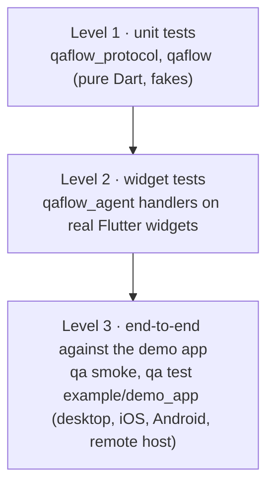

# 6. Testing strategy

A tool that tests other apps has to be trustworthy itself. Testing happens at three levels, from fast unit tests up to real apps on real devices.



## The suites at a glance

Counts are from a full local run on 2026-11-10 with Flutter 3.47.5; they move with every change.

| Package | Runner | Test files | Tests | Time |
|---|---|---|---|---|
| `packages/qaflow_protocol` | `dart test` | 5 | 17 | under a second |
| `packages/qaflow` | `dart test` | 43 | 548 passed, 1 skipped (the `integration`-tagged loopback test) | about 45 s |
| `packages/qaflow_agent` | `flutter test` | 10 | 80 | a few seconds |
| `example/demo_app` | `flutter test` | 1 | 4 | a few seconds |

About 650 tests in all, plus the end-to-end flows of level 3, which need a real desktop. QAFlow Studio has its own suite and self-test flows in its repository.

## Running things locally

The workspace is built and tested with **Flutter 3.47.5** (Dart 3.13; the packages need Dart 3.12 or later). Flutter 3.47 needs macOS 12 or later, and the Xcode projects target 12.0. On the development Mac it comes from fvm (`~/fvm/versions/3.47.5`, the global fvm version). Either put it first on `PATH` or prefix commands with `fvm`:

```bash
export PATH="$HOME/fvm/versions/3.47.5/bin:$PATH"   # or: fvm flutter …, fvm dart …
flutter pub get                                       # once, at the workspace root
```

From the workspace root:

```bash
dart format --output=none --set-exit-if-changed .     # page width 120 (analysis_options.yaml)
flutter analyze

(cd packages/qaflow_protocol && dart test)
(cd packages/qaflow && dart test)
(cd packages/qaflow_agent && flutter test --timeout 60s)
(cd example/demo_app && flutter test)
```

One file or one test: `dart test test/flow_parser_test.dart`, or `flutter test test/features/flow_editor_test.dart --plain-name 'Ctrl+Space'`.

**The `integration` tag.** [`packages/qaflow/dart_test.yaml`](../../packages/qaflow/dart_test.yaml) declares an `integration` tag that is skipped by default ("Builds and drives a real app; run with dart test -P integration") and an `integration` preset that includes only that tag and runs skipped tests. The one tagged test today is [`remote_integration_test.dart`](../../packages/qaflow/test/remote_integration_test.dart) (`@TestOn('mac-os')`): it starts a `qa host` in process on loopback and runs the demo app's macOS flows through it. Run it on a Mac with a visible desktop:

```bash
cd packages/qaflow
dart test -P integration test/remote_integration_test.dart
```

It passed in 44 s when it was written. Level 3 and 4 commands are below.

## Level 1: unit tests

**`qaflow_protocol`** covers every type's JSON round trip, the error codes' wire names, chord parsing (`KeyChord.namedKeys`), screenshot transfer, and a test that pins the number of protocol methods. Adding or removing a method fails that test, which forces a deliberate protocol change.

**`qaflow`** tests every layer without launching a real app, using fakes:

| Fake | Does |
|---|---|
| [`FakeProcess`](../../packages/qaflow/test/fake_process.dart) | Scripts a process's stdout, stderr and exit code, and records what was written to stdin. The launcher tests replay a realistic `flutter run --machine` transcript through it. |
| [`FakeVmService`](../../packages/qaflow/test/fake_vm_service.dart) | Scripts isolates, isolate events and extension responses. It can make a reply hang, to model a frozen app and test the 60 s call limit. |
| [`flow_test_support.dart`](../../packages/qaflow/test/flow_test_support.dart) | A fake `AppSession` and driver for the flow runner |
| [`host_fakes.dart`](../../packages/qaflow/test/host_fakes.dart) | Fake launchers and devices behind an in-process `qa host` |

What the suites cover, by area:

| Area | Test files | Covers |
|---|---|---|
| Launch and session | `flutter_run_launcher_test`, `binary_launcher_test`, `daemon_protocol_test`, `flutter_sdk_test`, `prebuilt_inspector_test`, `vm_connection_test`, `qa_driver_test`, `qa_session_test`, `run_until_test` | Launchers, SDK discovery (including a hung login shell), the prebuilt check, VM connection (hot-restart following, error mapping), the driver's retry policy, the session lifecycle |
| Processes | `process_tree_test`, `termination_test` | Killing a whole tree read from `ps`, start-time checks against pid reuse, `taskkill` on Windows, SIGINT/SIGTERM handling and the second-signal force kill |
| Devices | `device_target_test`, `device_manager_test`, `ios_devices_test`, `android_devices_test`, `android_sdk_test` | Device strings, discovery, boot and readiness, the SIM wait, orientation and deep links over faked `simctl`, `emulator` and `adb` |
| Flows | `flow_parser_test`, `flow_model_test`, `flow_schema_test`, `flow_variables_test`, `flow_discovery_test`, `flow_executor_test`, `flow_runner_test`, `selectors_test`, `step_writer_test` | The parser (asserting the **exact line and column** of every error), the schema, variables, discovery and tags, each command's execution, resets, `launchApp` freshness, retries and flakiness, infrastructure errors, stopping and previews, and the recorder's YAML |
| The schema agreement | `flow_schema_test` | `FlowSchema` against the parser: the same commands in the same order, every `allowOnly` key set in `parser.dart` equal to the schema's, every example parsing. A change to the parser that the schema doesn't follow fails here (chapter 5, D19) |
| Screenshots | `assert_screenshot_test`, `baseline_store_test`, `image_compare_test`, `qa_driver_screenshot_test` | Modes, device keys, ignore rects scaled by pixel ratio, thresholds, atomic baseline writes |
| Reports | `results_test`, `console_reporter_test`, `junit_reporter_test`, `html_reporter_test` | The three reports from one model. The JUnit test validates its XML with `xmllint` and skips itself when the tool is missing |
| Remote hosts | `host_protocol_test`, `host_server_test`, `remote_client_test`, `qa_session_remote_test`, `remote_integration_test` | Message encoding, tokens and 401s, the one-client lock, the disconnect grace (fake clock), the VM proxy, `RemoteLauncher` and `RemoteDevices` against an in-process host, the device default on a host, and the loopback integration run |
| Config and CLI | `project_config_test`, `project_file_test`, `cli_test`, `test_run_test`, `smoke_runner_test` | The project file and its error positions, `host:`, and [`cli_test`](../../packages/qaflow/test/cli_test.dart), which runs `bin/qa.dart` as a real subprocess to check exit codes and messages |

## Level 2: widget tests

**`qaflow_agent`** pumps real Flutter UIs headless and calls the agent's handlers directly:

- the finder's matching and clipping rules;
- that a tap on a covered button is `obscured`;
- that `ctrl+a` reaches `Shortcuts`/`Actions`, and that an Enter a widget above the field handles is not also typed or submitted;
- that a text edit runs input formatters;
- that a spinner settles as `stable`;
- that a hidden window answers `not_ready` instead of hanging;
- touch taps on touch platforms (`pointer_test`) and the mobile commands (`mobile_test`);
- that `elementAt` reports the control the mirror outlines (`snapshot_test`).

The helpers in [`test/helpers.dart`](../../packages/qaflow_agent/test/helpers.dart) pump frames while agent code awaits real frames, and deliver lifecycle changes the way the engine does. Run it with `--timeout 60s`, as CI did.

## Level 3: end to end against the demo app

[`example/demo_app`](../../example/demo_app/) is a small Flutter app with a login screen, a long list, a dialog, a tooltip and a few mobile-only screens. Every interactive widget has both a `ValueKey<String>` and a `Semantics` identifier. Its `.qa/` holds three project files:

| Project file | Runs | Notes |
|---|---|---|
| `.qa/project.yaml` | macOS | Excludes the `mobile` tag |
| `.qa/project.ios.yaml` | An iOS simulator | Debug only |
| `.qa/project.android.yaml` | An Android emulator (`qa_pixel_baklava` locally) | Debug or profile |

The flows are in `.qa/flows` (with `mobile/` for back, deep links, keyboard, orientation and swipe), subflows in `.qa/subflows`, committed screenshot baselines in `.qa/baselines/<device key>/`, and a deliberately failing flow in `.qa/failing/`, used to check failure reports, screenshots and JUnit output.

- **`qa smoke`** runs a fixed Dart scenario of about 20 steps (login, scroll to item 150, dialog, hover, editing) in debug and profile:

  ```bash
  dart run qaflow:qa smoke --project example/demo_app --mode profile --out qa-out/smoke
  ```

- **`qa test`** runs the demo's YAML flows:

  ```bash
  dart run qaflow:qa test --config example/demo_app/.qa/project.yaml
  dart run qaflow:qa test --config example/demo_app/.qa/project.ios.yaml          # boots the simulator if needed
  dart run qaflow:qa test --config example/demo_app/.qa/project.android.yaml      # boots the AVD if needed
  dart run qaflow:qa test --config example/demo_app/.qa/project.yaml example/demo_app/.qa/failing   # fails on purpose
  ```

- **Prebuilt binaries** can be tested the same way:

  ```bash
  dart run qaflow:qa test example/demo_app/.qa/flows --binary example/demo_app/build/macos/Build/Products/Profile/demo_app.app --mode profile
  ```

- **Through a remote host** on loopback: the `integration` test above, or by hand with `qa host` in one terminal and `qa test … --host ws://127.0.0.1:7777 --host-project <absolute demo_app path>` with `QA_HOST_TOKEN` set in another ([chapter 11](11-remote-hosts.md)).

The screenshot flow compares against the committed `macos-27.0`, `ios-iPhone_17_Pro-iOS_26.5` and `android-qa_pixel_baklava-Android_15_API_35` baselines. Another machine or OS version records its own set on the first run (chapter 5, D18).

These need a desktop with a visible window (for the macOS app), and Xcode or the Android SDK for the mobile files.

## Continuous integration

[`ci.yml`](../../.github/workflows/ci.yml) ("CI"), on every pull request and push to `main`, on Ubuntu, with Flutter 3.47.5:

1. installs `xmllint`, then `flutter pub get`;
2. `dart format --output=none --set-exit-if-changed .`;
3. `flutter analyze` across the workspace;
4. `dart test` for `qaflow_protocol` and `qaflow`;
5. `flutter test` for `qaflow_agent` (with `--timeout 60s`) and the demo app.

[`e2e.yml`](../../.github/workflows/e2e.yml) ("End-to-end") runs level 3. It runs on demand from the Actions tab until the mobile jobs are reliable:

- **macOS job** (`macos-15`): builds the demo app from `lib/main_qa.dart`; runs its macOS flows; picks the runner's newest iPhone simulator, boots it, builds for it and runs `project.ios.yaml` (`QA_IOS_BOOT_TIMEOUT: '600'`); keeps every run folder as the `e2e-runs` artifact.
- **Android job** (`ubuntu-latest`): frees disk space, builds the debug APK, enables KVM, creates a cached AVD (API 34, x86_64) whose emulator is cold-booted (`-no-snapshot`) through `reactivecircus/android-emulator-runner`, and runs `project.android.yaml` with `--device android:emulator-5554` (`QA_ANDROID_BOOT_TIMEOUT: '600'`); keeps the run folders as `e2e-android-runs`.
- The demo-flow steps set `QA_BASELINE_KEY_SUFFIX: ci` and pass `--baselines record`, so CI records its own baselines (kept with the artifacts) instead of comparing against the Mac's.

## Before publishing the packages

Two checks guard the pub.dev packages. Neither runs in CI; run them by hand before a release ([`tool/publish.md`](../../tool/publish.md) has the order and commands).

- **Dry run.** `dart pub publish --dry-run` in `packages/qaflow_protocol`, `packages/qaflow_agent` and `packages/qaflow` must end with `Package has 0 warnings.` It does not catch a wrong publish order, because inside the workspace every `^0.1.0` dependency resolves locally.
- **Outside the repo.** Inside the workspace a path dependency or a path activation resolves through the workspace, so it proves nothing about what pub.dev would serve. Instead:
  1. `dart pub publish --to-archive <scratch>/<pkg>.tar.gz` for each package, then extract each archive into its own folder.
  2. In each extracted copy, delete `resolution: workspace` and add `dependency_overrides` with `path:` entries to the other extracted copies (the `^0.1.0` constraints can't resolve from pub.dev before publishing).
  3. `flutter create --platforms=macos outside_app`, depend on the extracted `qaflow_agent` (plus an override for the extracted `qaflow_protocol`), add `lib/main_qa.dart` and a `.qa/project.yaml` with a flow of `launchApp` then `assertVisible: Flutter Demo Home Page`.
  4. `dart pub global activate --source path <scratch>/qaflow`, then `qaflow test --config outside_app/.qa/project.yaml`. The flow must pass. Afterwards `dart pub global deactivate qaflow`.

  This also proves the archives contain everything needed at run time, such as `bin/qa.dart`. It last passed on 2026-11-10 (macOS 27.0, Flutter 3.47.5).

## Writing new tests: conventions

- **Time.** Prefer injected clocks, fakes and timeouts over real time. Where a test has to measure real time, allow for clock skew: the timer and `Stopwatch` read different clocks, and CI once measured a 200 ms timeout as 199.58 ms.
- **Processes.** Tests that start real processes kill only a pid that is still their own (`ProcessTree` checks the start time). Use `ProcessTree.direct` for a faked process whose pid isn't real.
- **Error positions.** A new flow command or project-file key needs a parser test asserting the error position of its invalid forms, and an entry in `FlowSchema` (the agreement test fails until it has one).
- **Real apps or hosts.** A test that builds and drives a real app belongs under the `integration` tag, so the default `dart test` stays fast and headless.
