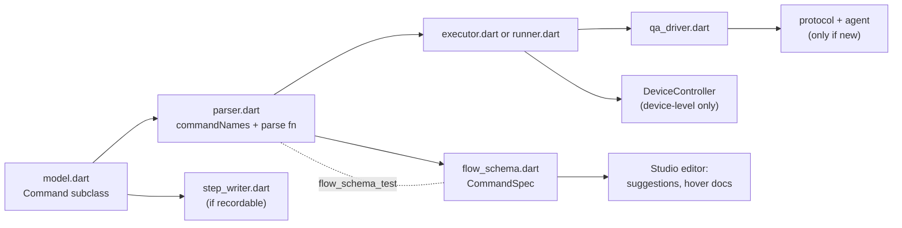

# 8. Extending QAFlow

How to add to QAFlow itself: its CI workflows, a new flow command, a new protocol method, and running its own end-to-end tests. For where each file lives, see [chapter 12](12-code-map.md).

Using QAFlow in your own app is covered by the user guides: [Integration and CI](../integration.md) (adding the agent, the project file, running flows, baselines, CI) and [Remote hosts](../remote-hosts.md) (running the app on another machine).

## 8.1 The toolkit's own workflows

The repository has three GitHub Actions workflows in [`.github/workflows/`](../../.github/workflows/):

| Workflow | Runs on | Does |
|---|---|---|
| `ci.yml` ("CI") | Pull requests and pushes to `main`, on `ubuntu-latest` | `dart format --set-exit-if-changed`, `flutter analyze`, then the unit and widget tests of `qaflow_protocol`, `qaflow`, `qaflow_agent` and the demo app. Installs `xmllint` for the JUnit test |
| `e2e.yml` ("End-to-end"), job `e2e` | Manual dispatch only, for now, on `macos-15` | Builds the demo app; runs its flows on macOS; picks the newest iPhone simulator, boots it, builds and runs the flows there; uploads `qa-out/` and the `*-ci` baselines |
| `e2e.yml`, job `android` | The same trigger, on `ubuntu-latest` | Frees disk space, builds the APK, enables KVM, caches an API 34 x86_64 AVD, cold-boots it and runs the demo flows with `--device android:emulator-5554` |
| `publish.yml` ("Publish") | Tags `qaflow_protocol-v*`, `qaflow_agent-v*`, `qaflow-v*` | Checks the tag against the package's version and CHANGELOG, then publishes that package to pub.dev through GitHub's OIDC token ([`tool/publish.md`](../../tool/publish.md)) |

Every device step sets `QA_BASELINE_KEY_SUFFIX: ci` and passes `--baselines record`. Chapter 6 says what each suite covers.

## 8.2 Add a flow command

The path a new command takes, end to end. Example: a `doubleClickOn` command.



1. **Model.** Add a `Command` subclass in [`flow/model.dart`](../../packages/qaflow/lib/src/flow/model.dart) with its fields, its `name` (the YAML word) and a `describe()` that returns the title shown in reports. `Command` is `sealed`, so the executor's `switch` stops compiling until step 4 handles it.
2. **Parser.** In [`flow/parser.dart`](../../packages/qaflow/lib/src/flow/parser.dart):
   - add the name to `FlowParser.commandNames`, which also feeds the "did you mean" suggestions;
   - add a case to the `switch` in `command()` that dispatches command names;
   - write a parse function that uses `withOptions`, `allowOnly` and the typed helpers (`string`, `integer`, `boolean`, `selector`, `point`, `direction`, `condition`), so errors get line and column. Keep the `allowOnly(o.rest, {…}, 'name')` call in that literal shape: the schema test reads it from the source;
   - reject options that aren't supported, rather than ignoring them. If Maestro has the command and you are not adding it, it belongs in `unsupportedCommands` instead.
3. **Schema.** Add a `CommandSpec` to `FlowSchema.commands` in [`flow/flow_schema.dart`](../../packages/qaflow/lib/src/flow/flow_schema.dart), **at the same position as in `commandNames`**: its description, whether it is `bare`, its `scalar` kind and `scalarExample`, `selectorForm` if its map is a selector, and a `KeySpec` (kind, `required`, example, description) for every key its `allowOnly` accepts. Run [`flow_schema_test`](../../packages/qaflow/test/flow_schema_test.dart): it fails until the order, the key sets, the examples and the required keys agree with the parser. QAFlow Studio's editor then suggests the command, its template, its keys and values, and shows its hover doc, with no editor change, as long as its value kinds are existing `ValueKind`s. A new `ValueKind` needs handling in the editor's `completions.dart` and `editor_actions.dart`.
4. **Execution.**
   - **UI commands** go in [`flow/executor.dart`](../../packages/qaflow/lib/src/flow/executor.dart), as driver calls. Use the driver's retrying methods for anything that finds an element. Return `CommandOutcome.none`, or artifacts and a note.
   - **Lifecycle or composite commands** go in [`flow/runner.dart`](../../packages/qaflow/lib/src/flow/runner.dart)'s `_execute`, and in the executor's list of commands it refuses.
   - If the command does not act on the UI, exclude it in `FlowRunner._isUi`, which controls previews and `--screenshots all`.
   - **Device-level commands** (like `setOrientation`, `openLink`) go through `DeviceController` in [`device/device.dart`](../../packages/qaflow/lib/src/device/device.dart): add the method there and implement it in `AndroidDeviceController`, `IosDeviceController`, `UnsupportedDeviceController` (which throws `unsupported`) and `RemoteDeviceController`, which forwards it to a QA host as a `device.*` call that [`remote/host_server.dart`](../../packages/qaflow/lib/src/remote/host_server.dart) must also handle.
5. **Agent and protocol**, only if the command needs something the agent cannot do yet: follow 8.3.
6. **Recording (optional).** If QAFlow Studio should record it, add a `Record…` step to [`flow/step_writer.dart`](../../packages/qaflow/lib/src/flow/step_writer.dart) and handle it in the recorder's `_act` (`inspect_controller.dart`). If the editor's element picker should offer it, add it to `pickerCommands` in `editor_actions.dart`.
7. **Tests:**
   - parser tests for every form and every error position (`flow_parser_test.dart`);
   - `flow_schema_test.dart` passing;
   - executor or runner tests against the fakes in `flow_test_support.dart`;
   - for recording, a `step_writer_test` that checks the written YAML parses back to the same thing.
8. **Docs:** the [command reference](../commands.md#flow-commands) (and chapter 3's command table), the project README's command table, and QAFlow Studio's starter flows if it's commonly needed.

## 8.3 Add a protocol method

1. **Protocol.** Add the method to `QaMethod` in [`qaflow_protocol/lib/src/method.dart`](../../packages/qaflow_protocol/lib/src/method.dart). It is exposed as `ext.qa.<name>`. The method-count test in `qaflow_protocol/test/response_test.dart` will fail until you update it, which is deliberate. If you change an existing JSON shape (not just add a method), bump `protocolVersion` in `qaflow_protocol/lib/src/version.dart`.
2. **Agent.**
   - Handle it in [`qaflow_agent/lib/src/handlers.dart`](../../packages/qaflow_agent/lib/src/handlers.dart).
   - Validate arguments with the helpers in `args.dart`, which give `bad_request`.
   - Throw `QaException` with a precise code (`unsupported` for a platform that cannot do it).
   - Call `Frames.requireRunning()` first if the method needs frames.
   - Bound every wait.
3. **Driver.** Add a typed method to [`qa_driver.dart`](../../packages/qaflow/lib/src/driver/qa_driver.dart) and decide whether it goes through `_retry`. Retry anything that searches for an element; never retry anything with side effects that mustn't happen twice. Nothing changes for QA hosts: the host proxies the VM service, so `ext.qa.*` calls reach a remote app unchanged.
4. **Tests:**
   - a widget test in `qaflow_agent/test/` against a real widget tree;
   - a driver test with the fake transport;

## 8.4 Run the toolkit's own end-to-end tests locally

From the repository root, with the windows visible:

```bash
dart run qaflow:qa test --config example/demo_app/.qa/project.yaml           # the demo app's flows on macOS
dart run qaflow:qa test --config example/demo_app/.qa/project.ios.yaml       # on an iOS simulator
dart run qaflow:qa test --config example/demo_app/.qa/project.android.yaml   # on an Android emulator
```

The mobile project files name the local devices (`ios:iPhone 17 Pro`, `android:qa_pixel_baklava`); pass `--device` for others. The QA host loopback test is tagged `integration` and skipped by default: run it with `dart test -P integration test/remote_integration_test.dart` from `packages/qaflow` (macOS only). Chapter 6 explains what each suite covers.
