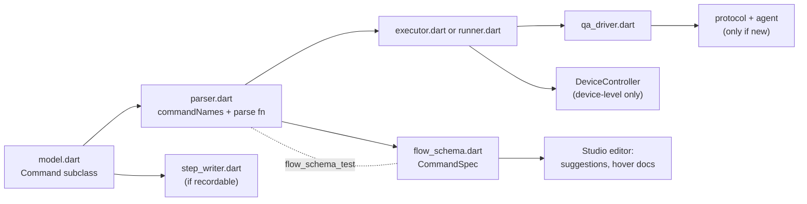

# 8. Integrating and extending: how-to guides

Step-by-step guides for the common jobs: testing your own app, running flows in CI, running on another machine, and adding to the toolkit itself. For where each file lives, see [chapter 12](12-code-map.md).

## 8.1 Test your own Flutter app

### 1. Prerequisites

- Flutter 3.47 or later, the version QAFlow is built and tested with (`qaflow_agent` needs Dart 3.12). Flutter 3.47 needs macOS 12 or later to build macOS apps.
- A target the toolkit can drive:

  | Target | Status | Notes |
  |---|---|---|
  | macOS desktop | Verified | `flutter create --platforms=macos .` if the app has no macOS folder yet |
  | iOS simulator | Verified | Xcode with a simulator runtime; **debug only** (Flutter refuses profile on a simulator) |
  | Android emulator | Verified | An Android SDK with an AVD (`ANDROID_HOME` or `ANDROID_SDK_ROOT` if not in the default place); debug and profile |
  | Windows, Linux desktop | Written, unverified | Linux needs a visible display |

- Release builds cannot be driven: the VM service the toolkit talks through only exists in debug and profile builds.

### 2. Add the agent

```bash
flutter pub add qaflow_agent
```

To try an unreleased change, depend on the repository instead, pinned to a tag or commit:

```yaml
dependencies:
  qaflow_agent:
    git:
      url: https://github.com/dmtorks/qaflow.git
      path: packages/qaflow_agent
      ref: <tag or commit>      # pin it, so builds don't change under you
```

It must be a regular dependency, not a dev dependency, because a file in `lib/` imports it. It still stays out of what you ship: the driver only launches the separate `lib/main_qa.dart` entrypoint, `lib/main.dart` never imports the agent, and `QaAgent.install()` throws when `kReleaseMode` is true.

### 3. Add the QA entrypoint

Create `lib/main_qa.dart`. If `main.dart` does setup before `runApp`, move it into a shared function, so tests start the app the way users do:

```dart
import 'package:flutter/widgets.dart';
import 'package:qaflow_agent/qaflow_agent.dart';

import 'bootstrap.dart';

void main() async {
  QaAgent.install(onReset: clearLocalData); // onReset is optional; it backs clearState
  runApp(QaAgent.wrap(await bootstrap()));
}
```

- **`QaAgent.wrap`** goes around the outermost widget given to `runApp`.
- **`onReset`** should clear whatever your app persists: preferences, databases, files. Between flows the app is restarted, but persisted data survives a restart. Without it, `clearState` and `launchApp: {clearState: true}` fail with `unsupported`.
- The project file's `app.entrypoint` (or `--entrypoint`) points elsewhere if you name it differently.

### 4. Platform setup

- **macOS.** Debug and profile builds use `macos/Runner/DebugProfile.entitlements`. Flutter's default file already has what the VM service needs:

  ```xml
  <key>com.apple.security.network.server</key>
  <true/>
  ```

  Screenshots are transferred inline, so the App Sandbox needs nothing more.
- **Android.** Flutter's default `debug` and `profile` manifests already declare `android.permission.INTERNET`, which the VM service needs. Keep it.
- **iOS.** Nothing to add for a simulator.
- **Mobile builds** are launched from source (`app.source`); prebuilt apps are desktop only.

### 5. Give widgets stable ids

Text works with no changes. For anything whose text changes or repeats, add `key: const ValueKey('login')` or `Semantics(identifier: 'login', …)`. Only `ValueKey<String>` keys are recognised.

### 6. Add the project file and flows

In QAFlow Studio, **Add project folder…** creates `.qa/project.yaml` and offers starter flows. Or create them by hand (chapter 2, chapter 7). A minimal file:

```yaml
app:
  source: .
flows:
  folders: [.qa/flows]
```

Commit `.qa/` (flows, subflows, baselines) and add `qa-out/` to `.gitignore`. To run the same flows on several targets, keep one project file per target, as the demo app does with `.qa/project.yaml`, `.qa/project.ios.yaml` (`device: ios:iPhone 17 Pro`) and `.qa/project.android.yaml` (`device: android:<AVD>`), and use tags (`mobile`, `desktop`) with `excludeTags` to keep platform-specific flows apart.

### 7. Run

- **In QAFlow Studio:** ⌘R or ⇧⌘R.
- **From a terminal:** `qa test --config <app>/.qa/project.yaml`. Get `qa` with `dart pub global activate qaflow` once it is on pub.dev; until then, `dart pub global activate --source path <checkout>/packages/qaflow`, or `dart run qaflow:qa …` from the toolkit folder. Both executables, `qa` and `qaflow`, run the same CLI. Add `--device "ios:iPhone 17 Pro"` or `--device android:<AVD>` to pick a device without editing the file.
- Check flows without launching anything: `qa validate --config <app>/.qa/project.yaml`.

### 8. Screenshot baselines

If your flows use `assertScreenshot`, the first run records baselines under `.qa/baselines/<device key>/` (each step warns `baseline recorded`). Review and commit them. Each machine and OS version has its own device key, so another Mac or OS version records its own set. Once a set is committed, run with `--baselines strict` (or `flows.baselines: strict`) so a missing baseline fails instead of being recorded. Accept an intended change in QAFlow Studio's run detail, or rerun with `--baselines update`.

### Testing a prebuilt build

Build in profile mode from the QA entrypoint, then use **Add prebuilt app…**:

```bash
flutter build macos --profile -t lib/main_qa.dart
```

QAFlow Studio checks a chosen `.app` straight away (chapter 2.1):

- **Release builds** are refused with this command.
- **Builds without the agent** get a warning you can override.

## 8.2 Run flows in CI

A CI job needs the `qa` command, Flutter, and a machine that can show the app: a **macOS machine with a logged-in desktop session** for macOS apps, a simulator for iOS, an emulator for Android.

```bash
dart pub global activate qaflow
(cd my_app && flutter build macos --debug -t lib/main_qa.dart)    # build first: a cold build can exceed the launch timeout
(cd my_app && qa test --env PASSWORD="$PASSWORD")
```

- **Exit code:** 0 when every flow passed; flaky counts as passed. 1 for failures, 64 for a usage mistake (chapter 7.6).
- **Reports:** publish `qa-out/*/junit.xml` to your CI's test report, and keep the whole `qa-out/` folder as an artifact. Its `report.html` and screenshots work offline.
- **Secrets:** pass them as `--env NAME=…` or as environment variables of the same name.
- **Build first.** Build the app in a step before `qa test`, so the flows spend their time testing rather than compiling inside the app-start timeout.

### Mobile in CI

- **iOS.** On a macOS runner, pick a simulator the image has, boot it (`xcrun simctl boot <udid>` and `xcrun simctl bootstatus <udid> -b`) before building so it has time to settle, build with `flutter build ios --simulator --debug -t lib/main_qa.dart`, then `qa test --device "ios:<udid>"`. Set `QA_IOS_BOOT_TIMEOUT` (seconds) if a cold boot takes longer than 120 s.
- **Android.** On a Linux runner with KVM, start the emulator with an action such as `reactivecircus/android-emulator-runner` and point `qa` at its serial: `--device android:emulator-5554`. Build the APK first (`flutter build apk --debug -t lib/main_qa.dart`). Set `QA_ANDROID_BOOT_TIMEOUT` if needed. In the toolkit's own CI a cold boot (`-no-snapshot`) was needed: restoring a cached snapshot left the software-GL emulator with a zero-size app window. Hosted runners may also need disk space freed first.

### Screenshot baselines in CI

A hosted runner renders differently from your Mac but can have the same device key. Set `QA_BASELINE_KEY_SUFFIX=ci` so CI reads and writes its own set (`macos-<version>-ci`, …). Run with `--baselines record` until a CI set is committed, upload `.qa/baselines/*-ci/` with the reports, commit the reviewed images, then switch to `--baselines strict`. `actions/upload-artifact@v4` skips paths under a dot folder such as `.qa/` unless you set `include-hidden-files: true`.

### The toolkit's own workflows

The repository has three GitHub Actions workflows in [`.github/workflows/`](../../.github/workflows/):

| Workflow | Runs on | Does |
|---|---|---|
| `ci.yml` ("CI") | Pull requests and pushes to `main`, on `ubuntu-latest` | `dart format --set-exit-if-changed`, `flutter analyze`, then the unit and widget tests of `qaflow_protocol`, `qaflow`, `qaflow_agent` and the demo app. Installs `xmllint` for the JUnit test |
| `e2e.yml` ("End-to-end"), job `e2e` | Manual dispatch only, for now, on `macos-15` | Builds the demo app; runs its flows on macOS; picks the newest iPhone simulator, boots it, builds and runs the flows there; uploads `qa-out/` and the `*-ci` baselines |
| `e2e.yml`, job `android` | The same trigger, on `ubuntu-latest` | Frees disk space, builds the APK, enables KVM, caches an API 34 x86_64 AVD, cold-boots it and runs the demo flows with `--device android:emulator-5554` |
| `publish.yml` ("Publish") | Tags `qaflow_protocol-v*`, `qaflow_agent-v*`, `qaflow-v*` | Checks the tag against the package's version and CHANGELOG, then publishes that package to pub.dev through GitHub's OIDC token ([`tool/publish.md`](../../tool/publish.md)) |

Every device step sets `QA_BASELINE_KEY_SUFFIX: ci` and passes `--baselines record`. Chapter 6 says what each suite covers.

## 8.3 Run on another machine: QA hosts

When the app has to run somewhere other than where `qa` or QAFlow Studio runs (a Windows desktop app driven from a Mac, a Mac with simulators driven from a Linux CI box), start a QA host on the machine that runs the app:

```bash
dart run qaflow:qa host            # on the machine that runs the app; prints a token once
ssh -N -L 7777:127.0.0.1:7777 <user>@<that machine>   # on the client
```

Then, on the client, either add `host: {url: ws://127.0.0.1:7777, project: <project folder on the host>}` to `.qa/project.yaml`, or pass `--host ws://127.0.0.1:7777 --host-project <path>`, and set `QA_HOST_TOKEN` (QAFlow Studio keeps hosts and tokens in its settings). The host builds, launches and boots devices; flows, reports and baselines stay on the client. The host listens on `127.0.0.1` only and serves one client at a time; the SSH tunnel is the network path. [Chapter 11](11-remote-hosts.md) covers the protocol, security and limits.

## 8.4 Add a flow command

The path a new command takes, end to end. Example: a `doubleClickOn` command.



1. **Model.** Add a `Command` subclass in [`flow/model.dart`](../../packages/qaflow/lib/src/flow/model.dart) with its fields, its `name` (the YAML word) and a `describe()` that returns the title shown in reports. `Command` is `sealed`, so the executor's `switch` stops compiling until step 4 handles it.
2. **Parser.** In [`flow/parser.dart`](../../packages/qaflow/lib/src/flow/parser.dart):
   - add the name to `FlowParser.commandNames`, which also feeds the "did you mean" suggestions;
   - add a case to the `switch` in `command()` that dispatches command names;
   - write a parse function that uses `withOptions`, `allowOnly` and the typed helpers (`string`, `integer`, `boolean`, `selector`, `point`, `direction`, `condition`), so errors get line and column. Keep the `allowOnly(o.rest, {…}, 'name')` call in that literal shape: the schema test reads it from the source;
   - reject options that aren't supported, rather than ignoring them. If Maestro has the command and you are not adding it, it belongs in `unsupportedCommands` instead.
3. **Schema.** Add a `CommandSpec` to `FlowSchema.commands` in [`flow/flow_schema.dart`](../../packages/qaflow/lib/src/flow/flow_schema.dart), **at the same position as in `commandNames`**: its description, whether it is `bare`, its `scalar` kind and `scalarExample`, `selectorForm` if its map is a selector, and a `KeySpec` (kind, `required`, example, description) for every key its `allowOnly` accepts. Run [`flow_schema_test`](../../packages/qaflow/test/flow_schema_test.dart): it fails until the order, the key sets, the examples and the required keys agree with the parser. QAFlow Studio's editor then suggests the command, its template, its keys and values, and shows its hover doc, with no editor change, as long as its value kinds are existing `ValueKind`s. A new `ValueKind` needs handling in the editor's `completions.dart` and `editor_actions.dart`.
4. **Execution.**
   - **UI commands** go in [`flow/executor.dart`](../../packages/qaflow/lib/src/flow/executor.dart), as driver calls. Use the driver's retrying methods for anything that finds an element. Return `CommandOutcome.none`, or artifacts and a note.
   - **Lifecycle or composite commands** go in [`flow/runner.dart`](../../packages/qaflow/lib/src/flow/runner.dart)'s `_execute`, and in the executor's list of commands it refuses.
   - If the command does not act on the UI, exclude it in `FlowRunner._isUi`, which controls previews and `--screenshots all`.
   - **Device-level commands** (like `setOrientation`, `openLink`) go through `DeviceController` in [`device/device.dart`](../../packages/qaflow/lib/src/device/device.dart): add the method there and implement it in `AndroidDeviceController`, `IosDeviceController`, `UnsupportedDeviceController` (which throws `unsupported`) and `RemoteDeviceController`, which forwards it to a QA host as a `device.*` call that [`remote/host_server.dart`](../../packages/qaflow/lib/src/remote/host_server.dart) must also handle.
5. **Agent and protocol**, only if the command needs something the agent cannot do yet: follow 8.5.
6. **Recording (optional).** If QAFlow Studio should record it, add a `Record…` step to [`flow/step_writer.dart`](../../packages/qaflow/lib/src/flow/step_writer.dart) and handle it in the recorder's `_act` (`inspect_controller.dart`). If the editor's element picker should offer it, add it to `pickerCommands` in `editor_actions.dart`.
7. **Tests:**
   - parser tests for every form and every error position (`flow_parser_test.dart`);
   - `flow_schema_test.dart` passing;
   - executor or runner tests against the fakes in `flow_test_support.dart`;
   - for recording, a `step_writer_test` that checks the written YAML parses back to the same thing.
8. **Docs:** chapter 7.1 (and chapter 3's command table), the project README's command table, and QAFlow Studio's starter flows if it's commonly needed.

## 8.5 Add a protocol method

1. **Protocol.** Add the method to `QaMethod` in [`qaflow_protocol/lib/src/method.dart`](../../packages/qaflow_protocol/lib/src/method.dart). It is exposed as `ext.qa.<name>`. The method-count test in `qaflow_protocol/test/response_test.dart` will fail until you update it, which is deliberate. If you change an existing JSON shape (not just add a method), bump `protocolVersion` in `qaflow_protocol/lib/src/version.dart`.
2. **Agent.**
   - Handle it in [`qaflow_agent/lib/src/handlers.dart`](../../packages/qaflow_agent/lib/src/handlers.dart).
   - Validate arguments with the helpers in `args.dart`, which give `bad_request`.
   - Throw `QaException` with a precise code (`unsupported` for a platform that cannot do it).
   - Call `Frames.requireRunning()` first if the method needs frames.
   - Bound every wait.
3. **Driver.** Add a typed method to [`qa_driver.dart`](../../packages/qaflow/lib/src/driver/qa_driver.dart) and decide whether it goes through `_retry`. Retry anything that searches for an element; never retry anything with side effects that mustn't happen twice. Nothing changes for QA hosts: the host proxies the VM service, so `ext.qa.*` calls reach a remote app unchanged.
4. **Tests:**
   - a widget test in `qaflow_agent/test/` against a real widget tree;
   - a driver test with the fake transport;

## 8.6 Run the toolkit's own end-to-end tests locally

From the repository root, with the windows visible:

```bash
dart run qaflow:qa test --config example/demo_app/.qa/project.yaml           # the demo app's flows on macOS
dart run qaflow:qa test --config example/demo_app/.qa/project.ios.yaml       # on an iOS simulator
dart run qaflow:qa test --config example/demo_app/.qa/project.android.yaml   # on an Android emulator
```

The mobile project files name the local devices (`ios:iPhone 17 Pro`, `android:qa_pixel_baklava`); pass `--device` for others. The QA host loopback test is tagged `integration` and skipped by default: run it with `dart test -P integration test/remote_integration_test.dart` from `packages/qaflow` (macOS only). Chapter 6 explains what each suite covers.
