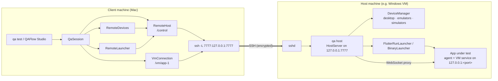
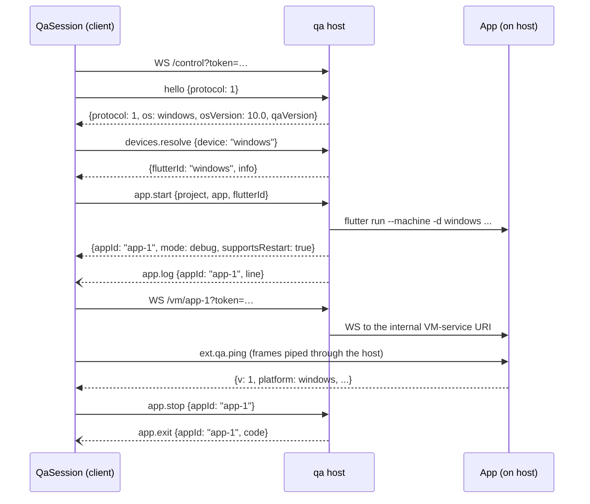

# 11. Remote hosts: running the app on another machine

A **QA host** lets `qa` or QAFlow Studio on one machine (the *client*, typically a Mac) run flows against an app that runs on another machine (the *host*, for example a cloud Windows machine reached by Remote Desktop). The host's desktop counts, and so do its simulators and emulators. The host runs one small daemon, `qa host`; everything else stays on the client.

This chapter covers why it is built this way, the wire protocol, the host daemon, the client classes in `qaflow`, configuration, and how to set up a host. QAFlow Studio's side (the Remote hosts settings, Run on, the device picker) is in chapter 4. The threat model is in [chapter 10.2](10-security.md#102-remote-hosts-threat-model). Paths below are relative to `packages/qaflow/lib/src/remote/` unless noted. The design and its "As built" notes are in `2026-10-10-remote-hosts-design.md`.

## 11.1 Why a host daemon

Everything in chapters 1 and 2 assumes the app runs on the same machine as the driver:

- **The VM service listens on loopback.** The Dart VM service binds `127.0.0.1` on the machine where the app runs. A driver on another machine can't reach it at all, and its URI carries an auth code that only the launcher learns.
- **Launching is local.** `flutter run`, `simctl`, `adb` and `emulator` act on the machine they run on.
- **Some platforms need their own OS.** A Windows desktop app needs Windows; iOS simulators need macOS.

So the host needs a process that can launch apps and boot devices there, and that can pass the VM service through to the client. `qa host` is that process. It reuses the same `DeviceManager`, `FlutterRunLauncher` and `BinaryLauncher` a local session uses, and adds a WebSocket proxy for the VM service.

What stays on the client: the flow files, the parser, the runner, the driver, the reports, screenshots and baselines. Only the app's source (or build) lives on the host. Flows are parsed on the client, so the host never sees them.

## 11.2 Architecture



Two channels share one tunnelled port:

| Path | Carries | Who uses it |
|---|---|---|
| `/control?token=<t>` | JSON-RPC 2.0: devices, app start/stop/restart, device actions; log and exit notifications | `RemoteHost` (and through it `RemoteDevices`, `RemoteLauncher`, `RemoteDeviceController`) |
| `/vm/<appId>?token=<t>` | The app's VM service, frame for frame | `VmConnection`, unchanged from a local session |

Because the second channel is the real VM service, everything above `VmConnection` (the driver, its retry policy, the runner, QAFlow Studio's inspector) works without knowing the app is remote.

## 11.3 The control protocol

[host_protocol.dart](../../packages/qaflow/lib/src/remote/host_protocol.dart). Each WebSocket text frame holds one JSON-RPC 2.0 object. `HostMessage.decode` turns a frame into one of three types and throws `FormatException` for anything else:

| Type | Shape | Direction |
|---|---|---|
| `HostRequest` | `{"jsonrpc":"2.0", "id": 7, "method": "app.start", "params": {...}}` | client → host |
| `HostResponse` | `{"jsonrpc":"2.0", "id": 7, "result": {...}}` or `{"jsonrpc":"2.0", "id": 7, "error": {"code": 1, "message": "...", "data": {...}}}` | host → client |
| `HostNotification` | `{"jsonrpc":"2.0", "method": "app.log", "params": {...}}` (no id) | host → client |

Ids are integers chosen by the client. The host answers each request as soon as its work finishes, so slow requests (a device boot) don't block quick ones, and responses can arrive out of order; the client matches them by id. A frame the host can't decode is dropped (it has no id to answer), and so is a notification from the client.

`hostProtocolVersion` is `1`. It is separate from the agent's `protocolVersion` (chapter 1.2): this one versions the host's control channel, the other the app's `ext.qa.*` calls, which pass through the proxy untouched.

### Methods

| Method | Params | Result |
|---|---|---|
| `hello` | `{protocol}` | `{protocol, os, osVersion, qaVersion}`. `os` is `macos`, `windows` or `linux`; `osVersion` is `major.minor` (`10.0`); `qaVersion` is `qaflow`'s version (`0.1.0`, kept equal to `pubspec.yaml` by a test) |
| `devices.list` | `{}` | `{devices: [DeviceInfo], problems: [{platform, message}]}` |
| `devices.resolve` | `{device}`, a `DeviceTarget` string | `{flutterId, info: DeviceInfo}`, after booting if needed |
| `app.start` | `{project, app: {source?, binary?, entrypoint, mode, flavor?, dartDefines, env}, flutterId}` | `{appId, mode, supportsRestart}` |
| `app.stop` | `{appId}` | `{}`; an unknown id is not an error |
| `app.restart` | `{appId}` | `{}`; a hot restart, as `LaunchedApp.restart` |
| `device.setOrientation` | `{flutterId, orientation}` | `{}`; used for Android (iOS rotates through the agent) |
| `device.resetOrientation` | `{flutterId}` | `{}` |
| `device.openLink` | `{flutterId, link}` | `{}` |

`DeviceInfo` travels as `{platform, name, id, osVersion?, booted}` (`deviceInfoToWire`/`deviceInfoFromWire`). The `device.*` methods need a `flutterId` the host has resolved earlier through `devices.resolve`.

### Notifications from the host

| Notification | Params | When |
|---|---|---|
| `devices.booting` | `{info}` | A `devices.resolve` started booting a device |
| `app.log` | `{appId, line}` | Each output line of an app (the same lines a local launcher's `logs` carry) |
| `app.exit` | `{appId, code}` | The app's process ended. The host first waits up to 2 s for the app's log stream to drain, so the last lines arrive before the exit |

### Errors

`HostError(code, message, data)` is carried as a JSON-RPC `error`:

| Code | Meaning | Raised for |
|---|---|---|
| `1` (`launchFailed`) | The work itself failed | `LaunchException`, `DeviceToolException`, `QaException`, a missing app source or binary on the host, an invalid config, an unknown `appId` for `app.restart`, an unresolved `flutterId`, a client that disconnected while its app was starting |
| `2` (`protocolMismatch`) | `hello` from a different protocol version | `QA host speaks protocol 1; this qa speaks <n>. Update qa on both machines.` |
| `-32601` | Unknown method | `unknown method <name>` |
| `-32602` | Bad params | a `FormatException` (a bad device string), `TypeError` (a missing or mistyped field), or `ArgumentError` |
| `-32603` | Anything else | an unexpected exception |

For a `QaException`, `error.data` is `{"qaCode": "<name>"}` (for example `unsupported`), and `HostError.qaCode` turns it back into a `QaErrorCode`. That way a device action that is unsupported on the host fails the step on the client with the same code it would have locally.

## 11.4 The host: `qa host` and `HostServer`

### The command

```
dart run qaflow:qa host [--port 7777] [--token-file <path>]
```

`HostCommand` in [`bin/qa.dart`](../../packages/qaflow/bin/qa.dart):

1. Loads or creates the token (11.5). The default file is `~/.qa/host-token` (`%USERPROFILE%\.qa\host-token` on Windows).
2. Starts `HostServer` on `127.0.0.1:<port>`. If it can't bind, it prints `qa: could not listen on 127.0.0.1:<port>: <reason>` and exits 1.
3. Prints `QA host listening on 127.0.0.1:<port>`, and always `Anyone with this token can run programs as you on this machine; treat it like an SSH key.`
4. When the token was just created, prints it once with the client setup: the `ssh -N -L` tunnel command, `QA_HOST_TOKEN`, the `host:` block for `project.yaml`, and the `--host`/`--host-project` flags.
5. On Windows, prints the session notes from 11.9.
6. Runs until SIGINT or SIGTERM. Through `exitOnTermination` (chapter 2.1), the first signal closes the server, which stops every app it launched, then kills any launched process trees still running.

### Routing and authentication

[host_server.dart](../../packages/qaflow/lib/src/remote/host_server.dart). `HostServer.start` binds `HttpServer` to `InternetAddress.loopbackIPv4` only, so nothing on the network can connect; the SSH tunnel delivers connections to loopback. Every HTTP request is handled in this order:

1. **Token.** `?token=` must equal the host token, or the answer is **HTTP 401** before any WebSocket upgrade. `_authorized` compares in constant time: it XORs every byte of the expected token with the given one (and the lengths), whatever the first difference, so response timing reveals nothing about how much of a guess was right.
2. **Route.** `/control` and `/vm/<appId>`; anything else is 404. A plain HTTP request to either is 400.

### The control connection: one client at a time

`_acceptControl` upgrades the request to a WebSocket. If a client is already connected (or the host is closing), the new socket is closed at once with **close code 4000** and reason `QA host is in use by another client`. The client reports that reason as its error. One client keeps app and device ownership simple.

Each control and proxy socket has a **5 s ping interval** (`WebSocket.pingInterval`). `dart:io` closes a socket whose peer misses a pong, so a half-open connection (a laptop that dropped off the network while the tunnel's far end stayed up) releases the lock instead of holding it for ever.

### Ownership and the grace period

- The host keeps every app it launched in `_apps`, keyed by an id it chooses: `app-1`, `app-2`, … Each `LaunchedApp` keeps its internal VM-service URI, which never leaves the host.
- When the control connection closes (or misses a pong), the host cancels that client's in-flight device boots at once (their `CancelSignal`s), and starts a **10 s grace timer**. When it runs out, every app is stopped.
- A client that connects within the grace period cancels the timer and inherits the apps. This lets a session survive a brief tunnel drop. Any holder of the token inherits them, not only the client that dropped.
- `QaSession` uses this carefully: its `_HostLink` remembers the app ids it launched, and when it has to reconnect, it first sends `app.stop` for each of them (ignoring errors) so a relaunch never runs two copies (11.6).
- If an app finishes starting after its client has gone and the grace period has ended, the host stops it and fails `app.start` with `the client disconnected while the app was starting`.
- `close()` (on SIGINT/SIGTERM) closes the server, the client and every proxy socket, then stops every app.

### Devices

`devices.list` and `devices.resolve` go through the host's own `DeviceManager` (chapter 2.1). `devices.resolve` relays `onBooting` as `devices.booting` notifications and keeps the resulting `ReadyDevice` by `flutterId`, so later `device.*` calls and `app.start` can find its controller and platform. On a Windows or Linux host, iOS shows up as a problem (`iOS simulators need macOS`).

### Launching

`app.start` builds a `ProjectConfig` from the params (`_projectConfig`):

- **Paths.** `source` and `binary` resolve against `project`, the host folder that contains `.qa/`, the same way `ProjectFile` resolves them locally. `entrypoint` stays relative to the source, as it does locally.
- **Device.** The config's device is worked out from the `flutterId`: the resolved device's platform and id if it was resolved through `devices.resolve`, else the id parsed as a device string, else the host's desktop. The config is then validated for the platform it will actually run on (flavor, binary and profile rules).
- **Existence.** A source folder or binary that doesn't exist on the host is code 1 (`the app source <path> does not exist on the host`).
- **Launcher.** `BinaryLauncher` for a binary, otherwise `FlutterRunLauncher` with `deviceId: flutterId`. Flutter is located lazily, on the first source launch (`_LazySdkLauncher`), so a host that only runs prebuilt binaries never needs an SDK.

The host then forwards the app's log lines as `app.log` and its exit as `app.exit`, and answers with `{appId, mode, supportsRestart}`. The internal VM-service URI is not in the result.

### Device actions

`device.setOrientation`, `device.resetOrientation` and `device.openLink` call the controller of the `ReadyDevice` resolved earlier (code 1 if there is none). The host has no connection to the app's agent. For Android, `device.setOrientation` runs only `AndroidDeviceController.applyOrientation` (the `adb` settings); the client then waits for the app's views to rotate through its own driver (11.6). Any other controller gets a driver whose transport always answers `unsupported` (`_NoAgent`). iOS never reaches this path: the client rotates iOS through its own driver (11.6).

### The VM-service proxy

`/vm/<appId>` (`_proxyVmService`):

1. An unknown `appId` is 404.
2. The host connects to the app's internal VM-service URI **before** upgrading the client. If that fails, the client gets a clean **502**, which never contains the internal URI.
3. It upgrades the client's request, and pipes frames both ways: every text or binary frame from one side is added to the other as is. The VM service's JSON-RPC passes through without being parsed.
4. When one side closes, the other is closed with the same code and reason (codes 1005, 1006 and 1015 describe a close and may not be sent, so those are dropped). An error closes both.

The auth code in the app's own URI (for `flutter run` launches) stays on the host. The client only ever knows `/vm/<appId>` and the host token.

## 11.5 The token

`loadOrCreateHostToken(path)` in [host_server.dart](../../packages/qaflow/lib/src/remote/host_server.dart):

- **An existing, non-empty file** is reused. If it has any group or other permission bits, it is tightened to `600` first (a file copied in or made by hand).
- **Otherwise** a new token is made: 32 bytes from `Random.secure()`, as 64 hex characters.
- **The folder**, when it has to be created, is made `700`.
- **The file** is written through a temporary file in the same folder: created empty, restricted to `600`, then the token is written and flushed, then it is renamed over the target. The token is therefore never in a file others can read, and a crash leaves no half-written token. A failure deletes the temporary file.
- On Windows, `chmod` is skipped, so the file keeps whatever access its folder grants. Keep it under your own profile.

**On the client, the token never touches the project.** `project.yaml` refuses a `token:` key. `qa` reads `QA_HOST_TOKEN`; QAFlow Studio keeps tokens in its `settings.json` (mode 0600) and shows them as `••••` (chapter 4).

**Redaction.** The token travels in the query string of both URLs, so the client scrubs it wherever a URL might be printed ([launched_app.dart](../../packages/qaflow/lib/src/launch/launched_app.dart)):

- `redactUri(uri)` replaces the `token` query value with `***`; the session logs `connecting to ws://127.0.0.1:7777/vm/app-1?token=***`.
- `redactToken(text, uri)` removes the token, plain or query-encoded, from any text, such as the last error inside a `VmConnection.connect` failure.

`qa host` prints the token once, on creation, by design.

## 11.6 The client classes

### `RemoteHost`: the control connection

[remote_host.dart](../../packages/qaflow/lib/src/remote/remote_host.dart). `RemoteHost.connect(url, token)`:

1. Opens `RemoteHost.endpoint(url, 'control', token)`, which keeps any base path in the URL (`ws://gateway/qa` becomes `ws://gateway/qa/control?token=…`). The connect has a 10 s timeout. If the timeout fires, a late upgrade is closed as soon as it arrives, so it can't hold the host's one-client lock with nobody using it.
2. Sets a 5 s ping interval, so a host that vanished (a dropped tunnel) closes the connection and fails every pending call.
3. Sends `hello {protocol: 1}` (10 s timeout) and stores `os`, `osVersion` and `qaVersion`.

Failures are `RemoteHostException`s with messages meant for the person running `qa`:

| Situation | Message |
|---|---|
| Nothing listening, the tunnel down, or a timeout | `Can't reach the QA host at <url>. Is the SSH tunnel open?` |
| HTTP 401 (recognised from `WebSocketException`'s text, which is the only place `dart:io` puts the status) | `The QA host refused the token` |
| Another client connected (close code 4000) | `QA host is in use by another client` |
| A different protocol version | `QA host speaks protocol <n>; this qa speaks <m>. Update qa on both machines.` |
| The connection dropped later | `Lost the connection to the QA host at <url>.` |

After connecting, `call(method, params)` sends a request and completes with the result, or throws `HostError` for an error response and `RemoteHostException` once the connection is lost. `launchCall` is the same but turns a `HostError` into a `LaunchException`, which sessions and Studio already report as a failed launch. `notifications` (and `on(method)`) deliver host notifications synchronously, in arrival order. `done`/`isClosed` report the connection's end.

### `RemoteDevices` and `RemoteDeviceController`

[remote_devices.dart](../../packages/qaflow/lib/src/remote/remote_devices.dart). `RemoteDevices` implements the same `Devices` interface as `DeviceManager` (chapter 2.1), so `QaSession` and QAFlow Studio take either:

- `list()` calls `devices.list`.
- `resolve(target, onBooting:, cancel:)` listens for `devices.booting` (relaying it to `onBooting`), calls `devices.resolve`, and returns a `ReadyDevice` with the host's `flutterId` and `DeviceInfo`. A `cancel` only stops the client waiting: there is no cancel RPC, and the host's boot carries on until the client disconnects.
- The `DeviceInfo` values are the host's, so **baseline keys carry the host's OS**: a Windows host's desktop is `windows-10.0`, not the client's `macos-27.0`.

`RemoteDeviceController` implements `DeviceController`:

- **iOS** `setOrientation` goes through the client's own driver, exactly as locally (`IosDeviceController.rotateThroughAgent`), because the agent is reachable through the proxy and `simctl` can't rotate anyway. `resetOrientation` does nothing, as locally.
- **Android** `setOrientation` is a `device.setOrientation` call, which sets the rotation with `adb` on the host, followed by `AndroidDeviceController.waitForViews` through the client's own driver, the same wait the local controller runs.
- **Everything else** is a `device.*` call. A `HostError` becomes a `QaException` with the host's `qaCode` (else `internal`); a lost connection becomes `internal`.

### `RemoteLauncher`

[remote_launcher.dart](../../packages/qaflow/lib/src/remote/remote_launcher.dart) implements `AppLauncher`. `start()`:

1. Subscribes to notifications **before** sending `app.start`, buffering any that arrive before the app id is known, so a log line or exit that comes with the response is not lost.
2. Calls `app.start {project, app, flutterId}` through `launchCall`.
3. Replays the buffered notifications for its app id, then keeps routing `app.log` lines to `logs` and `app.exit` to `exitCode`.
4. Returns a `LaunchedApp` whose `wsUri` is `RemoteHost.endpoint(hostUrl, 'vm/<appId>', token)`, for example `ws://127.0.0.1:7777/vm/app-1?token=…`.

Details that matter:

- **Early log lines are kept.** `logs` is a broadcast stream, which would drop lines with no listener, so lines that arrive before the session subscribes are held and replayed to the first listener.
- **A lost host is a dead app.** When the control connection closes, `exitCode` completes with -1, which ends a `VmConnection.connect` wait and lets the runner report it.
- **`stop()`** calls `app.stop` and waits up to 10 s for `app.exit`. A lost connection is not an error here: the host stops a lost client's apps once its grace period ends.
- **`restart()`** calls `app.restart`; `supportsRestart` is whatever the host's launcher reported (true for a debug `flutter run`).
- `onLaunched`/`onStopped` tell the session's `_HostLink` which app ids may still be running.

`VmConnection` needed no change: the `vm_service` client keeps the `?token=` query when it connects.

### `QaSession` and `_HostLink`

When `config.host` is set, `QaSession.create` ([qa_session.dart](../../packages/qaflow/lib/src/session/qa_session.dart)):

1. Takes the token from `hostToken` (QAFlow Studio passes it from its settings, and it wins) or the `QA_HOST_TOKEN` environment variable. Missing, it fails **before connecting** with `Set QA_HOST_TOKEN to the token qa host printed`.
2. Wraps the connection in a `_HostLink` and connects, logging `using the QA host at <url> (<os> <version>)`.
3. **Device default.** If the config has no device (`deviceIsDefault`: no `device:` in the file and no `--device`), it replaces it with the host's `os` from `hello`, so the app runs on the host's desktop rather than a desktop named after the client's OS. An explicit device is kept. The config is validated again against that device (a flavor on a Linux host's desktop is refused here, for example).
4. Uses `RemoteDevices` for `prepareDevice` and builds a `RemoteLauncher` for the resolved `flutterId`. It locates no Flutter SDK.

The rest of the session works as in chapter 2.4, with these differences:

- **Inline screenshots only.** The driver is built with `inlineScreenshotsOnly`, and `ping` sends no `screenshotDirectory`: a folder on this machine means nothing to an app on the host.
- **Reconnecting.** `_HostLink.connected()` reuses an open connection, or opens a new one, first stopping every app id the previous connection launched (errors ignored). `prepareDevice` resolves again over a new connection if the old one closed.
- **Relaunches keep the connection.** A reset that relaunches (profile mode, or a binary) stops and starts the app over the same host connection.
- **`stop()` closes the connection** after stopping the app; a later `start()` reconnects. `launch` closes it if `start` fails.



## 11.7 Configuring a client

### `project.yaml`

```yaml
app:
  source: .                  # a path on the host, relative to host.project
host:
  url: ws://127.0.0.1:7777   # default; the local end of the SSH tunnel
  project: C:\src\myapp      # the folder on the host that contains .qa/; required
```

`RemoteHostConfig` ([project_config.dart](../../packages/qaflow/lib/src/config/project_config.dart)) holds `url` and `project`. The parser ([project_file.dart](../../packages/qaflow/lib/src/config/project_file.dart)):

- requires `project`, non-blank (`host needs project, the project folder on the host`);
- accepts a `ws://` or `wss://` URL with a host name (`the host url must look like ws://127.0.0.1:7777`). `qa host` itself serves plain `ws://` only; the SSH tunnel provides the encryption;
- refuses a `token:` key (`the host token is never read from the project file; set QA_HOST_TOKEN instead`);
- keeps `app.source` and `app.binary` **as written**, since they are host paths, and doesn't check that they exist locally. The host checks them at `app.start`;
- skips the device and flavor checks for an unset device, since this machine's desktop says nothing about the host's. The session checks again after `hello`.

### CLI flags

`qa test`, `qa smoke` and `qa ping` take:

| Flag | Effect |
|---|---|
| `--host <url>` | Use this host, overriding the file's URL |
| `--host-project <path>` | The project folder on the host. Alone, it uses the file's URL or the default `ws://127.0.0.1:7777` |
| `--host none` | Run on this machine even when the file names a host; paths are resolved locally again |

`--host` with no project folder anywhere, a bad URL, and `--host none --host-project` are usage errors (exit 64). With a host, `--project` and `--binary` are passed on as host paths, unresolved. The token always comes from `QA_HOST_TOKEN`. A host run with no project file has no local app root, so screenshot baselines are not used.

### Example

```sh
# on the client, in one terminal
ssh -N -L 7777:127.0.0.1:7777 me@qa-windows

# in another
export QA_HOST_TOKEN=<the token qa host printed>
dart run qaflow:qa test --config path/to/app/.qa/project.yaml \
    --host ws://127.0.0.1:7777 --host-project 'C:\src\myapp'
```

## 11.8 What changes for a run on a host

| Area | Local | On a host |
|---|---|---|
| Unset device | This machine's desktop | The host's desktop |
| Flutter SDK | Found on this machine | Found on the host, on first source launch |
| App paths | Resolved against the app root here | Host paths, resolved against `host.project` there |
| Screenshots | Inline (or file on request) | Inline only |
| Baseline keys | This machine's OS (`macos-27.0`) | The host's (`windows-10.0`) |
| iOS rotation | Through the agent | Through the agent, via the proxy |
| Android rotation, links | `adb` here | `device.*` RPCs, `adb` on the host; the rotation wait runs here |
| VM service URI in logs | Local, with the auth code | `/vm/<appId>?token=***` |
| Reports, run folders, baselines | On this machine | On this machine |

## 11.9 Setting up a host on a cloud Windows machine

This is the setup the design targets; `qa host` prints the Windows notes below when it starts on Windows.

**On the host:**

1. Install what a local run would need there: the Flutter SDK with its Windows desktop toolchain (what `flutter doctor` asks for), a checkout of this workspace (to run `qa`), and a checkout of the app with `qaflow_agent` as a dependency (chapter 8.1). For Android, also the Android SDK and an AVD.
2. Enable **OpenSSH Server**, so the client can open a tunnel.
3. Connect with **Remote Desktop** and open a terminal **inside that desktop session**. Start the host from the workspace root:

   ```
   dart run qaflow:qa host
   ```

   Don't start it from an SSH session: apps started from there run without a desktop, so a Windows desktop app has no window to render.
4. Keep the desktop rendering. Flutter stops producing frames when its window can't be shown (chapter 1.4.7), and every input step then answers `not_ready`. Keep the RDP window open (minimised is fine), or, before disconnecting, run `tscon %sessionname% /dest:console` to move the session to the console so it keeps a display.
5. Copy the token it prints. It is saved in `%USERPROFILE%\.qa\host-token`; delete that file and restart `qa host` to rotate it.

**On the client:**

1. Open the tunnel: `ssh -N -L 7777:127.0.0.1:7777 <user>@<host>`.
2. Give the token to `qa` (`QA_HOST_TOKEN`) or to QAFlow Studio (Settings → Remote hosts).
3. Point the project at the host: a `host:` block in `project.yaml`, `--host`/`--host-project`, or Run on in QAFlow Studio's Project settings.
4. Check it with `qa ping --host ws://127.0.0.1:7777 --host-project <path>`, which launches the app on the host, pings the agent and saves one screenshot locally.

**Mobile devices on a Windows host:**

- **Android emulators** need hardware virtualization inside the VM: the cloud machine must offer nested virtualization, and the emulator uses the Windows Hypervisor Platform (WHPX).
- **iOS simulators are not available on Windows.** They need a macOS host; `devices.list` on Windows reports `iOS simulators need macOS`.

Process cleanup on Windows uses `taskkill /T` (chapter 2.1), so stopping an app stops `flutter run` and the app together.

## 11.10 Tests

All in `packages/qaflow/test/`, against an in-process `HostServer` with fakes from [`host_fakes.dart`](../../packages/qaflow/test/host_fakes.dart):

| Test file | What it checks |
|---|---|
| [`host_protocol_test`](../../packages/qaflow/test/host_protocol_test.dart) | Every message type round-trips; `error.data.qaCode`; malformed input; `DeviceInfo` on the wire |
| [`host_server_test`](../../packages/qaflow/test/host_server_test.dart) | 401 for a missing or wrong token (and no upgrade); `hello`; -32601; devices and `devices.booting`; `device.*`; `app.start` paths, logs, exit and failures; one client at a time; the half-open client, the grace period and reconnecting within it; the proxy forwarding both ways, closing, 404 and 502 without the internal URI; the token file's permissions, temp file and reuse; `qaVersion` against `pubspec.yaml` |
| [`remote_client_test`](../../packages/qaflow/test/remote_client_test.dart) | Every `RemoteHost.connect` failure message; a late upgrade being closed; lost connections; `RemoteDevices` and both controllers; error codes surviving the hop; token redaction in errors and session logs; `RemoteLauncher`'s early lines, lost host and base path; `VmConnection` keeping the token through the real proxy |
| [`qa_session_remote_test`](../../packages/qaflow/test/qa_session_remote_test.dart) | The token sources and the missing-token message; devices and launches going through the host; reconnecting and stopping the previous connection's apps; the host's desktop as the default device; relaunches keeping the connection |
| [`cli_test`](../../packages/qaflow/test/cli_test.dart) (`--host` group) | The file's host, `--host` overriding it, `--host none`, usage errors, host paths passed as written |
| [`remote_integration_test`](../../packages/qaflow/test/remote_integration_test.dart) | Tagged `integration` and skipped by default. On macOS, `dart test -P integration test/remote_integration_test.dart` runs the demo app's flows through a loopback `qa host` with the real launchers |

QAFlow Studio's side has its own widget tests, in its repository.

## 11.11 Known limits

- **One client per host.** A second client is refused until the first disconnects.
- **No TLS of its own.** The host serves plain `ws://` on loopback and relies on the SSH tunnel for encryption and for machine-level authentication. Never forward its port to the network.
- **No `Origin` check.** The host doesn't reject WebSocket requests by `Origin`; the token is the only gate.
- **Grace-period inheritance.** Any holder of the token who connects within 10 s of a disconnect inherits the previous client's apps, not only that client.
- **A late `app.exit`** from a previous client's app may reach the next client. App ids are never reused, so it is ignored.
- **Cancelling a boot only stops the client waiting.** There is no cancel RPC; the host keeps booting until the client disconnects.
- **Remote device failures other than `QaException`** (for example a missing `adb`) arrive as `internal` (`HostError` code 1 without `qaCode`).
- **No source sync.** The app's source or build must already be on the host, at the configured folder.
- **No iOS from a Windows or Linux host.**
- **A real Windows host has not been tried yet.** The loopback setup on a Mac (host and client on one machine) has been checked by hand and by the integration test.
