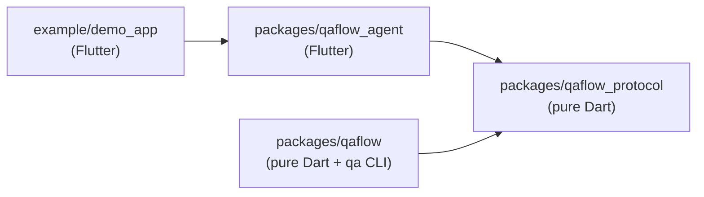

# 12. Code map

This chapter is a file-by-file map of the source. Every Dart file under `lib/` and `bin/` in the workspace has an entry (package `example/` files are listed under [Other files that matter](#other-files-that-matter)): what it is responsible for and the public types and functions it declares. Use it to find where something lives before you open an editor, or to check what a file you are about to change is supposed to do. The other chapters explain *how* the pieces work together; this one only says *where* they are.

Links are relative to this folder. Private helpers (names starting with `_`) are left out unless a file has nothing else.

## How the packages depend on each other

Arrows point from a package to what it imports.

- `qaflow_protocol` imports nothing from the workspace. It holds the JSON shapes both ends of the wire share.
- `qaflow_agent` runs inside the app under test and imports only `qaflow_protocol` (and Flutter).
- `qaflow` imports only `qaflow_protocol` and never Flutter, so the same engine runs in the CLI, in CI and inside QAFlow Studio, the desktop app built on it in a separate repository.
- `example/demo_app` is a plain Flutter app that installs `qaflow_agent` from its own `lib/main_qa.dart`.

The workspace root [`pubspec.yaml`](../../pubspec.yaml) lists all four as Dart workspace members, so they share one `pubspec.lock` and one `.dart_tool/`.

---

## packages/qaflow_protocol

The wire contract between `qaflow` (the driver) and `qaflow_agent` (inside the app). Pure Dart with no dependencies. Every type has `toJson`/`fromJson`, and both sides use the same code, so they cannot drift. See [chapter 1](01-protocol-and-agent.md).

| File | Responsibility | Main declarations |
|---|---|---|
| [qaflow_protocol.dart](../../packages/qaflow_protocol/lib/qaflow_protocol.dart) | Library barrel; exports every file below. | — |
| [src/method.dart](../../packages/qaflow_protocol/lib/src/method.dart) | The list of `ext.qa.*` service extensions the agent registers and the driver calls. | `QaMethod` (`ping`, `elements`, `find`, `elementAt`, `tap`, `longPress`, `hover`, `drag`, `scroll`, `enterText`, `eraseText`, `setText`, `pressKey`, `waitForIdle`, `screenshot`, `resetState`, `back`, `hideKeyboard`, `setOrientation`), `QaMethod.extensionName` |
| [src/selector.dart](../../packages/qaflow_protocol/lib/src/selector.dart) | How a command names a widget. Fields combine with AND; `within` nests a parent selector. | `Selector` |
| [src/node.dart](../../packages/qaflow_protocol/lib/src/node.dart) | One widget as reported in an `elements` snapshot or a `find` result: type, key, semantics id, text, rect, state flags. | `QaRect`, `QaNode` |
| [src/response.dart](../../packages/qaflow_protocol/lib/src/response.dart) | The response envelope and the error codes. The agent's handlers throw `QaException`; the driver rethrows it when a response is not ok. | `QaErrorCode` (`not_found`, `ambiguous`, `not_ready`, `off_screen`, `obscured`, `bad_request`, `unsupported`, `internal`), `QaException`, `QaResponse` |
| [src/key_chord.dart](../../packages/qaflow_protocol/lib/src/key_chord.dart) | Parses a `ctrl+shift+a` style key string into modifiers and a key name, for `pressKey`. | `KeyChord` |
| [src/screenshot_transfer.dart](../../packages/qaflow_protocol/lib/src/screenshot_transfer.dart) | How screenshot pixels travel back: base64 in the response (`inline`, the default, works with the macOS App Sandbox) or written by the agent to a shared path (`file`). | `ScreenshotTransfer` |
| [src/version.dart](../../packages/qaflow_protocol/lib/src/version.dart) | The protocol version, bumped on every breaking wire change and checked by `ping`. | `protocolVersion` |

---

## packages/qaflow_agent

The in-app half. Compiled into the app under test only through a QA entrypoint (`lib/main_qa.dart`), it registers one VM service extension per `QaMethod` and answers them by walking the element tree and synthesizing real input events. See [chapter 1](01-protocol-and-agent.md).

### Entry point and dispatch

| File | Responsibility | Main declarations |
|---|---|---|
| [qaflow_agent.dart](../../packages/qaflow_agent/lib/qaflow_agent.dart) | Library barrel; exports only `QaAgent`. | — |
| [src/agent.dart](../../packages/qaflow_agent/lib/src/agent.dart) | `install` registers the `ext.qa.*` extensions (and refuses release builds); `wrap` puts the app in the `RepaintBoundary` screenshots read; `handle` decodes args, dispatches and turns results and exceptions into `QaResponse` JSON. Holds the app's `onReset` hook for `clearState`. | `QaAgent.install`, `QaAgent.wrap`, `QaAgent.handle`, `QaAgent.onReset` |
| [src/handlers.dart](../../packages/qaflow_agent/lib/src/handlers.dart) | One handler per method: resolves the selector, checks the target is actionable, then calls the input, text, settle, screenshot or snapshot helpers. Also `back`, `hideKeyboard`, `setOrientation` and `resetState`. | `Handlers.dispatch` |
| [src/args.dart](../../packages/qaflow_agent/lib/src/args.dart) | Typed readers for the JSON args map; a wrong type becomes a `bad_request`. | `badRequest`, `selectorArg`, `optDouble`, `requireDouble`, `optInt`, `optString`, `requireString`, `optBool` |
| [src/agent_platform.dart](../../packages/qaflow_agent/lib/src/agent_platform.dart) | The real OS (`Platform.isAndroid`/`isIOS`), not `defaultTargetPlatform`, which debug builds can override. Decides touch versus mouse and which device actions exist. Replaceable in tests. | `AgentPlatform` |

### Finding widgets and reading the tree

| File | Responsibility | Main declarations |
|---|---|---|
| [src/finder.dart](../../packages/qaflow_agent/lib/src/finder.dart) | Walks every element in every view, builds a `Candidate` (element, render box, visible rect, `QaNode`) for each, matches selectors against them, and picks the action point (centre of the visible, unobscured part). `resolveOne` raises `not_found`, `ambiguous`, `off_screen`, `obscured` or `not_ready`. | `Candidate`, `QaFinder.collect`, `QaFinder.find`, `QaFinder.resolveOne`, `QaFinder.actionPoint`, `QaFinder.viewOf` |
| [src/snapshot.dart](../../packages/qaflow_agent/lib/src/snapshot.dart) | The `elements` dump (interesting nodes, or all, with `parentId` pointing at the nearest kept ancestor) and `elementAt` (the innermost interesting node under a point plus selector suggestions for the recorder). | `Snapshot.elements`, `Snapshot.elementAt` |
| [src/settle.dart](../../packages/qaflow_agent/lib/src/settle.dart) | `waitForIdle`: first waits for no scheduled frame and no transient callbacks (`idle`), falling back to a tree that stays the same for several frames (`stable`). | `Settle` |
| [src/frames.dart](../../packages/qaflow_agent/lib/src/frames.dart) | Bounds every wait for a rendered frame, because Flutter stops drawing while the app is hidden, paused or detached (for example a minimized macOS window). | `Frames.next`, `Frames.requireRunning` |
| [src/screenshot.dart](../../packages/qaflow_agent/lib/src/screenshot.dart) | Renders the `QaAgent.wrap` boundary to a PNG, shared by both transfer modes, and reports the device pixel ratio. | `Screenshot.boundaryKey`, `Screenshot.render`, `ScreenshotImage` |

### Input synthesis (`src/input/`)

Synthetic events enter Flutter where the engine's own events do, so gesture recognizers, focus, shortcuts and hover behave as they would for a person.

| File | Responsibility | Main declarations |
|---|---|---|
| [input/pointer.dart](../../packages/qaflow_agent/lib/src/input/pointer.dart) | Pointer events through `GestureBinding.handlePointerEvent`: touch on iOS and Android, mouse elsewhere (which also feeds `MouseTracker`, so hover works). Tap, long press, drag, wheel scroll and hover. | `PointerSynth.tap`, `.longPress`, `.drag`, `.scroll`, `.hover` |
| [input/keyboard.dart](../../packages/qaflow_agent/lib/src/input/keyboard.dart) | Hardware key down/up through the engine's key event entry point, so `HardwareKeyboard`, `FocusManager`, `Shortcuts` and `Actions` see them. Maps key names to logical and physical keys. | `KeyboardSynth`, `KeyPair`, `KeyboardSynth.lookup`, `KeyboardSynth.canonicalModifier` |
| [input/text.dart](../../packages/qaflow_agent/lib/src/input/text.dart) | Finds the focused `EditableText` (or the one inside a selected widget, focusing it) and edits its value as an IME would: type, erase, replace, submit. | `TextSynth.focusedEditable`, `.resolve`, `.editableIn`, `.enterText`, `.eraseText`, `.setText`, `.submit` |

---

## packages/qaflow

The engine: launch an app, connect to its VM service, drive it, run flows, compare screenshots, write reports, manage devices and remote hosts. Pure Dart. [`lib/qaflow.dart`](../../packages/qaflow/lib/qaflow.dart) exports every file under `lib/src/`; QAFlow Studio and the CLI import only that barrel. See chapters [2](02-driver-launch-and-cli.md) and [3](03-flows-and-reports.md).

### bin/

| File | Responsibility | Main declarations |
|---|---|---|
| [bin/qa.dart](../../packages/qaflow/bin/qa.dart) | The `qa` command line, built on `package:args`. Commands: `ping` (launch and ping), `smoke` (the demo smoke scenario), `host` (run a QA host daemon), `validate` (parse flows only) and `test` (run flows and write reports). Installs SIGINT/SIGTERM handling that stops whatever the running command started. | `main`, `projectFilePath`, `ProjectOptions`, `PingCommand`, `SmokeCommand`, `HostCommand`, `ValidateCommand`, `TestCommand` |

### config/ — the project file

| File | Responsibility | Main declarations |
|---|---|---|
| [config/project_config.dart](../../packages/qaflow/lib/src/config/project_config.dart) | The resolved launch settings for one run: source folder or prebuilt binary, device, mode, flavor, dart-defines, environment, Flutter path, optional remote host. Validates combinations that cannot work. | `BuildMode`, `ProjectConfig`, `ProjectConfig.withDevice`, `ProjectConfig.deviceProblems`, `RemoteHostConfig` |
| [config/project_file.dart](../../packages/qaflow/lib/src/config/project_file.dart) | Parses `.qa/project.yaml` with line and column errors, resolves relative paths against the app root, resolves secrets from the environment, and turns the file into a `ProjectConfig`. Shared by `qa test` and QAFlow Studio. | `ProjectFile` (`load`, `findIn`, `configWithHost`, `baselinesFor`, `appRootFor`), `ProjectFileException` |

### device/ — simulators, emulators and desktop targets

| File | Responsibility | Main declarations |
|---|---|---|
| [device/device.dart](../../packages/qaflow/lib/src/device/device.dart) | Device vocabulary shared by everything else: platforms, the `device:` target string, listed devices, a ready (booted) device, and the controller for device-level actions (orientation, deep links). | `DevicePlatform`, `DeviceTarget`, `DeviceInfo`, `ScreenOrientation`, `DeviceController`, `UnsupportedDeviceController`, `ReadyDevice`, `DeviceGroupProblem`, `DeviceList`, `DeviceToolException`, `CancelSignal` |
| [device/device_manager.dart](../../packages/qaflow/lib/src/device/device_manager.dart) | Lists every device this machine can run on (desktop plus iOS and Android) and resolves a `DeviceTarget` into a booted device, booting a simulator or emulator when needed. | `MobileDevices`, `Devices`, `DeviceManager` |
| [device/ios_devices.dart](../../packages/qaflow/lib/src/device/ios_devices.dart) | iOS simulators through `xcrun simctl`: list, boot, open URLs. | `IosDevices`, `IosDeviceController` |
| [device/android_devices.dart](../../packages/qaflow/lib/src/device/android_devices.dart) | Android emulators through `emulator` and `adb`: list AVDs and running emulators, boot, wait for boot, rotate, open URLs. | `AndroidDevices`, `AndroidDeviceController` |
| [device/android_sdk.dart](../../packages/qaflow/lib/src/device/android_sdk.dart) | Where `adb` and `emulator` live (SDK root from the environment, or PATH). | `AndroidSdk` |

### launch/ — starting and stopping the app

| File | Responsibility | Main declarations |
|---|---|---|
| [launch/launched_app.dart](../../packages/qaflow/lib/src/launch/launched_app.dart) | The launcher interface and its result (VM service URI, log stream, stop/restart), plus redaction of a host token in URIs for logs. | `AppLauncher`, `LaunchedApp`, `LaunchException`, `redactUri`, `redactToken` |
| [launch/flutter_run_launcher.dart](../../packages/qaflow/lib/src/launch/flutter_run_launcher.dart) | Launches a source project with `flutter run --machine -t lib/main_qa.dart`, reads the VM service address from the daemon's `app.debugPort` event, hot restarts and stops over the daemon protocol. | `FlutterRunLauncher` |
| [launch/daemon_protocol.dart](../../packages/qaflow/lib/src/launch/daemon_protocol.dart) | Frames of the `flutter run --machine` JSON-lines protocol. | `DaemonMessage`, `DaemonProtocol` |
| [launch/binary_launcher.dart](../../packages/qaflow/lib/src/launch/binary_launcher.dart) | Launches a prebuilt debug or profile binary, passing engine switches through the environment so it opens the VM service on a chosen port. | `BinaryLauncher` |
| [launch/prebuilt_inspector.dart](../../packages/qaflow/lib/src/launch/prebuilt_inspector.dart) | Reads a macOS `.app` bundle without launching it to tell whether it can be driven (release build, agent present). | `PrebuiltInfo`, `inspectPrebuiltApp`, `prebuiltScanChunkSize` |
| [launch/flutter_sdk.dart](../../packages/qaflow/lib/src/launch/flutter_sdk.dart) | Finds the `flutter` executable (explicit path, `FLUTTER_ROOT`, fvm, PATH, login shell) and reads its version. | `FlutterSdk.locate`, `FlutterSdk.version`, `FlutterSdkSource`, `FlutterVersion`, `RunProcess`, `defaultRunProcess` |
| [launch/process.dart](../../packages/qaflow/lib/src/launch/process.dart) | Injectable process starters and runners so tests never spawn real tools, and `runUntil`, which kills a command if a stop signal arrives first. | `ProcessStarter`, `ProcessRunner`, `DetachedStarter` (and their defaults), `runUntil` |
| [launch/process_tree.dart](../../packages/qaflow/lib/src/launch/process_tree.dart) | Stops a launched process together with everything it started (`flutter run` starts the app as a child), and tracks live processes so a terminated `qa` or Studio can kill what a graceful stop could not reach. | `ProcessTree`, `LiveProcesses`, `liveProcesses`, `PidSignaller` |
| [launch/termination.dart](../../packages/qaflow/lib/src/launch/termination.dart) | SIGINT and SIGTERM as one stream, and a handler that runs a bounded shutdown on the first signal and exits. | `terminationSignals`, `exitOnTermination` |

### driver/ — talking to the agent

| File | Responsibility | Main declarations |
|---|---|---|
| [driver/transport.dart](../../packages/qaflow/lib/src/driver/transport.dart) | One `ext.qa.*` call in, one response out; any failure becomes a `QaException`. | `QaTransport` |
| [driver/vm_connection.dart](../../packages/qaflow/lib/src/driver/vm_connection.dart) | Connects to the VM service WebSocket with `package:vm_service`, finds the isolate that registered `ext.qa.ping`, and implements the transport over it. | `VmConnection`, `VmConnector` |
| [driver/qa_driver.dart](../../packages/qaflow/lib/src/driver/qa_driver.dart) | The typed API over the agent. Waits for idle before UI calls and retries `not_found`/`not_ready`-style errors every 100 ms up to the step timeout. | `QaDriver` (`ping`, `waitForIdle`, `elements`, `elementAt`, `tap`, `tapAt`, `longPress`, `hover`, `dragAt`, `scrollAt`, `pressKey`, `back`, `hideKeyboard`, `setOrientation`, `screenshot`, `screenshotCapture`, `resetState`, …), `QaStepFailure`, `ElementHit`, `ScreenshotCapture` |

### session/ and run/ — one app, one run

| File | Responsibility | Main declarations |
|---|---|---|
| [session/qa_session.dart](../../packages/qaflow/lib/src/session/qa_session.dart) | One app under test across a run: prepares the device, picks a launcher (source, prebuilt or remote), connects and pings, resets between flows (hot restart in debug, relaunch otherwise, `onReset` for `clearState`) and stops it. Holds the connection to a `qa host` when the project has one. | `QaSession` (`create`, `launch`, `prepareDevice`, `start`, `reset`, `stop`), `HostConnector` |
| [run/test_run.dart](../../packages/qaflow/lib/src/run/test_run.dart) | One run of flows against one app, shared by `qa test` and QAFlow Studio: creates the run folder, starts the session, runs the flows, stops the session and writes `results.json`, `junit.xml` and `report.html`. | `TestRun.start`, `TestRun.stop`, `TestRunRequest`, `TestRunOutcome`, `SessionFactory` |

### flow/ — the flow language and the runner

| File | Responsibility | Main declarations |
|---|---|---|
| [flow/model.dart](../../packages/qaflow/lib/src/flow/model.dart) | The parsed form of a flow file: header, a sealed `Command` hierarchy with one class per command, selectors as written (before variable substitution), points and conditions, each with a source position. | `Flow`, `FlowHeader`, `Command` and its subclasses (`LaunchApp`, `Tap`, `InputText`, `AssertVisible`, `ScrollUntilVisible`, `AssertScreenshot`, `RunFlow`, `Repeat`, …), `FlowSelector`, `PointSpec`, `Condition`, `SourceRef`, `Direction`, `TapKind` |
| [flow/parser.dart](../../packages/qaflow/lib/src/flow/parser.dart) | YAML to `Flow`, with `file:line:col: message` errors. Rejects unsupported Maestro commands by name. Caches every file it parsed, so a run parses each subflow once. | `FlowParser` (`parseFile`, `parseText`), `FlowParseException` |
| [flow/flow_schema.dart](../../packages/qaflow/lib/src/flow/flow_schema.dart) | A data description of every command, its keys, value kinds, examples and docs. Drives QAFlow Studio's suggestions, templates and hover docs; a test keeps it in step with the parser. | `FlowSchema`, `CommandSpec`, `KeySpec`, `ValueKind` |
| [flow/variables.dart](../../packages/qaflow/lib/src/flow/variables.dart) | `${NAME}` substitution through nested scopes; the innermost definition wins. | `VariableScope`, `UndefinedVariableException` |
| [flow/discovery.dart](../../packages/qaflow/lib/src/flow/discovery.dart) | Expands paths into flow files (a folder contributes its own `.yaml`/`.yml` files, not subfolders) and filters flows by tag. | `discoverFlowFiles`, `selectFlows` |
| [flow/validate.dart](../../packages/qaflow/lib/src/flow/validate.dart) | `qa validate`: parse every flow and print each problem. | `validateFlows` |
| [flow/runner.dart](../../packages/qaflow/lib/src/flow/runner.dart) | Runs flows and emits the event stream: hooks, `launchApp`/`stopApp`/`clearState`, `runFlow`, `repeat`, conditions, retries, `optional` steps, failure artifacts (screenshot, element dump, log tail), and stopping between steps. | `FlowRunner` (`run`, `stop`, `slugify`, `baselineSlug`), `FlowRunOptions`, `ScreenshotPolicy`, `runIdFor` |
| [flow/executor.dart](../../packages/qaflow/lib/src/flow/executor.dart) | Runs one UI command through the driver (taps, text, keys, assertions, waits, scrolls, swipes, screenshots, screenshot assertions). Lifecycle and composition belong to the runner. | `CommandExecutor` (`execute`, `toSelector`, `mainScrollable`, `screenshotPath`), `ExecutionContext`, `BaselineContext`, `CommandOutcome`, `ScreenshotMismatch` |
| [flow/events.dart](../../packages/qaflow/lib/src/flow/events.dart) | The run event stream every consumer reads (CLI, results builder, Studio live view), and the step and flow status enums. | `RunEvent` and subclasses (`RunStarted`, `DeviceBooting`, `DeviceReady`, `FlowStarted`, `StepStarted`, `StepFinished`, `StepPreview`, `AppLog`, `FlowFinished`, `RunFinished`), `StepStatus`, `FlowStatus`, `StepError`, `FlowInfo` |
| [flow/app_session.dart](../../packages/qaflow/lib/src/flow/app_session.dart) | What the runner needs from a running app, so tests can supply a fake. `QaSession` implements it. | `AppSession` |
| [flow/selectors.dart](../../packages/qaflow/lib/src/flow/selectors.dart) | Ranked selector suggestions for a widget the recorder hit (ids, own text, text `childOf` an ancestor id, type plus index), each with its match count. | `suggestSelectors`, `bestSuggestion`, `selectorLabel`, `SelectorSuggestion` |
| [flow/step_writer.dart](../../packages/qaflow/lib/src/flow/step_writer.dart) | Writes recorded steps back as YAML list items the parser reads, in the repository's block style. | `StepWriter`, `RecordedStep` and subclasses (`RecordLaunchApp`, `RecordTapOn`, `RecordInputText`, `RecordPressKey`, `RecordScroll`, `RecordBack`, `RecordHideKeyboard`, `RecordSetOrientation`, `RecordAssertVisible`) |

### screenshot/ — visual comparison

| File | Responsibility | Main declarations |
|---|---|---|
| [screenshot/baseline_store.dart](../../packages/qaflow/lib/src/screenshot/baseline_store.dart) | Baseline image paths: `<app root>/.qa/baselines/<device key>/<flow slug>/<name>.png`. | `BaselineStore` |
| [screenshot/image_compare.dart](../../packages/qaflow/lib/src/screenshot/image_compare.dart) | Pixel comparison with per-channel tolerance, ignored regions and a diff image. | `compareImages`, `ComparisonResult`, `PixelRect`, `pixelRects`, `formatPercent` |
| [screenshot/screenshot_comparison.dart](../../packages/qaflow/lib/src/screenshot/screenshot_comparison.dart) | One `assertScreenshot` outcome under a baseline mode (record a missing baseline, strict, update). | `ScreenshotComparison`, `BaselineMode`, `ComparisonOutcome` |

### report/ — run output

| File | Responsibility | Main declarations |
|---|---|---|
| [report/results.dart](../../packages/qaflow/lib/src/report/results.dart) | The run result model, folded from events, and `results.json` (the source for every other report and for Studio's history). Also orders dotted step ids the way a flow runs them. | `RunResult`, `FlowResult`, `AttemptResult`, `StepResult`, `RunResultBuilder`, `writeResultsJson`, `stepIdParts`, `compareStepIdParts`, `inRunOrder` |
| [report/console_reporter.dart](../../packages/qaflow/lib/src/report/console_reporter.dart) | Human-readable progress on a terminal for `qa test`. | `ConsoleReporter` |
| [report/junit_reporter.dart](../../packages/qaflow/lib/src/report/junit_reporter.dart) | `junit.xml`: one suite per run, one test case per flow, screenshots as `[[ATTACHMENT|path]]` lines. | `renderJunit`, `writeJunit` |
| [report/html_reporter.dart](../../packages/qaflow/lib/src/report/html_reporter.dart) | `report.html`: a static page with no JavaScript, one expandable section per flow, escaped throughout. | `renderHtml`, `writeHtml` |
| [report/comparison_text.dart](../../packages/qaflow/lib/src/report/comparison_text.dart) | Reformats a `screenshot_mismatch` message for the console and JUnit reports. Not exported from the barrel. | `mismatchDetail` |

### remote/ — running on another machine

A `qa host` daemon on one machine launches the app and boots devices for a client (the CLI or QAFlow Studio) on another, over an authenticated WebSocket reached through an SSH tunnel. See [chapter 2](02-driver-launch-and-cli.md).

| File | Responsibility | Main declarations |
|---|---|---|
| [remote/host_protocol.dart](../../packages/qaflow/lib/src/remote/host_protocol.dart) | JSON-RPC 2.0 messages on the control socket, the host protocol version, the "host in use" close code, and `DeviceInfo` on the wire. | `HostMessage`, `HostRequest`, `HostResponse`, `HostNotification`, `HostError`, `hostProtocolVersion`, `qaVersion`, `hostInUseCloseCode`, `deviceInfoToWire`, `deviceInfoFromWire` |
| [remote/host_server.dart](../../packages/qaflow/lib/src/remote/host_server.dart) | The daemon behind `qa host`. Serves `/control` (methods `hello`, `devices.list`, `devices.resolve`, `app.start`, `app.stop`, `app.restart`, `device.setOrientation`, `device.resetOrientation`, `device.openLink`; notifications `devices.booting`, `app.log`, `app.exit`) and `/vm/<id>`, a proxy to the launched app's VM service. One client at a time; token checked on every connection. | `HostServer.start`, `HostServer.close`, `loadOrCreateHostToken` |
| [remote/remote_host.dart](../../packages/qaflow/lib/src/remote/remote_host.dart) | The client side of the control connection: connects, says `hello`, checks the protocol, sends requests and exposes notifications. | `RemoteHost` (`connect`, `endpoint`, `on`, `close`), `RemoteHostException` |
| [remote/remote_launcher.dart](../../packages/qaflow/lib/src/remote/remote_launcher.dart) | An `AppLauncher` that starts the app on the host; the VM service URI it returns is the host's proxy. | `RemoteLauncher` |
| [remote/remote_devices.dart](../../packages/qaflow/lib/src/remote/remote_devices.dart) | `Devices` and `DeviceController` over a host, so listing, booting and rotating work as they do locally. | `RemoteDevices`, `RemoteDeviceController` |

### smoke/

| File | Responsibility | Main declarations |
|---|---|---|
| [smoke/smoke_runner.dart](../../packages/qaflow/lib/src/smoke/smoke_runner.dart) | A minimal step runner predating flows, kept for `qa smoke`: runs steps in order, stops at the first failure and screenshots it. Includes the demo app's acceptance scenario. | `SmokeRunner`, `SmokeStep`, `SmokeResult`, `SmokeReport`, `demoAppSmokeSteps` |

---

## example/demo_app

A small Flutter app the end-to-end tests and the docs' examples run against. Its widgets carry `ValueKey`s (`username`, `password`, `login`, `login_error`, `item_list`, `item_<n>`, `open_dialog`, `dialog_input`, …) that flows select with `id:`.

| File | Responsibility | Main declarations |
|---|---|---|
| [main.dart](../../example/demo_app/lib/main.dart) | Normal entrypoint, no agent. | `main` |
| [main_qa.dart](../../example/demo_app/lib/main_qa.dart) | QA entrypoint: `QaAgent.install` with an empty `onReset` (the demo keeps no state) and `QaAgent.wrap`. The template for testing your own app. | `main` |
| [app.dart](../../example/demo_app/lib/app.dart) | `MaterialApp` with routes `/`, `/list`, `/dialog` and the deep link `/item/<n>`. | `DemoApp` |
| [screens/login_screen.dart](../../example/demo_app/lib/screens/login_screen.dart) | Username and password form with an error message on a wrong password. | `LoginScreen` |
| [screens/list_screen.dart](../../example/demo_app/lib/screens/list_screen.dart) | A long scrollable list for scroll and swipe flows. | `ListScreen` |
| [screens/dialog_screen.dart](../../example/demo_app/lib/screens/dialog_screen.dart) | A dialog with a text field, for overlay and focus flows. | `DialogScreen` |
| [screens/item_screen.dart](../../example/demo_app/lib/screens/item_screen.dart) | The page the `demo://app/item/<n>` deep link opens. | `ItemScreen` |

Paths are under [`example/demo_app/lib/`](../../example/demo_app/lib/).

---

## Tests

Each package keeps its tests in `test/`, one file per unit under test, named `<unit>_test.dart`. [Chapter 6](06-testing.md) covers the strategy.

| Package | Layout |
|---|---|
| `packages/qaflow_protocol/test/` | Round-trip tests for each wire type (`selector_test`, `node_test`, `response_test`, `key_chord_test`, `screenshot_transfer_test`). |
| `packages/qaflow_agent/test/` | Flutter widget tests that call the agent's handlers against real widget trees (`finder_test`, `pointer_test`, `keyboard_test`, `text_test`, `settle_test`, `snapshot_test`, `screenshot_test`, `frames_test`, `mobile_test`, `agent_test`); `helpers.dart` is shared setup. |
| `packages/qaflow/test/` | Flat folder, one file per source file (parser, runner, executor, driver, session, launchers, devices, host server and client, reporters, image comparison, CLI). Shared fakes: `fake_vm_service.dart`, `fake_process.dart`, `host_fakes.dart`, `flow_test_support.dart`. `remote_integration_test.dart` runs a real `HostServer` on loopback. |
| `example/demo_app/test/` | `app_test.dart`, a widget test of the demo app itself. |

## Other files that matter

| Path | What it is |
|---|---|
| [`pubspec.yaml`](../../pubspec.yaml) | The Dart workspace: lists the three packages and the demo app. |
| [`analysis_options.yaml`](../../analysis_options.yaml) | Shared lints for every package. |
| [`LICENSE`](../../LICENSE) | BSD-3-Clause. Each published package carries the same text in its own `LICENSE`, because pub needs one per package. |
| `packages/*/README.md`, `CHANGELOG.md`, `example/` | What pub.dev shows for each published package: [`qaflow_protocol/example/qaflow_protocol_example.dart`](../../packages/qaflow_protocol/example/qaflow_protocol_example.dart) encodes and decodes a request, [`qaflow_agent/example/`](../../packages/qaflow_agent/example/README.md) is a counter app with both entrypoints, `lib/main.dart` and `lib/main_qa.dart`, and [`qaflow/example/README.md`](../../packages/qaflow/example/README.md) has a project file, a flow and the CLI commands. |
| [`tool/publish.md`](../../tool/publish.md) | How releases work: `tool/release.dart` bumps the versions, and tags publish through `publish.yml` in order (protocol, agent, `qaflow`). |
| [`.github/workflows/ci.yml`](../../.github/workflows/ci.yml) | Format, analyze, and every package's tests on each push and pull request. |
| [`.github/workflows/e2e.yml`](../../.github/workflows/e2e.yml) | End-to-end: builds and runs the demo app's flows on macOS, on an iOS simulator and on an Android emulator, and uploads the run folders. On demand only, for now. |
| [`.github/workflows/publish.yml`](../../.github/workflows/publish.yml) | On a `<package>-v<version>` tag: checks the version and CHANGELOG, then publishes that package to pub.dev. |
| [`tool/release.dart`](../../tool/release.dart) | Bumps the three packages to one new version and adds the CHANGELOG entries ([`tool/publish.md`](../../tool/publish.md)). |
| `example/demo_app/.qa/` | The demo's QA project: `project.yaml` (macOS), `project.ios.yaml`, `project.android.yaml`; `flows/` (with `flows/mobile/` for mobile-only flows), `subflows/` (not run directly), `failing/` (flows that are meant to fail, for testing failure output) and `baselines/<device key>/` for `assertScreenshot`. |
| `qa-out/` (in each app root) | Run folders written by `qa test`. Not source. |

---

## Where to look when…

| You want to… | Start at |
|---|---|
| Add a flow command | [`flow/model.dart`](../../packages/qaflow/lib/src/flow/model.dart) (new `Command`), [`flow/parser.dart`](../../packages/qaflow/lib/src/flow/parser.dart), then [`flow/executor.dart`](../../packages/qaflow/lib/src/flow/executor.dart) for a UI command or [`flow/runner.dart`](../../packages/qaflow/lib/src/flow/runner.dart) for lifecycle or composition; describe it in [`flow/flow_schema.dart`](../../packages/qaflow/lib/src/flow/flow_schema.dart) so the editor knows it. If the recorder can write it, [`flow/step_writer.dart`](../../packages/qaflow/lib/src/flow/step_writer.dart). |
| Add or change a protocol method | [`qaflow_protocol/lib/src/method.dart`](../../packages/qaflow_protocol/lib/src/method.dart), [`qaflow_agent/lib/src/handlers.dart`](../../packages/qaflow_agent/lib/src/handlers.dart), [`driver/qa_driver.dart`](../../packages/qaflow/lib/src/driver/qa_driver.dart); bump [`version.dart`](../../packages/qaflow_protocol/lib/src/version.dart) for a breaking change. |
| Change how taps, drags or scrolls are synthesized | [`input/pointer.dart`](../../packages/qaflow_agent/lib/src/input/pointer.dart); the target point comes from `QaFinder.actionPoint` in [`finder.dart`](../../packages/qaflow_agent/lib/src/finder.dart). |
| Change keys or typing | [`input/keyboard.dart`](../../packages/qaflow_agent/lib/src/input/keyboard.dart), [`input/text.dart`](../../packages/qaflow_agent/lib/src/input/text.dart), [`key_chord.dart`](../../packages/qaflow_protocol/lib/src/key_chord.dart). |
| Change how a selector matches or when a widget counts as visible | [`finder.dart`](../../packages/qaflow_agent/lib/src/finder.dart); `Selector` in [`selector.dart`](../../packages/qaflow_protocol/lib/src/selector.dart); `FlowSelector` and `CommandExecutor.toSelector` on the core side. |
| Change waiting and retries | Agent side [`settle.dart`](../../packages/qaflow_agent/lib/src/settle.dart) and [`frames.dart`](../../packages/qaflow_agent/lib/src/frames.dart); driver side [`qa_driver.dart`](../../packages/qaflow/lib/src/driver/qa_driver.dart). |
| Change how the app is launched, restarted or stopped | [`launch/`](../../packages/qaflow/lib/src/launch/) and [`session/qa_session.dart`](../../packages/qaflow/lib/src/session/qa_session.dart). |
| Change `.qa/project.yaml` | [`config/project_file.dart`](../../packages/qaflow/lib/src/config/project_file.dart), [`config/project_config.dart`](../../packages/qaflow/lib/src/config/project_config.dart) |
| Change report output | [`report/results.dart`](../../packages/qaflow/lib/src/report/results.dart) first (it feeds everything), then the [`junit`](../../packages/qaflow/lib/src/report/junit_reporter.dart), [`html`](../../packages/qaflow/lib/src/report/html_reporter.dart) or [`console`](../../packages/qaflow/lib/src/report/console_reporter.dart) reporter. |
| Change screenshot comparison | [`screenshot/`](../../packages/qaflow/lib/src/screenshot/), the `AssertScreenshot` branch of [`executor.dart`](../../packages/qaflow/lib/src/flow/executor.dart). |
| Add a device platform or device action | [`device/`](../../packages/qaflow/lib/src/device/) (`DeviceManager`, a `MobileDevices` and `DeviceController`), and the host's `device.*` methods in [`host_server.dart`](../../packages/qaflow/lib/src/remote/host_server.dart) and [`remote_devices.dart`](../../packages/qaflow/lib/src/remote/remote_devices.dart). |
| Change the remote host protocol | [`remote/host_protocol.dart`](../../packages/qaflow/lib/src/remote/host_protocol.dart) (bump `hostProtocolVersion` for a breaking change), [`host_server.dart`](../../packages/qaflow/lib/src/remote/host_server.dart), [`remote_host.dart`](../../packages/qaflow/lib/src/remote/remote_host.dart) |
| Add a `qa` CLI command or option | [`bin/qa.dart`](../../packages/qaflow/bin/qa.dart). |
