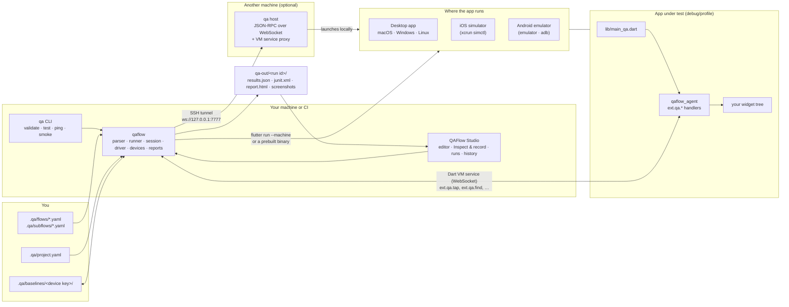
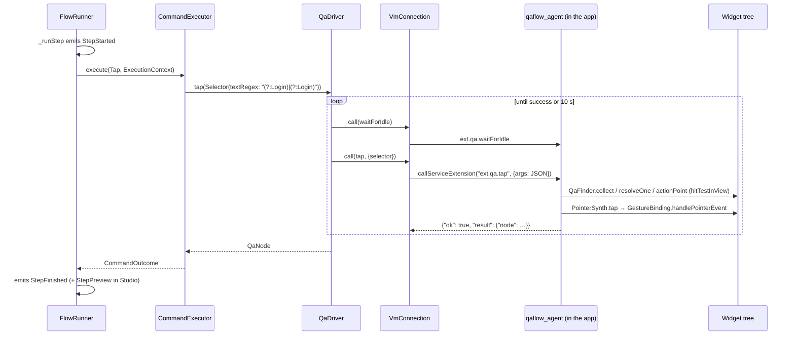

# QAFlow architecture

QAFlow tests Flutter apps through their UI. You describe what a user does in YAML ("tap Login, type a password, check the welcome text"). The toolkit launches your app, performs those steps through the real widget tree, and reports what happened, with screenshots, element dumps and logs when something fails. **QAFlow Studio** is a macOS desktop app over the same engine: in it you write flows with a context-aware editor, record them by clicking, run them live, and review and compare past runs.

It drives:

- **Desktop apps** on macOS, Windows and Linux, built from source or as a prebuilt debug/profile binary.
- **iOS simulators and Android emulators**, built from source; `qa` boots the device on demand.
- **Apps on another machine**, through a `qa host` daemon reached over an SSH tunnel, so a Mac can test a Windows build on a cloud VM.

It's for teams that want Maestro-style end-to-end flows for a Flutter app, run the same way on a laptop, in CI and in a GUI.

This folder explains how it all works and why it's built this way. The [project README](../../README.md) is the user guide; this is the engineer's guide. This page is the tour from top to bottom; the chapters go deep.

| Chapter | Covers |
|---|---|
| [1. Wire protocol and in-app agent](01-protocol-and-agent.md) | `qaflow_protocol`, `qaflow_agent`: how the app is driven from inside |
| [2. Launching, connecting, driving, CLI](02-driver-launch-and-cli.md) | `qaflow`'s launchers, devices, VM service connection, driver, session, process cleanup, `.qa/project.yaml`, the `qa` CLI |
| [3. Flows, runner and reports](03-flows-and-reports.md) | The flow language, parser, runner, events, run folders, screenshot assertions, `results.json`/`junit.xml`/`report.html` |
| 4. QAFlow Studio | Documented with the desktop app, in its own repository. The numbering is kept so chapter references stay stable |
| [5. Design decisions](05-design-decisions.md) | Each major choice, its alternatives and its trade-offs; known limitations |
| [6. Testing strategy](06-testing.md) | Unit, widget and end-to-end tests, plus CI |
| 7. Command reference | Moved to the user guide: [Command reference](../commands.md), every flow command, selector, key name and `qa` option |
| [8. Extending QAFlow](08-integration-and-how-to.md) | The repository's workflows, adding a flow command or a protocol method, running the end-to-end tests. Using QAFlow in your app is in [Integration and CI](../integration.md) |
| 9. Troubleshooting | Moved to the user guide: [Troubleshooting](../troubleshooting.md), messages and symptoms with their causes and fixes |
| [10. Security model](10-security.md) | What's protected, what isn't, and a checklist for teams |
| [11. Remote hosts](11-remote-hosts.md) | `qa host`, its JSON-RPC protocol, the VM service proxy, tokens and tunnels, Studio's host support |
| [12. Code map](12-code-map.md) | Every source file in this repository and what it does |

## The system in one picture



Three processes matter: the **client** (`qa` or QAFlow Studio, which parse flows and run them), the **app under test** (which carries the agent), and, when you use one, the **host** (which launches the app on its own machine and relays its VM service). The client always talks to the agent through the VM service; with a host, that WebSocket simply goes through the host's proxy.

## The packages

```
qaflow/
  packages/qaflow_protocol/   pure Dart: the JSON wire types both sides share
  packages/qaflow_agent/      Flutter: compiled into the app under test via lib/main_qa.dart
  packages/qaflow/            pure Dart: launch, devices, connect, drive, run flows, compare screenshots,
                              write reports, the qa CLI and the qa host daemon
  example/demo_app/           Flutter app (desktop, iOS, Android) used for end-to-end tests
  tool/                       release.dart (version bumps) and publish.md (how releases work)
  docs/architecture/          this guide
```

| Package | Flutter? | Published | Depends on |
|---|---|---|---|
| `qaflow_protocol` | no | pub.dev | nothing |
| `qaflow_agent` | yes | pub.dev | `flutter`, `qaflow_protocol` |
| `qaflow` | **no** | pub.dev; executables `qa` and `qaflow` | `qaflow_protocol`, `vm_service`, `yaml`, `image`, `args`, `path` |

The rule that **`qaflow` never imports Flutter** is what lets the same engine run in a terminal, in CI, on a remote host and inside QAFlow Studio.

### How people get it

- **The packages** are on pub.dev and share one version. They depend on each other with caret constraints (`qaflow_protocol: ^0.1.4`); inside this repository the pub workspace (`resolution: workspace`) resolves those to the local copies. An app adds `flutter pub add qaflow_agent` and a `lib/main_qa.dart`, and the CLI comes from `dart pub global activate qaflow` ([Integration and CI](../integration.md)). Releases are tagged here and published by GitHub Actions ([`tool/publish.md`](../../tool/publish.md)).
- **QAFlow Studio**, the macOS desktop app, is built on `qaflow` in a separate repository and ships as its own download.
- **Names that stayed.** The rename to QAFlow kept the user-facing `qa` names: the `qa` command, the `.qa/` folder, `lib/main_qa.dart`, the `ext.qa.*` extensions, `QA_HOST_TOKEN`, `qa host`, and `QA_STUDIO_SETTINGS_DIR`. Public Dart types keep their names too (`QaAgent`, `QaDriver`, `QaSession`).

## Life of a flow step

Follow one step, `- tapOn: Login`, from the YAML file to the button and back. The flow is in `.qa/flows/login.yaml`, and you started it with `qa test` or **Run flow** in QAFlow Studio.

### 1. Before the step: config, parse, launch, connect

- **Config.** `.qa/project.yaml` is parsed into a `ProjectFile` ([`config/project_file.dart`](../../packages/qaflow/lib/src/config/project_file.dart)), which yields a `ProjectConfig`: source or binary, entrypoint, mode, device, flavor, dart-defines, an optional `host:`. Secrets are resolved from the environment or Studio's settings.
- **Parse.** `FlowParser.parseFile` ([`flow/parser.dart`](../../packages/qaflow/lib/src/flow/parser.dart)) reads the file with `package:yaml`'s `loadYamlDocuments`, which keeps every node's source span. `- tapOn: Login` is a single-key map whose value is a scalar, so `_FileParser.tap` returns `Tap(kind: TapKind.tap, selector: FlowSelector(text: 'Login'))`, a case of the sealed `Command` hierarchy in [`flow/model.dart`](../../packages/qaflow/lib/src/flow/model.dart). Any error is a `FlowParseException` printed as `file:line:col: message`, before anything launches. `runFlow` subflows are parsed eagerly, with cycle detection.
- **Run and session.** `TestRun.start` ([`run/test_run.dart`](../../packages/qaflow/lib/src/run/test_run.dart)) creates a `QaSession` ([`session/qa_session.dart`](../../packages/qaflow/lib/src/session/qa_session.dart)), then the run folder `qa-out/<UTC yyyyMMdd-HHmmss>/`, then a `FlowRunner`. QAFlow Studio calls the same `TestRun.start` in-process.
- **Device.** For an `ios:` or `android:` device, the session's `DeviceManager` ([`device/device_manager.dart`](../../packages/qaflow/lib/src/device/device_manager.dart)) resolves it with `IosDevices` (`xcrun simctl list devices available -j`) or `AndroidDevices` (`emulator -list-avds`, `adb devices`), boots it if needed and waits until it's ready.
- **Launch.** `QaSession` picks a launcher:
  - `FlutterRunLauncher` ([`launch/flutter_run_launcher.dart`](../../packages/qaflow/lib/src/launch/flutter_run_launcher.dart)) runs `flutter run --machine -d <device> -t lib/main_qa.dart` and reads the VM service URI from the daemon's `app.debugPort` event.
  - `BinaryLauncher` ([`launch/binary_launcher.dart`](../../packages/qaflow/lib/src/launch/binary_launcher.dart)) starts a prebuilt binary with engine switches that open the VM service on a free port.
  - `RemoteLauncher` ([`remote/remote_launcher.dart`](../../packages/qaflow/lib/src/remote/remote_launcher.dart)) asks a `qa host` to do either of the above and gets back a proxied VM service URI.
- **Connect.** `VmConnection.connect` ([`driver/vm_connection.dart`](../../packages/qaflow/lib/src/driver/vm_connection.dart)) opens the VM service WebSocket, listens to the isolate, stdout and stderr streams, and finds the isolate whose `extensionRPCs` include `ext.qa.ping`. The session calls `QaDriver.ping` and refuses an agent whose `protocolVersion` differs.

### 2. The step itself



1. **Runner.** `FlowRunner._runList` walks the flow's commands and gives each a step id (`3`, `2.1`, `start.1`). `_runStep` emits `StepStarted` ([`flow/events.dart`](../../packages/qaflow/lib/src/flow/events.dart)) and calls `_execute`. Lifecycle and control commands (`launchApp`, `runFlow`, `repeat`, ...) are handled in the runner itself ([`flow/runner.dart`](../../packages/qaflow/lib/src/flow/runner.dart)); everything that touches the UI goes to `CommandExecutor.execute` ([`flow/executor.dart`](../../packages/qaflow/lib/src/flow/executor.dart)) with an `ExecutionContext` (driver, variable scope, screenshot folder, view size, device controller, baselines).
2. **Executor.** The `Tap` case calls `CommandExecutor.toSelector`, which substitutes `${VARS}` and turns the flow selector into a wire `Selector` ([`qaflow_protocol/selector.dart`](../../packages/qaflow_protocol/lib/src/selector.dart)). Text that compiles as a regular expression becomes `textRegex: (?:Login)|(?:Login)`, so it matches as a regex or as the literal string. Then it calls `QaDriver.tap(selector)`.
3. **Driver.** `QaDriver` ([`driver/qa_driver.dart`](../../packages/qaflow/lib/src/driver/qa_driver.dart)) wraps the call in `_retry`: before each attempt it calls `waitForIdle`, and it retries `not_found`, `ambiguous`, `not_ready`, `off_screen` and `obscured` every 100 ms until the 10 s step timeout. On timeout it takes an element snapshot and throws `QaStepFailure`.
4. **Transport.** `VmConnection.call` (the `QaTransport` interface in [`driver/transport.dart`](../../packages/qaflow/lib/src/driver/transport.dart)) sends `callServiceExtension('ext.qa.tap', isolateId: …, args: {'args': '<json>'})` over the VM service WebSocket. It bounds the call at 60 s plus any wait the call asks for, and turns VM-level failures (`SentinelException`, `RPCError` during a hot restart) into `not_ready`, so the retry loop rides through a restart.
5. **Agent entry.** In the app, `QaAgent.install` ([`qaflow_agent/agent.dart`](../../packages/qaflow_agent/lib/src/agent.dart)) registered one `dart:developer` `registerExtension` handler per `QaMethod`. `QaAgent.handle` decodes the JSON args, calls `Handlers.dispatch` ([`handlers.dart`](../../packages/qaflow_agent/lib/src/handlers.dart)), and always answers with a `QaResponse` (`ok`, `result`, or `code`/`message`/`details`); it never throws back into the VM.
6. **Finder.** `Handlers._tap` calls `target`, which calls `QaFinder.resolveOne` ([`finder.dart`](../../packages/qaflow_agent/lib/src/finder.dart)). `QaFinder.collect` walks every onstage element from `WidgetsBinding.instance.rootElement` (`debugVisitOnstageChildren`), recording for each its widget type, text, `ValueKey<String>`, Semantics identifier and label, whether it's interactive and enabled, its global rect (`getTransformTo(null)`) and its visible rect, clipped by every enclosing viewport. `find` keeps the matches and drops any match that contains another match, so you get the innermost widget. No match is `not_found`; several are `ambiguous`.
7. **Hit test.** `QaFinder.actionPoint` takes the centre of the visible rect, runs `RendererBinding.instance.hitTestInView` there, and checks the hit path reaches the target's render box. Outside the view is `off_screen`; covered by something else (a dialog barrier, a snackbar) is `obscured`; a disabled button is `not_ready`.
8. **Input.** `PointerSynth.tap` ([`input/pointer.dart`](../../packages/qaflow_agent/lib/src/input/pointer.dart)) feeds `PointerDownEvent` and, 50 ms later, `PointerUpEvent` into `GestureBinding.instance.handlePointerEvent`: the same entry point the engine uses for real input. On desktop the pointer is a mouse that first hovers the point (so `MouseRegion` enter/exit fire); on iOS and Android it's a touch. Your `GestureDetector` or `InkWell` sees an ordinary tap. The handler waits for the next frame with `Frames.next` and returns the tapped `QaNode`.

### 3. After the step

- `FlowRunner._finished` emits `StepFinished` with the status, duration and artifacts. With `--screenshots all` it takes a screenshot after each UI step; QAFlow Studio also asks for a `StepPreview` screenshot to show beside the live step tree.
- **On failure** the runner saves `failure-<step>.png`, `elements-<step>.json` and the last 50 lines of app output, skips the rest of the flow, still runs `onFlowComplete`, and resets the app before the next flow (hot restart in debug, relaunch otherwise). An error carrying `rpcCode` means the app or its connection is gone; that ends the run.
- **At the end** `RunResultBuilder` ([`report/results.dart`](../../packages/qaflow/lib/src/report/results.dart)) folds the events into one `RunResult`, and `TestRun` writes `results.json` (`writeResultsJson`), `junit.xml` (`writeJunit`) and `report.html` (`writeHtml`). The CLI's `ConsoleReporter` prints `PASS`/`FAIL` lines as events arrive and exits 0 or 1. QAFlow Studio reads the same `results.json` files for its history.

## The technology that makes it work

### Dart VM service and service extensions

Every debug and profile Flutter app runs a **Dart VM service**: a JSON-RPC 2.0 API over WebSocket that DevTools and IDEs use. Any Dart code can add its own methods to it with `dart:developer`'s `registerExtension`. `qaflow_agent` registers one per `QaMethod` ([`qaflow_protocol/method.dart`](../../packages/qaflow_protocol/lib/src/method.dart)): `ext.qa.ping`, `elements`, `find`, `elementAt`, `tap`, `longPress`, `hover`, `drag`, `scroll`, `enterText`, `eraseText`, `setText`, `pressKey`, `waitForIdle`, `screenshot`, `resetState`, `back`, `hideKeyboard` and `setOrientation`. The client side uses `package:vm_service` (`vmServiceConnectUri`, `callServiceExtension`, the isolate and stdout/stderr streams).

Why: the transport already exists in every debuggable build, needs no port of your own, no extra package in the app beyond the agent, and runs the handler on the UI isolate, where the widget tree lives. It's also why release builds can't be driven: the engine doesn't open the VM service there, and `QaAgent.install` throws when `kReleaseMode` is true. See [chapter 1](01-protocol-and-agent.md).

### `flutter run --machine`

To build and launch from source, `FlutterRunLauncher` runs `flutter run --machine`, which speaks the Flutter daemon protocol: one JSON array per line on stdout (`[{"event":"app.debugPort","params":{"wsUri":…}}]`) and requests on stdin (`app.restart` with `fullRestart: true` for the hot restart between flows, `app.stop`). `DaemonProtocol` ([`launch/daemon_protocol.dart`](../../packages/qaflow/lib/src/launch/daemon_protocol.dart)) parses and encodes the frames. Why: it gives the VM service address, hot restart and a clean stop without screen-scraping `flutter run`'s human output. Flutter itself is found through `FLUTTER_ROOT`, fvm's default version, `PATH`, then your login shell ([`launch/flutter_sdk.dart`](../../packages/qaflow/lib/src/launch/flutter_sdk.dart)).

### Prebuilt binaries with `vm-service-port`

A prebuilt debug or profile desktop binary has no `flutter` process to ask. `BinaryLauncher.engineEnvironment` sets `FLUTTER_ENGINE_SWITCHES` with `vm-service-port=<free port>`, `disable-service-auth-codes=true` and `enable-dart-profiling=true`, and the session connects to `ws://127.0.0.1:<port>/ws`. A macOS `.app` is run through its `Contents/MacOS` executable (read with `plutil`), since `open` drops environment variables. `inspectPrebuiltApp` ([`launch/prebuilt_inspector.dart`](../../packages/qaflow/lib/src/launch/prebuilt_inspector.dart)) refuses a release build up front.

### Flutter's binding hooks for input

The agent never fakes OS input; it feeds events into the same Flutter bindings the engine does:

| Input | Hook | Where |
|---|---|---|
| Taps, long presses, hovers, drags | `GestureBinding.instance.handlePointerEvent` with `PointerAdded/Hover/Down/Move/Up` events; touch on iOS and Android, mouse elsewhere | [`input/pointer.dart`](../../packages/qaflow_agent/lib/src/input/pointer.dart) |
| Scrolling | `PointerScrollEvent` from a separate mouse wheel device, in chunks, on every platform | same |
| Keys | `ServicesBinding.instance.keyEventManager.handleKeyData` with a synthesized `ui.KeyData`, so `HardwareKeyboard`, `FocusManager`, `Shortcuts` and `Actions` all see it; the handler's answer is read back to know whether the app handled the key | [`input/keyboard.dart`](../../packages/qaflow_agent/lib/src/input/keyboard.dart) |
| Text | The focused `EditableTextState`'s `userUpdateTextEditingValue`, the path a keyboard's edits take; `performAction` for submit | [`input/text.dart`](../../packages/qaflow_agent/lib/src/input/text.dart) |
| Back (Android) | `WidgetsBinding.instance.handlePopRoute`, the system back button's path | [`handlers.dart`](../../packages/qaflow_agent/lib/src/handlers.dart) |
| Hide keyboard | Unfocus, then `TextInput.hide` on `SystemChannels.textInput` | same |
| Orientation (iOS) | `SystemChrome.setPreferredOrientations`, since `simctl` can't rotate | same |

Because events go through the bindings, they reach your gesture recognizers, focus system and shortcuts exactly like real input, without OS permissions and without the window needing focus.

### Element tree walking and hit testing

`QaFinder` reads the live element tree (every onstage element from `rootElement`) rather than the semantics tree, so it sees every widget, its `ValueKey`, its `Semantics.identifier`, and the text of `Text`, `RichText`, `EditableText` and `Tooltip`. An obscured (password) field reports no text, so its value never reaches a dump or a selector. Geometry comes from each `RenderBox`'s transform; visibility is clipped through every `RenderAbstractViewport`. `RendererBinding.hitTestInView` answers "would a real tap here reach this widget?". `elementAt(x, y)` uses the same hit test to report the innermost widget under a point, which is how QAFlow Studio's mirror knows what you clicked.

### Settling

`Settle.waitForIdle` ([`settle.dart`](../../packages/qaflow_agent/lib/src/settle.dart)) returns when `SchedulerBinding` has no scheduled frame and no transient callbacks (idle), or, for endless animations, when a hash of the element snapshot has been unchanged for three frames and at least 500 ms (stable). Every frame wait goes through `Frames.next` ([`frames.dart`](../../packages/qaflow_agent/lib/src/frames.dart)) with a time limit, because Flutter stops producing frames while the app is hidden (`framesEnabled` false); then a step fails with `not_ready: the app is not rendering frames` instead of hanging.

### Screenshots and image diffing

`QaAgent.wrap` puts your app inside a `RepaintBoundary` with a known `GlobalKey`. `Screenshot.render` ([`screenshot.dart`](../../packages/qaflow_agent/lib/src/screenshot.dart)) calls `RenderRepaintBoundary.toImage(pixelRatio: devicePixelRatio)` and `toByteData(format: png)`. By default the PNG travels inline as base64 in the response and the client writes the file, which works inside the macOS App Sandbox and across a remote host. `assertScreenshot` decodes both images with `package:image`, blanks `ignore` areas, counts pixels whose channels differ by more than 8 of 255, and paints a diff image ([`screenshot/image_compare.dart`](../../packages/qaflow/lib/src/screenshot/image_compare.dart)). `BaselineStore` ([`screenshot/baseline_store.dart`](../../packages/qaflow/lib/src/screenshot/baseline_store.dart)) keeps baselines at `.qa/baselines/<device key>/<flow slug>/<name>.png`.

### Devices: `xcrun simctl`, `emulator`, `adb`

The device layer talks to the native tools, not `flutter emulators`, because they give readiness signals and device control:

- **iOS** ([`device/ios_devices.dart`](../../packages/qaflow/lib/src/device/ios_devices.dart)): `xcrun simctl list devices available -j` to resolve, `simctl boot` and `simctl bootstatus -b` to boot and wait, `simctl openurl` for `openLink`.
- **Android** ([`device/android_devices.dart`](../../packages/qaflow/lib/src/device/android_devices.dart), SDK lookup in [`android_sdk.dart`](../../packages/qaflow/lib/src/device/android_sdk.dart)): `emulator -list-avds`, `emulator -avd <name> -no-snapshot-save -no-boot-anim`, `adb wait-for-device` and `getprop sys.boot_completed`, then a wait for the SIM; `settings put system user_rotation` for `setOrientation`; `am start -W -a android.intent.action.VIEW -d <url>` for `openLink`.

### Process trees and signals

`flutter run` starts the app as its own child, and on macOS the app outlives a kill of `flutter run` alone. `ProcessTree` ([`launch/process_tree.dart`](../../packages/qaflow/lib/src/launch/process_tree.dart)) reads the tree from `ps -A -o pid= -o ppid= -o lstart=` before signalling, sends SIGTERM then SIGKILL after a grace period, and checks start times so a reused pid is never killed; Windows uses `taskkill /T /F`. `LiveProcesses` tracks every launched process, and `exitOnTermination` ([`launch/termination.dart`](../../packages/qaflow/lib/src/launch/termination.dart)) makes SIGINT and SIGTERM stop the run, kill what's left and exit with 128 + the signal number; a second signal force-kills at once. Both the `qa` CLI and QAFlow Studio install it, so Ctrl-C or quitting never leaves an app running. See [chapter 2](02-driver-launch-and-cli.md).

### WebSocket JSON-RPC for remote hosts

`qa host` ([`remote/host_server.dart`](../../packages/qaflow/lib/src/remote/host_server.dart)) is a `dart:io` `HttpServer` bound to `127.0.0.1` only. `/control` is a WebSocket carrying JSON-RPC 2.0 ([`remote/host_protocol.dart`](../../packages/qaflow/lib/src/remote/host_protocol.dart)): `hello`, `devices.list`, `devices.resolve`, `app.start`, `app.stop`, `app.restart`, `device.setOrientation`, `device.resetOrientation`, `device.openLink`, plus `app.log`, `app.exit` and `devices.booting` notifications. `/vm/<appId>` pipes a WebSocket straight to the app's VM service, so `VmConnection` and the agent are unchanged. Every request carries the token as a query parameter, checked in constant time; you reach the port through `ssh -L`, which gives encryption and authentication of the machine. See [chapter 11](11-remote-hosts.md) and [chapter 10](10-security.md).

### YAML parsing and editing

`package:yaml` parses flows and `project.yaml` with source spans, which is where every `file:line:col` error comes from. `FlowSchema` ([`flow/flow_schema.dart`](../../packages/qaflow/lib/src/flow/flow_schema.dart)) describes every command and key, and a test checks it against the parser; QAFlow Studio's suggestions and hover docs read it. QAFlow Studio edits `project.yaml` with `package:yaml_edit`, so your comments and key order survive. Recorded steps are appended as text by `StepWriter` ([`flow/step_writer.dart`](../../packages/qaflow/lib/src/flow/step_writer.dart)).

## Feature catalogue

### Flows and the runner

| Feature | What it does | Read more |
|---|---|---|
| Flow language | Maestro-style YAML: a header (`name`, `tags`, `env`, `onFlowStart`, `onFlowComplete`), `---`, then commands. Unsupported Maestro commands are parse errors, not silent no-ops. | [3](03-flows-and-reports.md), [Commands](../commands.md) |
| Commands | `launchApp`, `stopApp`, `clearState`, `tapOn`, `doubleTapOn`, `longPressOn`, `hover`, `inputText`, `eraseText`, `setText`, `pressKey`, `assertVisible`, `assertNotVisible`, `extendedWaitUntil`, `waitForAnimationToEnd`, `scroll`, `scrollUntilVisible`, `swipe`, `takeScreenshot`, `assertScreenshot`, `runFlow`, `repeat`, and the mobile `back`, `hideKeyboard`, `setOrientation`, `openLink`. Every step takes `label` and `optional`. | [Commands](../commands.md) |
| Selectors | `text` (literal or full-match regex), `id` (ValueKey or Semantics identifier), `type`, `index`, `enabled`, `childOf` (any ancestor). | [Commands](../commands.md) |
| Variables, env and secrets | `${NAME}` from the innermost `runFlow` env, `--env`/project env, then the flow header. Secrets are declared by name in `project.yaml`; values come from the environment or Studio's settings. | [3](03-flows-and-reports.md), [10](10-security.md) |
| Subflows | `runFlow` runs a file (relative to the caller) or inline commands, with its own `env` and an optional `when`. | [3](03-flows-and-reports.md) |
| Repeat and conditions | `repeat` with `times` or `while`; `when`/`while` take `visible`, `notVisible`, `platform` and `true` (a substituted `true`/`false`). | [3](03-flows-and-reports.md) |
| Retries and flakiness | `--retries N` reruns a failed flow after a reset; a pass on retry is `flaky`. | [3](03-flows-and-reports.md) |
| Reset between flows | Hot restart in debug, relaunch otherwise; `clearState` runs the app's `onReset` hook. | [2](02-driver-launch-and-cli.md) |

### Launching and targets

| Feature | What it does | Read more |
|---|---|---|
| Launch modes | From source with `flutter run --machine` (debug or profile, flavor, dart-defines, app env), or a prebuilt desktop binary. | [2](02-driver-launch-and-cli.md) |
| Mobile targets | `ios:<name or UDID>` and `android:<AVD or serial>`, booted on demand and left running; touch input on mobile. iOS simulators run debug only. | [2](02-driver-launch-and-cli.md) |
| Remote hosts | `qa host` on another machine launches the app there; the client parses and runs flows, the host relays the VM service. | [11](11-remote-hosts.md) |
| Process cleanup | The whole process tree of a launched app is stopped at the end, on Ctrl-C/SIGTERM and when Studio quits. | [2](02-driver-launch-and-cli.md) |

### Results

| Feature | What it does | Read more |
|---|---|---|
| Screenshot assertions | `assertScreenshot` compares with a per-device baseline; `record`, `strict` and `update` modes; `ignore` areas; diff images. | [3](03-flows-and-reports.md) |
| Reports | Each run folder holds `results.json` (schema 1, with a `device` object), `junit.xml` with screenshot attachments, and a static `report.html`. | [3](03-flows-and-reports.md) |
| Failure artifacts | Failure screenshot, element snapshot and app log tail for every failed step. | [3](03-flows-and-reports.md), [Troubleshooting](../troubleshooting.md) |

### The `qa` CLI

| Command | What it does | Read more |
|---|---|---|
| `qa validate` | Parses flows and the project file, printing `path:line:col: message`. | [Commands](../commands.md) |
| `qa test` | Runs flows and writes reports; exit 0, 1 or 64. | [Commands](../commands.md) |
| `qa ping`, `qa smoke` | Launch and check the agent; run the demo app's built-in smoke scenario. | [2](02-driver-launch-and-cli.md) |
| `qa host` | Serves this machine to one remote client. | [11](11-remote-hosts.md) |

### Quality

| Feature | What it does | Read more |
|---|---|---|
| CI | `ci.yml` formats, analyzes and tests every package; `e2e.yml` runs the demo flows on macOS, an iOS simulator and an Android emulator, on demand; `publish.yml` publishes a package when its tag is pushed. | [6](06-testing.md), [8](08-integration-and-how-to.md) |
| Self-testing | QAFlow Studio is driven by `qa` through its own `lib/main_qa.dart`. | [6](06-testing.md) |

## Glossary

| Term | Meaning |
|---|---|
| **App under test** | Your Flutter app, launched in debug or profile mode from `lib/main_qa.dart` |
| **Agent** | `qaflow_agent`, running inside the app under test and answering `ext.qa.*` calls |
| **VM service** | The Dart VM's debugging WebSocket, open in debug and profile builds only. The transport for everything |
| **Driver** | `QaDriver` in `qaflow`: the typed API over the agent, with the retry policy |
| **Session** | `QaSession`: one app under test across a run, including launching, resetting and stopping it |
| **Device** | Where the app runs: this desktop, an iOS simulator or an Android emulator (`DeviceTarget`, `DeviceInfo`) |
| **Host** | A machine running `qa host`, which launches apps for one remote client |
| **Flow** | A YAML file of steps, with an optional header |
| **Subflow** | A flow run from another with `runFlow`, usually kept in a folder that discovery doesn't scan |
| **Step id** | A dotted position such as `3`, `2.1`, `start.1` or `4.2.1`, naming a step in reports and screenshots |
| **Selector** | How a step names a widget: `text`, `id`, `type`, `index`, `enabled`, `childOf` |
| **Settle** | Wait until the app is idle, or its element tree has been stable for three frames and 500 ms |
| **Fresh** | The app was just started or reset and no UI step has run since; `launchApp` does nothing then |
| **Flaky** | Passed only on a retry (per run), or flips between pass and fail across recent runs (flow health) |
| **Infrastructure error** | The app or its connection is gone (marked by `rpcCode`); ends the run |
| **Baseline** | The reference PNG an `assertScreenshot` compares with, stored per device key |
| **Device key** | The baseline folder name: platform and OS version, plus device name on mobile (`macos-27.0`, `ios-iPhone_17_Pro-iOS_26.5`) |
| **Run folder** | `qa-out/<UTC yyyyMMdd-HHmmss>/` with the three reports and artifacts |
| **Mirror** | QAFlow Studio's screenshot-based view of the app in Inspect & record and Pick from app |
| **Prebuilt app** | A debug or profile desktop binary built from `lib/main_qa.dart`, launched without `flutter run` |

## Where to start reading code

[Chapter 12](12-code-map.md) maps every file. The usual entry points:

| You want to… | Start at |
|---|---|
| See how a tap reaches a widget | [`qaflow_agent/lib/src/handlers.dart`](../../packages/qaflow_agent/lib/src/handlers.dart), then [`finder.dart`](../../packages/qaflow_agent/lib/src/finder.dart) and [`input/pointer.dart`](../../packages/qaflow_agent/lib/src/input/pointer.dart) |
| Add a flow command | [`qaflow/lib/src/flow/model.dart`](../../packages/qaflow/lib/src/flow/model.dart), [`parser.dart`](../../packages/qaflow/lib/src/flow/parser.dart), [`flow_schema.dart`](../../packages/qaflow/lib/src/flow/flow_schema.dart), [`executor.dart`](../../packages/qaflow/lib/src/flow/executor.dart) or [`runner.dart`](../../packages/qaflow/lib/src/flow/runner.dart) |
| Add a protocol method | [`qaflow_protocol/lib/src/method.dart`](../../packages/qaflow_protocol/lib/src/method.dart), the agent's handler, [`qa_driver.dart`](../../packages/qaflow/lib/src/driver/qa_driver.dart); bump `protocolVersion` if the change breaks existing shapes |
| Support a device | [`qaflow/lib/src/device/`](../../packages/qaflow/lib/src/device/) |
| Change the remote host | [`qaflow/lib/src/remote/`](../../packages/qaflow/lib/src/remote/) |
| Change what reports contain | [`qaflow/lib/src/report/`](../../packages/qaflow/lib/src/report/) |
| Test your own app | [Integration and CI](../integration.md) |
| Understand an error | [Troubleshooting](../troubleshooting.md) |
